# 에이전트 워크플로우

이 문서에서는 판테온이 여러 에이전트를 조합해 제품 기능으로 구성하는 13개 에이전트 간
워크플로우를 살펴봅니다. 각 워크플로우에는 참여 에이전트, 트리거, 처음부터 끝까지의
실행 순서, 종료 조건이 명시되어 있습니다. 모든 워크플로우는 먼저 shadow 모드로 배포되며
([agent-pantheon-implementation.md § Wave 7](agent-pantheon-implementation-ko.md#11-wave-7---shadow-로-cross-agent-workflows)),
Wave 8에서 KPI를 측정한 후 워크플로우별로 승격됩니다.

> **범위:** 워크플로우는 특정 고객에 종속되지 않습니다. 예시에 사용된 구체적인 리소스 이름은 자리 표시자입니다([generic-scope.instructions.md](../../../.github/instructions/generic-scope.instructions.md)).
>
> **계약:** 모든 단계는 스키마 검증을 거친 토픽에서 pub/sub 이벤트로 처리됩니다([agent-pantheon.md § 6.1](agent-pantheon-ko.md#61-타입이-지정된-포트) 참고). 어떤 워크플로우도 에이전트 간 직접 RPC를 사용하지 않습니다. HIL 단계는 Var를 거치고 감사는 Saga를 거칩니다. 우회 경로는 없습니다.
>
> **기계가 읽을 수 있는 형식.** 배포된 실행 가능 워크플로우는 [`rule-catalog/workflows/`](../../../rule-catalog/workflows) 또는 각 패키지가 소유한 동등한 위치에 있습니다. 정확한 ID를 기준으로 관리하는 경계 목록에는 현재 `predictive-scale`과 선택적 `cost-aware-remediation` 패키지 워크플로우가 연결되어 있습니다. 나머지 11개 설계 워크플로우는 에이전트 간 작업 조율을 정의하는 메타데이터로만 존재하며, 각 섹션에 대응하는 파일이 하나씩 있다는 의미는 아닙니다. 이름이 비슷하더라도 명칭이 다른 `Process` 워크플로우는 별도의 카탈로그 항목입니다. 스키마, `Process` ObjectType, Runbook으로 컴파일하는 연결 구성은 [process-automation.md](../decisioning/process-automation-ko.md)에 정의되어 있습니다.

## 구현 상태

### 구현 범위

| 영역 | 상태 | 근거 | 참고 |
|------|------|------|------|
| 13개 작업 흐름 메타데이터 레지스트리 | implemented | `services/core-control-plane/src/fdai/agents/_framework/workflows.py`; `services/core-control-plane/tests/agents/test_wave7_workflows.py` | 등록된 모든 작업 흐름은 `shadow`가 기본값입니다. 레지스트리는 메타데이터이므로 그 자체로 배포된 종단 간 작업 흐름을 증명하지 않습니다. |
| 실행 가능한 shadow 추적 참조 | implemented | `services/core-control-plane/tests/agents/test_wave7_workflows.py`; `services/core-control-plane/tests/composition/test_readiness_service.py`; `services/core-control-plane/tests/core/test_control_loop_operator_request.py`; `services/core-control-plane/tests/agents/test_detection_readiness.py` | 집중 테스트가 등록된 추적 경로를 다룹니다. 이는 구현 근거이며 보존된 운영 추적은 아닙니다. |
| 게시된 작업 흐름 순서도 | validated | `docs/diagrams/fdai-agent-workflows-*.diagram.yaml`, `tools/architecture-diagrams/test/agent-workflows.test.ts`, 정확한 SHA의 CI 및 Pages 실행, 실제 이중 언어 geometry 검사 | 게시된 다이어그램 12개는 중앙에 배치된 이중 언어 카드에서 완전한 송신자와 수신자 이름 및 타입이 지정된 메시지를 표시합니다. 이 표현은 직접 호출, 작업 흐름 상태, 권한 또는 승격 근거를 추가하지 않습니다. |
| 메타데이터와 실행 카탈로그의 경계 | implemented | `config/workflow-promotion-verdicts.json`; `scripts/quality/architecture/check-workflow-promotion-verdicts.py`; 집중 검사기 테스트 | 정확한 작업 흐름 ID를 기준으로 메타데이터 작업 흐름 2개를 실행 카탈로그 항목에 연결하고 11개는 메타데이터로만 유지합니다. 그 밖의 실행 가능한 YAML 작업 흐름 14개는 모두 프로세스 카탈로그 전용으로 명시합니다. 정규 YAML 다이제스트는 트리거, 단계, 기본 모드, 승격 게이트를 비롯한 모든 선언 필드를 결속합니다. 비슷한 이름은 연결을 만들지 않으며 인벤토리는 모드나 권한을 부여하지 않습니다. |
| 측정된 승격 게이트 | not-started | 이 문서와 `services/core-control-plane/src/fdai/agents/_framework/workflows.py`의 승격 임계값 | 필요한 shadow 기간, KPI 기준선, 작업 흐름별 게이트 결과를 증명하는 보존 근거가 없습니다. |
| 작업 흐름별 승격 판정 인벤토리 | implemented | `config/workflow-promotion-verdicts.json`; `scripts/quality/architecture/check-workflow-promotion-verdicts.py`; 집중 검사기 테스트 | 메타데이터 작업 흐름 13개 모두 정확한 정의에 연결된 판정을 갖습니다. 12개는 이름이 명시된 운영 근거의 부재로 보류되며, 회고적 가정 분석은 영구적으로 shadow에 남습니다. 인벤토리는 운영 근거를 기록하지 않으며 모드나 권한을 변경하지 않습니다. |
| 적용 모드 승격 | not-started | `services/core-control-plane/src/fdai/agents/_framework/workflows.py`의 `default_mode="shadow"` | 승격은 작업 흐름별로 독립적입니다. 회고적 가정 분석은 본질적으로 shadow이며 적용 대상이 아닙니다. |

### 구현 이력

| 날짜 | 상태 | 변경 | 근거 | 남은 작업 |
|------|------|------|------|-----------|
| 2026-10-15 | implemented | 작업 흐름 13개 모두에 대해 메타데이터와 실행 카탈로그 사이의 비일대일 경계를 기록하고 게이트로 고정했습니다. 정확한 ID가 같은 2개 항목만 연결하고 나머지 11개는 메타데이터로 유지하며, 이름만 비슷한 항목으로 대체하거나 같은 ID를 중복 선언하면 안전한 쪽으로 차단합니다. | `current change`; 작업 흐름 판정 구성, 스키마, 검사기; 집중 검사기 테스트 10개 | 승격 대상 작업 흐름의 운영 shadow 기간, KPI 기준선, 정책 위반 탈출 및 추적 근거를 보존합니다. |
| 2026-10-15 | implemented | 실행 가능한 YAML 작업 흐름 16개 전체로 경계를 확장했습니다. 독립 프로세스 카탈로그 항목 14개를 명시하고, 트리거, 단계, 기본 모드, 승격 게이트 또는 그 밖의 선언 필드가 바뀌면 정규 정의 다이제스트가 인벤토리를 무효화합니다. | `current change`; 작업 흐름 판정 구성, 스키마, 검사기; 집중 검사기 테스트 15개 | 승격 대상 작업 흐름의 운영 shadow 기간, KPI 기준선, 정책 위반 탈출 및 추적 근거를 보존합니다. |
| 2026-10-01 | implemented | I12 일괄 작업에서 구현된 작업 흐름 단계를 작업 흐름 레지스트리, 추적 assertion, 계획된 에이전트 종료 조건, 문서 parity 테스트에 기록했으며 작업 흐름 모드는 변경하지 않았습니다. | `current change`; `services/core-control-plane/src/fdai/agents/_framework/workflows.py`; `services/core-control-plane/tests/agents/test_wave7_workflows.py`; `docs/roadmap/agents/agent-workflows.md`; `docs/roadmap/agents/agent-workflows-ko.md`; focused Wave 7, Pantheon doc parity, localization, roadmap, link, punctuation, readable-Hangul, core-import 검사 | 어떤 적용 모드 변경 전에도 운영 shadow 기간, KPI 기준선, 정책 위반 탈출, 승격 근거를 보존합니다. |
| 2026-09-16 | implemented | 구현 추적을 운영 측정값으로 취급하지 않고 모든 메타데이터 작업 흐름에 실패 폐쇄형 판정을 하나씩 기록했습니다. 정확한 카탈로그 및 정의 다이제스트를 사용하므로 새 작업 흐름이나 변경된 작업 흐름은 판정을 다시 검토할 때까지 인벤토리 게이트를 통과하지 못합니다. | `current change`; `config/workflow-promotion-verdicts{,.schema}.json`; `scripts/quality/architecture/check-workflow-promotion-verdicts.py`; 집중 검사기 테스트 7개 통과 | 보류 판정을 교체하기 전에 이름이 명시된 런타임 기간, KPI 기준선, 가드 회귀, 정책 위반 탈출 근거를 보존합니다. 작업 흐름 모드는 변경하지 않았습니다. |
| 2026-08-20 | validated | 수정한 작업 흐름 다이어그램에 대해 정확한 소스의 CI, Pages 배포 및 실제 이중 언어 geometry 근거를 보존했습니다. 배포된 SVG 24개는 모든 노드에 메시지 본문을 표시하고 순서를 오차 없이 중앙에 배치하며 text overflow와 node overlap이 모두 0건입니다. 영어 및 한국어 route도 desktop, constrained desktop 및 mobile 너비에서 page 또는 diagram host overflow가 없습니다. | 커밋 `c22ea624b`, [CI 실행 32336843459](https://github.com/dotnetpower/fdai/actions/runs/32336843459), [Pages 실행 32336843527](https://github.com/dotnetpower/fdai/actions/runs/32336843527), 실제 `1440x900`, `993x641`, `390x844` 검사 | 게시된 순서도 회귀에 남은 작업은 없습니다. 런타임 승격 근거는 별도 열린 작업으로 유지합니다. |
| 2026-08-20 | implemented | 실제 화면 검토에서 모든 작업 흐름이 왼쪽에 치우친 좁은 에이전트 연결로 축소되고 타입이 지정된 메시지는 카드에서 보이지 않으며 Njord 같은 반환 화살표 송신자가 잘리는 문제를 확인한 뒤 게시된 순서도 표현을 수정했습니다. 이제 순서 카드는 범위가 제한된 메시지 본문을 표시하고 정렬된 연결을 중앙에 배치하며 완전한 참여자 별칭을 보존합니다. | `current change`, 이중 언어 작업 흐름 spec 12개와 미러 자산, diagram compiler 테스트 95개, typecheck, 자산 최신성, public migration pair 35개, 집중 site 계약 10개 및 EN/KO 직접 geometry 검사에서 text overflow와 node overlap 0건 | 시각적 회귀를 닫기 전에 정확한 소스의 Pages 배포 근거를 보존합니다. 런타임 승격 근거는 별도 열린 작업으로 유지합니다. |
| 2026-08-13 | implemented | 구현 원장을 도입하고 작업 흐름 인벤토리를 메타데이터 레지스트리 및 집중 shadow 테스트와 대조했습니다. 이전 구현 이력은 재구성하지 않았습니다. | 현재 변경; 집중 작업 흐름 테스트 | 필요한 카탈로그 투영을 완료하고 운영 shadow 근거를 보존하며 승격 게이트를 독립적으로 평가합니다. |

### 남은 작업

- [x] 설계 작업 흐름 13개와 실행 가능한 YAML 작업 흐름 16개의 정확한 ID 카탈로그 경계를 기록하고 게이트로 고정합니다. 정확한 ID 2개는 연결하고, 설계 작업 흐름 11개는 메타데이터로만 유지하며, 실행 가능한 작업 흐름 14개는 프로세스 카탈로그 전용으로 명시합니다.
- [ ] 운영 환경에서 작업 흐름별 shadow 기간, KPI 기준선, 정책 위반 탈출, 추적 근거를 보존합니다.
- [x] 모든 메타데이터 작업 흐름에 정확한 정의와 연결된 승격 판정을 하나씩 기록합니다. 현재 인벤토리는 이름이 명시된 근거가 없어 작업 흐름 12개를 보류하고 회고적 가정 분석을 영구적으로 shadow에 유지하며, 어떤 권한도 부여하지 않습니다.

## 0. 워크플로우 형태

모든 워크플로우 선언은 같은 구조를 따릅니다:

- **용도** - 워크플로우가 전달하는 비즈니스 기능.
- **트리거** - 흐름을 시작하는 이벤트 또는 스케줄.
- **에이전트** - 역할이 표시된 주 에이전트와 지원 에이전트.
- **순서** - 타입 지정 포트의 메시지를 보여 주는 정적 SVG 다이어그램.
- **Exit criteria** - shadow 추적이 성공했는지 측정할 수 있는 조건.
- **승격 게이트** - 강제 적용 모드에 필요한 KPI 임계값.
- **Anti-scope** - 워크플로우가 의도적으로 하지 않는 것.

워크플로우는 새 온톨로지 타입이나 ActionType을 추가하지 않습니다.
`rule-catalog/action-types/`의 기존 카탈로그와
`rule-catalog/vocabulary/object-types/`의 객체 타입을 소비한다. 새
타입이 필요한 워크플로우라면 먼저 업스트림 문서 PR을 열어야 합니다.

## 1. 비용을 고려한 수정

**용도.** 모든 SRE 교정에 비용 영향을 첨부하여 판정에 신뢰성과 재무를
모두 반영합니다. 당직 시간 1달러를 아끼려고 컴퓨팅 비용 10달러를 쓰는 자동화를
방지합니다.

**트리거.** Heimdall이 기존 룰 매칭이 있는 리소스에서 `object.drift`
(선언한 상태와 실제 상태의 불일치) 또는 `object.anomaly`를 발행합니다.

**에이전트.** Heimdall (initiator), Njord (비용 advisor), Forseti (판정자),
Thor (실행기), Saga (auditor).

**현재 실행 가능한 추적 에이전트.** Njord, Forseti, Thor, Saga.
**계획된 워크플로우 에이전트.** Heimdall.

**Exit criteria.**

- 현재 추적 assertion `cost_advisory_measured`: Njord가 제안된 액션에
  대해 측정된 서명 추정값을 반환합니다.
- 현재 추적 assertion `cost_ceiling_blocks_auto`: 집중 추적은 비용 영향이
  ceiling을 넘으면 HIL로 보내는 ceiling 규칙을 검증합니다.
- 현재 추적 assertion `cost_annotation_attached_to_verdict`: Forseti가
  범위가 제한된 Njord 비용 근거를 `object.verdict` payload에 첨부합니다.
- 현재 추적 assertion `terminal_action_run_audited`: 수락된 auto 판정이
  Thor에 도달하고 Saga가 terminal `object.action-run`을 기록합니다.
- 계획된 종료 조건: 워크플로우가 개시자 경로를 다룬다고 주장하려면 Heimdall이
  `object.drift` 또는 `object.anomaly`를 워크플로우 시작 이벤트로
  현재 Njord -> Forseti -> Thor -> Saga 추적에 공급해야 합니다.

**승격 게이트.** 14일 shadow; 이 워크플로우 감사 샘플에서 Njord
비용 예측 MAPE < 20%; 교정에서 cost_annotation 누락 zero.

**Anti-scope.** 예산을 강제하지 않습니다. Njord는 이를 위해 `CostAnomaly`를
별도로 발행합니다. 이 워크플로우는 SRE 액션에 비용 정보만 첨부합니다.

## 2. Predictive 규모

**용도.** Heimdall이 포화를 감지한 뒤 반응적으로 확장하는 대신,
Freyr 예측이 임계값을 넘기 전에 선제적으로 확장합니다.

**트리거.** Freyr가 매시간 예측을 실행합니다.
`fork_config.predictive_horizon`(기본값 2시간) 이내에 임계값 위반이
예상되면 시작합니다.

**에이전트.** Freyr (initiator), Heimdall (early-signal 교차 검증), Njord
(비용 검사), Odin (비용이 규모 블록 시 중재), Forseti, Thor.

**현재 실행 가능한 추적 에이전트.** Freyr, Heimdall, Njord, Odin, Forseti.
**계획된 워크플로우 에이전트.** Thor.

**Exit criteria.**

- 현재 추적 assertion `forecast_leads_reactive_baseline`: 용량 예측이
  paired 반응적 기준선보다 30분 이상 먼저 scale 임계값을 넘습니다.
- 현재 추적 assertion `false_positive_baseline_checked`: paired
  below-threshold 계열은 scale-up을 권장하지 않습니다.
- 현재 추적 assertion `arbitration_request_on_cost_conflict`: 같은
  리소스에 대한 Njord 비용 차단 신호는 capacity/cost 충돌에 대해 정확히
  하나의 Forseti 중재 요청을 만듭니다.
- 현재 추적 assertion `recurring_sample_maps_to_shadow_scale_verdict`:
  Freyr recurring sampling이 capacity forecast를 발행하면 Forseti가
  이를 `ops.scale-out` 또는 `ops.scale-in` shadow/HIL 판정으로 매핑합니다.
- 계획된 종료 조건: 워크플로우가 실행 가능한 크기 조정 경로를 다룬다고 주장하려면
  Thor가 통제된 크기 조정 ActionType을 전달하고 독립적인 효과 관측을
  보존해야 합니다.

**승격 게이트.** 30일 shadow; 이 워크플로우 샘플에서 Freyr 예측
MAPE < 15%; false-positive 규모 비율 < 5%.

**Anti-scope.** 자동 크기 조정 규칙이 아니며 기존 플랫폼의 자동 크기 조정은 계속 실행됩니다.
이 워크플로우는 Freyr 예측에 귀속되는 *의도적인* 크기 조정 액션을 시작합니다.

## 3. DR 훈련 orchestration

**용도.** 실제 인시던트를 기다리지 않고 정기적으로 재해 복구 예행 연습을 수행합니다.
Vidar의 롤백 경로, DR 장애 조치 메커니즘, 관측성이 모두
계속 작동하는지 검증합니다.

**트리거.** Loki 일정으로 시작합니다. 기본값은 매주이며 포크에서 구성할 수 있습니다.

**에이전트.** Loki (플래너), Forseti (판정자), Var (승인자), Vidar (실행),
Heimdall (관측), Norns (learning), Saga.

**현재 실행 가능한 추적 에이전트.** Loki, Thor, Vidar, Saga.
**계획된 워크플로우 에이전트.** Forseti, Var, Heimdall, Norns.

**Exit criteria.**

- 현재 추적 assertion `blast_radius_capped`: Loki가 요청된 실험을 설정된
  blast radius로 제한하고 사람 승인이 필요하다고 표시합니다.
- 현재 추적 assertion `recurring_scheduler_publishes_hil_drill_window`:
  Loki의 결정론적 scheduler가 due window마다 complete always-HIL drill
  proposal 하나를 발행합니다.
- 현재 추적 assertion `proposal_audited`: Saga가 Loki
  `object.chaos-experiment` 제안의 감사 기록을 남깁니다.
- 현재 추적 assertion `vidar_dr_contract_gates_failover_recovery_time`:
  Vidar가 타입이 지정된 DR 장애 조치 계약을 수락하고, Thor가 executor I/O
  전에 그 계약을 기다리며, Vidar가 recovery time이 포함된 DR outcome을
  발행합니다.
- 계획된 종료 조건: Forseti와 Var는 훈련을 통제된 판정 및 사람 승인으로
  라우팅해야 하고, Heimdall은 독립적인 관측을 발행해야 하며, Norns는
  이전 훈련 기준선과 비교하고 20%를 넘는 MTTR 성능 저하에 대해 후보 하나를
  발생시켜야 합니다.

**승격 게이트.** Shadow에서 훈련을 3회 성공하고, 훈련 소요 시간이 선언된 예산보다
짧으며, 계획하지 않은 프로덕션 부작용이 0건이어야 합니다. 부작용은 Heimdall의
영향 범위 감사로 측정합니다.

**Anti-scope.** 실제 DR이 아니라 예행 연습입니다. 실제 DR 장애 조치는
동일한 Vidar 액션 타입을 사용하지만, 인시던트로 분류된 비상 상황이라는
다른 트리거로 시작합니다.

## 4. 재정의 -> 발견

**용도.** 사람이 규칙 판정을 재정의한 모든 사례를 규칙을 다듬기 위한 신호로 사용합니다.
같은 규칙을 자주 재정의한다면 규칙이 잘못되었거나, 적용 범위가 지나치게 넓거나,
중요한 예외가 빠졌다는 의미입니다.

**트리거.** Var가 Forseti가 제안한 판정과 다른 운영자 결정의
`Approval`을 기록합니다. 예를 들어 거부 판정에 승인하거나 자동 실행 판정에 거부하는 경우입니다.

**에이전트.** Var (initiator), Saga (aggregator), Norns (learner), Mimir
(룰 담당자).

**현재 실행 가능한 추적 에이전트.** Var, Saga, Norns, Mimir.
**계획된 워크플로우 에이전트.** 없음.

**Exit criteria.**

- 현재 추적 assertion `approval_override_source`: Norns는 override 신호를
  포함하는 Var 소유 `object.approval` 거부에서 학습합니다.
- 현재 추적 assertion `deduped_rule_candidate`: 같은 액션에 대한 반복
  결정은 정확히 하나의 inert `RuleCandidate`를 생성합니다.

**승격 게이트.** 60일 shadow; override-to-candidate 전환율이 예상
패턴과 일치 (즉, 모든 재정의가 후보가 되지는 않음); false-candidate
비율 < 10% (Mimir 거부 비율).

**Anti-scope.** 규칙을 자동으로 수정하지 않습니다. 모든 후보는 Mimir의
정규 승격 파이프라인을 통과합니다.

## 5. Security 에스컬레이션

**용도.**
[agent-pantheon.md § 9](agent-pantheon-ko.md#9-보안-및-권한-초과-감시)
의 권한 초과 감시 흐름을 승격 게이트가 있는 일급 워크플로우로
공식화합니다.

**트리거.** Forseti가 `type: privilege_escalation_attempt`로
`object.security-event`를 발행합니다.

**에이전트.** Forseti (initiator), Heimdall (correlator), Odin (critical
심각도 경로), Var (ChatOps를 통한 admin 알림 배송), Saga.

**현재 실행 가능한 추적 에이전트.** Forseti, Heimdall, Var.
**계획된 워크플로우 에이전트.** Odin, Saga.

**Exit criteria.**

- 모든 RBAC 거부가 정확히 하나의 `SecurityEvent`를 생성합니다.
- 심각도는 카운터와 표만으로 결정론적으로 분류합니다.
- 현재 추적 assertion `duplicate_same_user_action_upserts_one_card`:
  같은 사용자의 같은 액션에 대한 경보는 카운터가 증가하는 카드 하나로 합칩니다.
- 현재 추적 assertion `per_user_rate_limit_blocks_sixth_card`: rolling
  hour에서 같은 사용자에 대한 여섯 번째 high-severity 카드는 보류됩니다.
- 현재 추적 assertion `critical_pattern_pages_admin`: critical
  multi-action 패턴은 admin 카드를 발행합니다.
- 계획된 종료 조건: 미탐 0건 게이트를 평가하기 전에 Odin은 critical
  에스컬레이션 경로를 게시하고 Saga는 재현 가능한 감사
  근거를 보존해야 합니다.

**승격 게이트.** 30일 shadow를 거치고, 주입된 critical 패턴의 미탐이
0건이며, high에서 오탐 비율이 5% 미만이어야 합니다.

**Anti-scope.** Permission-upgrade 흐름을 구현하지 않음 (future 작업,
pantheon § 9.5 참고).

## 6. 인계 -> 기능

**용도.** 처리하지 못해 인계한 모든 요청은 기능 공백을 나타냅니다. 같은
지문으로 반복되는 인계는 새 규칙이나 새 에이전트 기능으로
전환해야 합니다.

**트리거.** Saga가 (`escalate_to_github_issue` 액션을 통해)
`object.issue`를 기록합니다. Norns가 지문별로 집계합니다.

**에이전트.** Saga (initiator), Norns (aggregator), Mimir (룰 담당자),
Bragi (기능 전달 시 업데이트).

**현재 실행 가능한 추적 에이전트.** Saga, Norns, Mimir.
**계획된 워크플로우 에이전트.** Bragi.

**Exit criteria.**

- 인계 지문 발생 개수를 단조적으로 추적한다.
- 현재 추적 assertion `candidate_deduped`: 임계값 초과 시
  RuleCandidate를 발행합니다 (dedup: rolling 구간 당
  지문 당 하나의 후보).
- 현재 추적 assertion `failed_promotion_keeps_issue_open`: Mimir 승격이
  거부되면 Saga 이슈가 열린 상태로 남습니다.
- 현재 추적 assertion `norns_quiet_window_signal_is_inert`: Norns는 조용한
  구간이 지난 뒤에만 비활성 이슈 종료 자격 신호를 발행하며 Saga 이슈를
  절대 변경하지 않습니다.
- 현재 추적 assertion `promotion_evidence_closes_after_clean_window`: Mimir
  승격 근거와 회귀 없는 24시간 구간이 있으면 Saga가 승격 PR
  참조를 포함해 이슈를 닫습니다.
- 계획된 종료 조건: Saga가 이슈를 닫은 뒤 Bragi가 운영자 브리핑에
  완료된 기능을 전달해야 워크플로우가 표시됩니다.

**승격 게이트.** 90일 shadow; 전환율 (인계 -> promoted 룰)
기준선 캡처; false-close 비율 < 2%.

**Anti-scope.** 규칙 텍스트를 자동으로 작성하지 않습니다. 후보에는 근거와
제안 형식을 포함하며, Mimir와 사람이 검토하고 다듬습니다.

## 7. 에이전트 상태 성능 저하

**용도.** 에이전트 자체에 장애가 생기면 시스템이 이를 감지하고 포트폴리오
우선순위를 조정하며 운영자에게 알립니다. 문제가 드러나지 않은 채 성능이 저하되다가
워크플로우가 깨진 뒤에야 발견되는 상황을 방지합니다.

**트리거.** Heimdall이 매분 하트비트와 기준선 대비 KPI를 주기적으로 검사합니다.
하트비트 공백, 높은 오류율 또는 KPI 드리프트를
감지하면 시작합니다.

**에이전트.** Heimdall (detector), Odin (portfolio re-planner), Bragi
(운영자 briefing), Saga.

**현재 실행 가능한 추적 에이전트.** Heimdall, Odin.
**계획된 워크플로우 에이전트.** Bragi, Saga.

**Exit criteria.**

- 현재 추적 assertion `odin_arbitrates_degradation_priority`: Odin은 상태
  성능 저하 우선순위 충돌을 결정론적으로 중재할 수 있습니다.
- 계획된 종료 조건: Bragi는 60초 안에 운영자 브리핑을 전달하고
  Saga는 성능 저하 감사 기록을 보존해야 합니다. Heimdall은 선언된 빈도로 모든
  에이전트를 탐색하고 성능 저하 정책은
  [pantheon anti-patterns 테이블](agent-pantheon-ko.md#11-anti-patterns)
  과 일치해야 합니다.

**승격 게이트.** 30일 shadow; 선언된 모든 성능 저하 정책이 주입된
실패로 최소 한 번 테스트; briefing 지연 시간 p99 < 60s.

**Anti-scope.** 자체 복구가 아니며 Heimdall은 실패한 에이전트를 다시 시작하지
않습니다. 복구는 별도의 운영자 액션입니다. 롤백 경로가 있으면 Vidar를 거칩니다.

## 8. Judgment coherence 감사

**용도.** 시간이 지나도 Forseti의 판정이 일관되는지 검증합니다.
규칙이 바뀌지 않았다면 같은 입력은 같은 판정을 생성해야 합니다. 모델 드리프트,
규칙 카탈로그 손상, 비결정성 버그를 찾아냅니다.

**트리거.** Forseti가 매일 자체 테스트를 실행하여 최근 판정을
표본 추출하고 다시 실행한 뒤 비교합니다.

**에이전트.** Forseti (self-tester), Muninn (감사 샘플), Norns (표류 analyzer),
Mimir (표류가 룰 변경으로 인한 것인 경우 리뷰), Saga.

**현재 실행 가능한 추적 에이전트.** Forseti, Saga, Norns.
**계획된 워크플로우 에이전트.** Mimir.

**Exit criteria.**

- 현재 추적 assertion `audit_sample_replayed`: Saga가 비교에 사용할 replay
  감사 샘플을 제공합니다.
- 현재 추적 assertion `forced_mismatch_creates_one_candidate`: 강제로 만든
  불일치는 집중 추적 실행 장치에서 정확히 하나의 후보와 하나의 경보
  레코드로 분류됩니다.
- 계획된 종료 조건: 15분 예산과 false-drift-alert 승격 메트릭을 평가하기
  전에 일일 작업, Muninn의 표본 조회, Mimir의 규칙 변경 검토가 존재해야 합니다.

**승격 게이트.** 60일 shadow; mismatch 비율 기준선 캡처;
false-drift-alert 비율 < 5%.

**Anti-scope.** 규칙 변경을 자동으로 롤백하지 않습니다. 모든 경보는
조사용입니다.

## 9. Rollback 예행 연습

**용도.** ActionType의 `rollback_contract`에 선언된 롤백 경로가
실제로 작동하는지 미리 테스트합니다. 인시던트가 발생한 뒤에야 롤백에 문제가 있음을
발견하는 상황을 방지합니다.

**트리거.** Loki 스케줄 (monthly). `fork_config.rollback_rehearsal_scope`
에 기반한 ActionType 서브셋 선택.

**에이전트.** Loki (플래너), Forseti (판정자), Var (승인자), Vidar (rehearser),
Heimdall (관찰기), Saga.

**현재 실행 가능한 추적 에이전트.** Loki, Vidar, Saga.
**계획된 워크플로우 에이전트.** Forseti, Var, Heimdall.

**Exit criteria.**

- 현재 추적 assertion `blast_radius_full_blocks_overlap`: Loki는 예행 연습
  blast-radius reservation이 가득 찬 경우 두 번째 제안을 거부합니다.
- 현재 추적 assertion `proposal_audited`: Saga가 수락된 Loki 예행 연습
  제안의 감사 기록을 남깁니다.
- 현재 추적 assertion `vidar_records_non_mutating_rehearsal_receipt`:
  Vidar는 바인딩된 rollback contract에 대해 범위가 제한된 non-mutating
  rehearsal receipt를 기록합니다.
- 계획된 종료 조건: Forseti와 Var는 예행 연습을 통제된 판정 및 사람 승인으로
  라우팅해야 하고, Heimdall은 롤백 후 상태를 변경 전 기준선과
  비교하여 차이가 있으면 후보를 생성해야 합니다.

**승격 게이트.** 각 ActionType 별 3회 성공적 예행 연습 후 shadow
밖에서 강제 적용 모드 자격. 예행 연습 cadence는 Loki 스케줄로 강제된다.

**Anti-scope.** 프로덕션 롤백 아님 (Vidar가 실제 실패에 반응할 때
실제 경로 사용).

## 10. 회고적 가정 분석

**용도.** 감사 로그의 과거 인시던트를 다른 규칙 구성으로 다시 판단하여
"당시에 이 규칙이 있었다면 인시던트를 예방했을까?"에 답합니다.
이는 Mimir의 규칙 승격 결정에 중요합니다.

**트리거.** 수동 (Bragi를 통해 운영자) 또는 scheduled
(post-incident).

**에이전트.** Saga (데이터 출처), Forseti (re-judge), Norns (delta
분석), Mimir (룰 평가), Bragi (리포트).

**현재 실행 가능한 추적 에이전트.** Saga, Forseti.
**계획된 워크플로우 에이전트.** Bragi, Norns, Mimir.

**Exit criteria.**

- 재생은 판단만 하며 액션을 다시 실행하지 않습니다.
- 현재 추적 assertion `overlay_rejudgment_reproducible`: 같은 감사 slice를
  같은 scoped judgment overlay 아래 재생하면 같은 what-if 판정을 생성합니다.
- 현재 추적 assertion `no_action_run_published`: 재생은
  `object.action-run`을 발행하지 않습니다.
- 현재 추적 assertion `versioned_what_if_disagreement_evidence_inert`:
  Forseti는 범위가 제한된 disagreement reason과 `shadow_only` ceiling이 있는
  versioned retrospective what-if evidence를 발행합니다.
- 계획된 종료 조건: Bragi report 생성, Norns delta 분석, Mimir rule 평가가
  재생 결과를 consume해야 judge-only what-if 추적을 넘어섭니다.

**승격 게이트.** 적용 안 됨 (이 워크플로우는 본질적으로 shadow - 절대
변경을 실행하지 않음).

**Anti-scope.** Saga 감사 로그는 수정하지 않습니다. 오버레이는 읽는 시점의
변환 결과입니다.

## 11. Operational 준비 상태 인계

**용도.** 개발팀에서 운영팀으로 인계하는 경계를 통제합니다. 개발팀이 소유한 범위가
운영팀의 책임이 되기 전에 누적된 거버넌스, 보안, RBAC, 신뢰성 상태를 검토하고
판정 하나(`clear` / `needs_review` / `blocked`)를 반환합니다. 권한이 과도한 워크로드 신원,
Owner 역할이 있는 게스트, 백업 누락처럼 변경별 검토가 놓치는 공백을 찾아냅니다.
어느 한 변경이 공백 전체를 만든 것은 아니기 때문입니다. 전체 설계:
[operational-readiness-ko.md](../operations/operational-readiness-ko.md).

**트리거.** Huginn이 `ownership_transfer` 신호 (인계 PR 라벨,
`lifecycle-stage: handoff` 태그, 또는 운영자 `request_ops_handoff`) 을
정규화 - 대상 범위, submitter, 대상 환경을 실음.

**에이전트.** Huginn (수집기), Mimir (적용 룰 집합), Forseti (판정자 /
ReadinessReport), Var (차단된 인계 + 제안된 fix에 대한 HIL 승인자),
Thor (승인된 fix의 실행기), Saga (auditor).

**현재 실행 가능한 추적 에이전트.** Forseti, Var, Thor, Saga.
**계획된 워크플로우 에이전트.** Huginn, Mimir.

**Exit criteria.**

- 현재 추적 assertion `composition_handoff_blocks_on_critical_finding`: 구성
  readiness 서비스는 critical 발견 사항에서 인계를 차단하고 승인된 fix를
  통제된 경로로 라우팅합니다.
- 계획된 종료 조건: 워크플로우가 transfer 신호당 하나의
  `ReadinessReport`를 주장하기 전에 Huginn 소유 `ownership_transfer`
  ingress와 Mimir 소유 적용 룰 선택이 Pantheon 추적에 공급되어야 합니다.

**승격 게이트.** 환경 당 30일 shadow; 주입된 critical 아이덴티티
패턴에 대해 false 부정 zero; 차단 발견 사항의 false-positive 비율
< 5%.

**Anti-scope.** fix를 직접 실행하지 않음 (제안만; RBAC fix는
`remediate.right-size-role`로 HIL 라우팅). 환경 모델을 정의하지 않음
([scope-expansion-ko.md](../fork-and-sequencing/scope-expansion-ko.md) 를 consume). per-deploy 체크가
아님 (그것은 [deployment-preflight-ko.md](../deployment/deployment-preflight-ko.md)).

## 12. Scheduled 통제된 Python 작업

**용도.** 작성 화면에 VM 신원을 제공하거나 셸 텍스트를 받지 않고,
변경할 수 없는 생성된 Python 산출물을 인벤토리에서 선택한 GPU VM 하나에서
실행합니다.

**트리거.** 대상 Resource와 `PythonTask` 산출물 연결을 포함해 스케줄러가
구체화한 엄격한 5필드 cron 예약입니다.

**에이전트.** Bragi는 authoring translation, Forseti는 risk 판정, Var는 Owner HIL
승인, Thor는 Managed Run Command 실행, Saga는 감사 기록을 담당합니다.
현재 런타임은 이러한 책임을 authoring API, 스케줄러와 `EventIngest`, unified
risk 게이트, HIL 재개 조정기, 도구 실행기에 매핑합니다. 선택적 Pantheon
소비자는 shadow 관찰기로 유지되며 제안을 실행하지 않습니다.

**현재 실행 가능한 추적 에이전트.** Forseti, Var, Thor, Saga.
**계획된 워크플로우 에이전트.** Bragi.

**Exit criteria.** 현재 추적 assertion
`control_loop_owner_approval_reaches_runner`: 원시 컨트롤 루프 제안은 Owner
승인 후 VM 실행기에 도달합니다. 계획된 종료 조건: Bragi는 작성 내용을
번역해 예약 제안으로 라우팅해야 합니다. 스케줄러가 소유하는 cron 구체화,
모든 게스트 호출의 산출물 재검사, 활성 `compute.vm` 대상 바인딩,
GPU 기능 검사, 재시도 멱등성, 원격 취소 경로, 최종 감사가 모두
존재해야 예약 워크플로우 게이트를 평가할 수 있습니다.

**승격 게이트.** 14일 및 shadow 계획 30개, accuracy >= 99%, 정책 escape zero,
`FDAI_VM_TASK_ENFORCE=1` 전에 명시적 Owner 검토가 필요합니다.

**Anti-scope.** VM을 provision 하거나 패키지 또는 driver를 설치하거나 셸
명령을 받거나 출처를 이벤트 버스로 전달하거나 risk 게이트를 우회하지 않습니다.

## 13. Detection 준비 상태 assurance

**용도.** 대상별 탐지 파이프라인 신호를 6개 차원(발견, 수집기 구성, 텔레메트리,
감지기 연결, 파이프라인 커버리지, 액션 거버넌스)에 걸쳐 종합하여 권위 있는 준비 상태
판정 하나를 만듭니다. 불완전하거나 형식이 잘못되었거나 오래된 탐지 커버리지로는
해당 대상의 자동 실행 판정이 `shadow`보다 높아질 수 없게 합니다.

**트리거.** raw ingress 토픽에 도착하는 `detection.readiness.observed`
이벤트 - 대상 및 pass 당 준비 상태 차원 하나씩.

**에이전트.** Huginn은 원시 관측을 수집하고 멱등성 키로
중복을 제거합니다. Heimdall은 완료된 검사의 6개 차원 관측을 리소스별
준비 상태 판단(`ready`, `partial`, `blocked`, `stale`, `unauthorized`,
`unknown`) 하나로 종합하여 `object.drift`를 발행합니다. 진행 중인 검사는
완료될 때까지 시간이 겹치거나 이후에 시작한 검사로 대체하지 않으며, 완료된
drift를 같은 리소스의 새 검사에 대해 다시 발행하지 않습니다.
Muninn은 리소스당 정확히 하나의 영속 스냅샷을 보존하며 `generated_at`을
기준으로 중복되거나 순서가 어긋난 전달을 거부합니다. Saga는 그 결과인
state-snapshot 전환의 감사 기록을 남깁니다. Forseti는 자신의 drift 스트림에 준비 상태 판단을
기록하되 위험 판정을 생성하지 않습니다. 이후 해당 리소스의 준비 상태 상한이
필요 수준 미만인 동안에는 그 리소스의 자동 실행 판정을 `hil`로
강등합니다. Bragi는 운영자 표시를 담당하도록 계획되어 있으며, 현재 런타임은
아직 탐지 준비 상태 트래픽을 Bragi로 라우팅하지 않습니다.

**현재 실행 가능한 추적 에이전트.** Huginn, Heimdall, Muninn, Forseti, Saga.
**계획된 워크플로우 에이전트.** Bragi.

**Exit criteria.** 현재 추적 assertion `readiness_reduced_in_shadow`:
완전한 원시 검사를 하나의 shadow 준비 상태 drift로 종합합니다. 집중
탐지 준비 상태 테스트 모음은 잘못된 형식의 관측, Huginn의 재생 중복 제거,
시간이 겹치는 부분 검사, Muninn의 오래된 스냅샷 거부, Saga 감사와 더불어,
기록된 준비 상태 판단이 필요한 상한 미만일 때 Forseti의 강등도 검증합니다.
계획된 종료 조건: 워크플로우가 운영자 표시 경로를 다룬다고 주장하기 전에
Bragi가 탐지 준비 상태 표시를 운영자 브리핑으로
라우팅해야 합니다.

**승격 게이트.** 대상별 30일 shadow; false-ready 스냅샷 zero; stale 탐지
p99 < 15분.

**Anti-scope.** 액션 자체를 실행하거나 검증하지 않으며, risk verdict를
직접 생성하지 않고(일반 이벤트 경로에서 발생한 판정만 강등), 불완전하거나
형식이 잘못된 관측 집합을 ready로 취급하지 않으며, 늦거나 중복된
스냅샷에 대한 Muninn의 순서 및 중복 제거 검사를 우회하지 않습니다.

## 14. 워크플로우 카탈로그 요약

| # | 이름 | 트리거 | 기본 에이전트 | 강제 적용 전제조건 |
|---|------|---------|---------------|-----------------|
| 1 | Cost-aware 교정 | 표류 / anomaly | Heimdall + Njord | 비용 예측 MAPE < 20% |
| 2 | Predictive 규모 | Freyr 예측 (hourly) | Freyr | 예측 MAPE < 15%, FP < 5% |
| 3 | DR 훈련 orchestration | Loki 스케줄 (weekly) | Loki | 3회 shadow 훈련 clean |
| 4 | 재정의 -> 발견 | Var 재정의 이벤트 | Var | 전환율 기준선 |
| 5 | Security 에스컬레이션 | Forseti RBAC 거부 | Forseti | Critical FN zero, FP < 5% |
| 6 | 인계 -> 기능 | Saga issue 생성 | Saga | 전환 기준선, FC < 2% |
| 7 | 에이전트 상태 성능 저하 | Heimdall 탐색 | Heimdall | 모든 성능 저하 테스트 |
| 8 | Judgment coherence 감사 | Forseti self-test | Forseti | Drift-alert FP < 5% |
| 9 | Rollback 예행 연습 | Loki 스케줄 (monthly) | Loki | ActionType 당 3회 예행 연습 |
| 10 | 회고적 가정 분석 | Operator 또는 post-incident | Bragi | (본질적으로 shadow) |
| 11 | Operational 준비 상태 인계 | `ownership_transfer` 신호 | Forseti | env당 30일 shadow, critical FN zero, FP < 5% |
| 12 | Scheduled 통제된 Python 작업 | Strict cron 예약 | Forseti + Thor | 계획 30개, accuracy >= 99%, escape zero, Owner HIL |
| 13 | Detection 준비 상태 assurance | `detection.readiness.observed` | Heimdall | 대상별 30일 shadow, false-ready zero, stale p99 < 15분 |
## Next 단계

| 학습 주제 | 읽기 |
|----------|------|
| 위에서 참조된 판테온 역할 | [agent-pantheon.md](agent-pantheon-ko.md) |
| 각 워크플로우를 착지시키는 웨이브 계획 | [agent-pantheon-implementation.md § Wave 7](agent-pantheon-implementation-ko.md#11-wave-7---shadow-로-cross-agent-workflows) |
| 각 워크플로우가 소비하는 ActionType 스키마 | [action-ontology.md](../decisioning/action-ontology-ko.md) |
| 각 판정이 대응하는 risk 분류 | [risk-classification.md](../decisioning/risk-classification-ko.md) |
