# AKS Outbound Connector

This design extends the AKS diagnostic evidence plane with a cluster-initiated transport for
private clusters. It separates observation, governed operations, and optional network segmentation
without introducing a new decision-making agent or exposing the Kubernetes API through a tunnel.

> **Delivery boundary:** This is the target design. The linked implementation ledger records what
> is implemented and tested. Neither this document nor connector registration authorizes a live
> deployment, policy enforcement, or a managed-resource change.

## Design at a glance

A read-only Observer collects exact Kubernetes evidence inside the cluster. An outbound HTTPS
connection transfers bounded evidence and receives typed work through a non-privileged gateway.
Existing agents retain judgment, approval, execution, recovery, and audit ownership. A separate
Executor uses existing execution contracts; optional segmentation uses the installed policy engine.
Focused connector tests load the real resource-preflight subclass before temporarily replacing the read probe. Test order therefore cannot substitute a fake cluster-identity check or change runtime behavior.



The diagram shows connection initiation, not execution authority. The gateway cannot mint work,
approve it, impersonate an executor, or access the central database on behalf of a cluster.
Observation and execution use separate processes, ServiceAccounts, identities, and message scopes.

## Decisions and design critique

| Concern | Decision after critique |
|---------|-------------------------|
| A generic reverse proxy would expose excessive authority. | Exchange finite schema-validated tasks and evidence, never arbitrary paths, shell, or kubectl text. |
| Node agents would duplicate existing CNI enforcement. | Start with a cluster Deployment. Reuse the installed Container Network Interface (CNI); add node collectors only for a demonstrated evidence gap. |
| A valid heartbeat could conceal stale observations. | Track connectivity, evidence freshness, task progress, and policy convergence independently. |
| Policy delivery is not enforcement. | Separate accepted, dispatched, applied, and independently verified outcomes. |
| Captured traffic could include malicious connections. | Observed flows are evidence, never automatic allow rules or execution authority. |
| Labels can change after approval. | Bind an exact workload identity, selector revision, affected-set digest, and policy revision; drift holds execution. |
| A deny-all policy may coexist with broad allow rules. | Evaluate the union of all applicable Kubernetes policies and ownership conflicts before proposing isolation. |
| Disconnection can conceal an already applied change. | Preserve an unknown outcome and reconcile authoritative state before retrying. |
| An offline policy cache could grant new authority. | Keep the last approved baseline; refuse new mutations when required authority dependencies are unavailable. |
| Network isolation can sever its own recovery path. | Protect exact management dependencies and verify an independently reachable recovery venue before enforcement. |

Illumio's PCE, Kubelink, C-VEN, and local policy cache inform the separation of central policy,
cluster metadata, and distributed application. FDAI does not replicate privileged host firewall
management or inherit Illumio's configurable fail-open behavior.

## Enrollment and transport

Registration binds an authenticated issuer and subject to one deployment, cluster, connector role,
namespace allowlist, capability set, enrollment revision, and validity interval. An untrusted body
cannot select its own tenant or cluster. Short-lived workload identity is preferred over static
credentials. Credential bytes never enter stored tasks, observations, logs, or configuration records.

The initial transport uses bounded HTTPS requests with connection reuse and no inbound listener
in the cluster. TLS verification is mandatory. Redirects, embedded credentials, arbitrary callback
URLs, and cross-origin token forwarding are not supported. The gateway authenticates before accepting
data and isolates quotas, storage, subscriptions, and task claims by the registered scope.

Task records pin the schema version, task ID, correlation ID, target UID and revision, operation,
argument digest, expiration, approval and safeguard references, idempotency key, and claim fence.
Transport acknowledgment never creates an execution authorization. A retired enrollment cannot
receive or acknowledge new work. Revocation during a network partition is bounded by authority
freshness and expiration; immediate offline revocation is not claimed.

## Observation and inventory

The first capability set collects the existing content-safe object snapshot and Event history.
Metric and log evidence retain their independent provider coverage requirements. Secret values,
ConfigMap values, environment values, command output, and raw log bodies are not transferred.

Each evidence generation has an exact cluster binding, producer revision, monotonic stream sequence,
observation cutoff, recorded time, content digest, completeness, and explicit coverage gaps. Partial
pages, expired Event cursors, sequence gaps, and unsupported schemas cannot prove absence or erase
prior resources. Bounded persistent buffering records overflow rather than silently dropping evidence.

The central inventory writer validates evidence before promoting resources and relationships. A
connector cannot write ontology state directly. Direct and outbound collection have one configured
source selection per cluster; failover requires a fresh, complete generation, not a second writer.
Future observations, stale generations, mismatched identity, and same-key different-content replay
are rejected. Identical retry remains safe and does not refresh the original observation time.

## Constraint-based deployment proposals

The complete constraint model and proposal contract are in [AKS Outbound Connector Deployment Proposals](aks-outbound-connector-deployment-proposals.md).
Observer proposal discovery also publishes informational ChatOps notifications through the
existing notification router and durable per-channel delivery store. The notification key binds the
proposal digest and recipient principal before the channel-specific outbox records, so unchanged
digests notify once per principal/channel boundary while changed digests notify once again. The
message has no approval button, executor identity, apply command, or authority to install an
observer.
The role-gated Console projection distinguishes an unavailable proposal source from a current
empty proposal set. When no current proposal exists, the view explains that it updates only after
observer evidence arrives and that it cannot install an observer or grant execution authority.

Two signed collectors cover constraints that were previously operator-asserted. Each fact is a
necessary-condition observation, so Azure evidence can deny or stay `unknown` but never grants a
method.

- `collect-azure-preflight` reads one AKS resource through a read-only management reader. It emits
  `azure_policy`, `run_command_authorized`, `private_egress`, and `public_egress`.
  `run_command_authorized` is `denied` when ARM disables command invoke or the deployment profile
  does not permit it, `allowed` only for a running cluster with both enabled, and `unknown`
  otherwise. `azure_policy` enumerates the assignments in force at the cluster scope, resolves each
  definition and policy-set member effect through its parameters, and ignores `DoNotEnforce`
  assignments and the Kubernetes data plane (admission is its own fact). A deny-capable
  cluster-scope policy, an unresolved effect, or an incomplete enumeration yields `unknown`, so a
  reviewer decides. Route facts classify the gateway address: a private address allows
  `private_egress` and denies `public_egress`; a public address needs a public outbound type, and a
  user-defined route stays `unknown`. The collector owns these four names, so a reviewed receipt
  must not supply them.
- `collect-ownership-preflight` reads the observer namespace and CronJob and is `allowed` only when
  each is absent or labeled as installer-owned. An unlabeled or foreign-owned object is `denied`.

Both facts live five minutes like the other collectors and are signed under a deployment-owned
grant that lists the exact fact names and sources.

## Snapshot runtime

Preflight design critique identified a dependency cycle: admission cannot be verified before its
manifest exists. The renderer therefore accepts an explicitly selected, non-blocked candidate
whose missing facts remain visible. Such output is an inspection draft, not a recommendation.
A ready recommendation still pins the selected method and egress; denied candidates never render.
The admission probe uses a separately supplied deployment-preflight credential, not the observer's
read-only ServiceAccount. It sends only the fixed recipe with `dryRun=All` and strict validation,
checks cluster identity before and after, and never falls back to a persisted request or retries.
The probe includes a separate Pod-template dry-run because CronJob acceptance cannot prove Pod
admission. It cannot prove capacity, mounted storage, egress or installation success.

Installation preview renders a fixed observer-only workload recipe, never an apply command.
The recipe uses an immutable image reference, a serialized bounded CronJob, an explicit projected
ServiceAccount token, a persistent spool and read-only cluster RBAC derived from the actual collector.
It does not render executor verbs, Secret reads, host networking or privileged containers. Existing
GitOps ownership and exact-plan review remain mandatory before any installation.

Projected Kubernetes Secret files can be root-owned symlinks, so mounting them directly would
violate the worker's private-file contract. A non-root init step reads only five named files from
one resolved in-volume generation and stages them atomically into an owner-only ephemeral directory.
Escaping symlinks, writable source files, oversized content and changed existing material fail.
A second init step resets the spool directory to `0700` and its files to `0600` on every start,
because Kubernetes applies the pod `fsGroup` to a volume at each mount, which makes the directory
set-group-ID and existing files group-writable and would otherwise fail the next run.
The observer then uses its unchanged `0600`/`0700` checks. This is runtime material handling, not
repository credential generation; preview output contains references only. Preview does not prove
image provenance, admission, storage support, egress, rollout, revocation or uninstall readiness.

The renderer verifies the exact private material digest, current single observer enrollment, target,
observer namespace, TLS key/certificate binding, fixed volume paths and API/gateway ports. The API
origin must be the in-cluster endpoint, and the full-read profile requires cluster-resource transfer.
It outputs six resources, with the CronJob suspended until a separate authorized activation.
No Namespace or Secret is created. The bounded NetworkPolicy denies all ingress and allows egress only to the
gateway, the API server and DNS. A policy engine evaluates egress after service translation, so an
address block never matches a Pod: DNS therefore always selects the `kube-system` `k8s-app=kube-dns`
Pods besides any `dns_cidrs`, and an in-cluster gateway is named by `gateway_peer` (namespace and
labels, with `gateway_port` as the Pod port) instead of an address. A gateway outside the cluster keeps
`gateway_cidrs`. Other policies and address translation still need independent checks.

```bash
python -m fdai.delivery.kubernetes_connector_installation \
  --inputs /private/installation.json --proposal /private/proposal.json \
  --material-directory /private/observer-material
```

Inputs explicitly name `target_ref`, `method`, `egress`, `namespace`, `name`, digest-pinned `image`, `material_secret`,
`material_digest`, `storage_class`, `gateway_port`, `api_port`, and bounded `gateway_cidrs`
and/or `gateway_peer`, `api_cidrs`, `dns_cidrs`. Private files are `0600`; the material directory contains `config.json`,
`registrations.json`, `ca.pem`, `client.pem`, and `client.key`. Runtime paths are fixed to
`/private/material`, `/api-identity` and `/spool/snapshots`. The preview binds inputs, proposal and
manifest digests and always reports `installation_ready=false` and `execution_authority=false`.

Use `python -m fdai.delivery.kubernetes_connector_proposal_cli collect-admission-preflight --config /private/admission.json`
to inspect that draft. The private configuration extends the read-preflight fields with
`installation_inputs_path`, `proposal_path` and `material_directory`; `api_token_path` references
the separately authorized deployment-preflight identity, never an expanded observer role.
Its registered verifier must permit `admission` from `kubernetes_api`. Seven fixed create requests
use `dryRun=All`, `fieldValidation=Strict` and a fixed field manager between cluster UID reads.
Changed specified fields, added list entries, rejected Pod admission, redirects and incomplete
responses stay unknown. A real API server drops false flags and empty collections from its echo,
which are defaults rather than changes. Because a dry-run create stores nothing, the dedicated
ServiceAccount cannot exist before installation and the server would refuse the Pod for that alone;
the Pod probe therefore names the namespace's `default` ServiceAccount and still inspects the exact
Pod shape. Run it in an existing namespace, since the renderer creates none. Failures are not retried. The signed five-minute-or-shorter result contains
only `admission`; retain it with the existing `retain-preflight` command. Matching returned fields
and real loopback TLS tests prove local mechanics, not actual Kubernetes schema or webhook behavior.
Existing-resource updates and installation lifecycle effects are not supported by this probe. The
`capacity` and `persistent_storage` preflights use the same identity and read the cluster only. On
clusters from Kubernetes 1.33 on, every running Pod reports `status.resources` and per-container
`allocatedResources`. Without a resize in progress these equal the declared requests, so the accounting
accepts them only when each equals the same container's CPU and memory request, and still refuses
`spec.resources`, `status.resize`, a resize condition, and any difference. A typed list returned by the
server omits `apiVersion` and `kind` on each item, so the collector fills them in after verifying the
list's own kind and rejects an item that names another.

For repeatable local schema validation, run the existing installation tests with a pinned optional
validator: `uv run --no-sync --with kubernetes-validate==1.36.0 pytest -q --no-cov services/core-control-plane/tests/delivery/test_kubernetes_connector_installation.py -k strict_kubernetes_schemas`.
The seven generated resource shapes pass strict Kubernetes 1.30, 1.34 and 1.36 schemas, with an
unknown-field negative control. This validates structure only, not admission webhooks, effective
RBAC, network enforcement or the selected cluster version. The three optional cases explicitly
skip without this validation overlay; ordinary runtime dependencies and the lockfile are unchanged.

The initial executable observation path uses explicitly configured mutual TLS (mTLS). Both
peers verify the certificate chain. The gateway derives the principal from the actual TLS client
certificate's SHA-256 fingerprint and reloads the protected enrollment file for admission. Forwarded
certificate headers and bearer tokens are not authentication for this gateway. Workload-token
acquisition remains available in the transport, but a corresponding Entra-authenticated ingress is
not implemented. Use a direct TLS listener; TLS termination at an untrusted proxy is unsupported.

The existing Core distribution provides these entry points:

```bash
python -m fdai.delivery.kubernetes_connector_cli observe-once --config /private/observer.json
python -m fdai.delivery.kubernetes_connector_cli serve --config /private/gateway.json
```

Each configuration file is owner-only mode `0600`. It names a `role`, `registration_path`,
`tls_ca_path`, `tls_certificate_path`, and `tls_key_path`. Observer configuration additionally
names `gateway_origin`, `observer_principal_ref`, `stream_id`, `producer_revision`,
`spool_directory`, `api_server`, `api_ca_path`, and `api_token_path`. The principal reference is
the client certificate fingerprint, not its subject display name. The enrollment file is a bounded
JSON array of the registered `cluster-connector-registration` schema. Each observation registration
lists the complete namespace set collected from its exact cluster, whose reference is the canonical
neutral inventory identity. Cluster-scoped object transfer requires explicit
`allow_cluster_resources: true` on both producer and receiver. Unknown configuration fields fail.

The gateway alone reads `FDAI_STATE_STORE_DSN`. The observer receives no central database
credential. Its mode-`0700` spool directory binds to one enrollment and stream and holds validated
snapshots in a mode-`0600` SQLite database. Exact acknowledgment removes only the oldest packet;
lost acknowledgment replays its original bytes and clock before new collection. Capacity exhaustion
and expired pending evidence stop the cycle without silently dropping data. Recovering an expired
unaccepted stream requires an explicitly revised enrollment and a new spool database. The `recover`
operation (below) retires the old database by renaming it; automatic stream reset and lifecycle-gap
recovery are not implemented.

The Inventory Job selects this source with `FDAI_KUBERNETES_CONNECTOR_REGISTRATION_PATH` and
`FDAI_KUBERNETES_CONNECTOR_PRINCIPAL_REF`. The independent
`FDAI_KUBERNETES_CONNECTOR_CLUSTER_RESOURCES` flag controls cluster-scoped read permission. The
initial binding is exclusive with direct cluster bindings and subscription discovery. The ordinary
inventory writer still owns all resource and verified-relationship promotion. The gateway stores
content and sequence atomically with audit, but its acknowledgment does not prove graph promotion.

This path transfers complete content-safe snapshots only. Event history, durable read task dispatch,
Executor work, segmentation, and protected live validation remain separate
delivery items. A scheduler may invoke the bounded observer cycle; no startup launcher enables it
implicitly. Local TLS and PostgreSQL tests use synthetic evidence and prove mechanics only.

## Governed installation

The preview renderer never changes a cluster. A separate command applies the same fixed recipe:

```bash
python -m fdai.delivery.kubernetes_connector_apply_cli apply --inputs ... --proposal ... \
  --material-directory ... --cluster-uid <kube-system UID> --kubeconfig ... \
  --lock-directory ... --audit-file ... --approver <human>
```

Without an approval, the command only checks the cluster identity and runs a server-side dry-run,
then prints the stable `recipe_digest` to approve. The recipe digest covers the installable
documents without the proposal annotation, so a proposal refresh (its signed facts live five
minutes) does not invalidate a human review, while any change to the installed bytes does. The
venue still renders from a current unblocked proposal and records its digest in the audit. The
apply, `activate`, and `rollback` operations each need their own short-lived (at most 30 minutes)
approval bound to the target, namespace, name, inputs, and recipe digest.

An approval is one of two kinds. A `sign-approval` signed by an enrolled approver key
(`ObserverApproverGrant`: approver, key, target, operation set, validity, revocation) names the
executor that may use it, and the executor must be a different identity from the approver. The
single-operator development profile may instead pass `--development-self-approval` with the
reviewed digest; the result reports `approval_mode` as `signed` or `development_self_issued`.
Before the first mutating call, the apply and `activate` operations write an exclusive claim, so an
approval is single use. A claim without an outcome means the result is unknown: the operator runs
`verify` and requests a fresh approval, and the same approval is never replayed. Once the observer
namespace exists, an operation also holds a Kubernetes `Lease` there (ten minutes, taken over only
when expired), so two hosts cannot operate on one target. Before the namespace exists only the host
lock applies, and the audit records the `lock_scope`. The transport follows the proposal's pinned method and never falls back: `existing_host`
and `managed_host` run `kubectl` with a kubeconfig, `run_command` uses `az aks command invoke`
(Azure RBAC only, no network line of sight; Azure Policy can disable command invoke), and `gitops`
uses `export` to write reviewable documents without credentials.

Before any effect, the command re-checks the documents against the observer-only recipe (read-only
`list`/`get` verbs, no Secret reads, non-privileged, no host namespaces, pinned image, suspended
CronJob), the `kube-system` UID, and a namespace that this installer owns. It then applies with
server-side apply, a fixed field manager, and no forced conflicts, so another owner is preserved.
A missing namespace is created first with the restricted Pod Security level; the rest is dry-run
before it is applied. The credential Secret is built in memory from digest-checked private files,
and its command output is never logged. Readback must equal the approved plan, and an ambiguous
failure records an unknown outcome instead of retrying. Two-phase audit records, an owner-only
per-target lock, and a stable idempotency key cover the apply.

`verify` runs the installed CronJob once as a smoke Job after checking that the live installation
equals the approved plan, then removes the Job. It reports `delivered` only when the observer logged an
accepted or duplicate delivery, and names `image_pull_failed` (grant the cluster pull access to the image
registry), `job_failed` (with the observer's error type), `completed_without_delivery`, or
`not_finished`. Delivery is the observer's own report, not observation; `wait-observed` stays the
independent check. `recover` suspends the observer, removes its Jobs, and renames the spool database
to `*.retired-<time>` through a short Pod, so a gateway reset or a revised enrollment can start a new
stream without deleting evidence. Revise the enrollment and stream on the gateway first, then run
`recover`, `apply` with matching material, `activate`, and `verify`.

Apply leaves the CronJob suspended. `activate` resumes it only when the live installation still
equals the approved plan. `activate` and `deactivate` change only `spec.suspend` under a separate
field manager, forcing just that field, so a stop never waits on another owner and a partial apply
never deletes the install manager's fields. `deactivate` is the stop condition and needs only a
target-bound approval; re-applying while activated is refused as a field conflict until it runs. `wait-observed` then reads the existing authenticated snapshot inbox:
operational success is claimed only after the gateway admits a fresh snapshot. `rollback` deletes
only resources labeled for this observer, in reverse order, and retains the namespace. `uninstall` is a
separately approved operation that does the same and then deletes the namespace, only when this installer
labeled it and only when nothing else remains in it other than terminating objects, the built-in
`default` ServiceAccount and `kube-root-ca.crt`. Otherwise it keeps the namespace and names what blocks
it. Removing the namespace deletes the volume claim and, under a `Delete` reclaim policy, its volume.
Applying a changed or repeated plan to an active observer is refused until `deactivate` runs, so an
upgrade is: `deactivate`, `apply` the new plan, read it back, `verify`. The local
lock serializes one host only; concurrent operators on other hosts rely on server-side conflicts.

## Governed operations

Read work and managed-resource changes have distinct schemas and queues. Read work has bounded
scope, deadline, audit, and redaction. State changes retain all seven existing safeguards: stop
condition, tested recovery, impact bound, successful dry-run, logical-target lock, stable idempotency,
and audit intent plus terminal closure. Independent observation is required before success.

The cluster Executor is a delivery adapter under Thor, not an independent authorizer. It resolves
and revalidates the authoritative execution bundle immediately before dispatch. Missing approval,
revoked identity, expired work, stale target revision, missing audit or recovery, and unknown lock
continuity block execution. New capabilities remain in shadow until separately promoted.

At-least-once delivery does not promise exactly-once side effects. A durable claim prevents parallel
dispatch, and an expired in-flight claim becomes an unknown outcome requiring reconciliation.
Provider success followed by lost acknowledgment never authorizes blind replay. Local journaling
alone does not replace Saga's authoritative audit or a current authorization.

## Optional segmentation

Segmentation is a separately registered state-changing capability, not a prerequisite for observing
a private cluster. Discover the existing CNI, OS, policy API support, GitOps ownership, and relevant
version constraints before selecting an adapter. Existing Illumio installations remain their policy
owner; FDAI does not concurrently manage the same host firewall rules.

Policy analysis preserves the additive Kubernetes NetworkPolicy semantics in both directions.
Unknown selectors, missing namespace metadata, host networking, NAT ambiguity, unsupported ports,
incomplete policy inventory, and stale flow data produce an explicit unknown result. A policy
candidate cannot obtain broader authority from an observed connection or a user-editable label.

Preview is analysis only. Server-side dry-run checks admission, not real connectivity. Enforcement
requires a frozen affected set, an approved capability, existing policy ownership, a tested recovery
plan, and positive and negative probes from an independent Observer. Policy acknowledgment,
Kubernetes acceptance, per-target convergence, and actual connectivity remain separate records.
DNS, identity, API, gateway, audit, and recovery dependencies are explicit allowlist requirements,
not a blanket port-443 exception. Initial enforcement is limited to one selected namespace.

## Failure and lifecycle behavior

On gateway loss, observation may continue within storage limits while new mutations stop. Existing
approved network policy stays in place; policy expiration does not mean deleting it or allowing all
traffic. Reconnection revalidates enrollment and pending work before any dispatch. Work with expired
authority is not executed. Stop and recovery behavior follow the approved action contract.

Cluster-wide failure also removes in-cluster observation and execution. Azure management-plane
health, cluster start, and an eligible external recovery venue remain outside this connector.
Outbound reachability, DNS, identity endpoints, image distribution, and bootstrap installation still
need an approved network and deployment path. Private connectivity is not eliminated by this design.

Installation and removal are governed operations. Package images are digest-pinned, non-root where
possible, and use minimum Kubernetes RBAC. The gateway and worker negotiate supported contract
versions. Rolling upgrades, duplicate replicas, restart recovery, revocation, and removal receive
focused tests; uninstall never implicitly removes protective application policy.

## Delivery and acceptance

| Stage | Required evidence |
|-------|-------------------|
| C1 contracts | Scope, freshness, replay, privacy, and no-authority tests. |
| C2 observation | Durable outbound collection, authenticated ingress, inventory promotion, and disconnect recovery. |
| C3 operations | Existing guarded Executor integration; negative authorization, duplicate dispatch, and unknown-outcome tests. |
| C4 policy analysis | Effective-policy union, selector drift, existing-owner conflict, and unsupported-source tests. |
| C5 restricted enforcement | Registered shadow ActionType, recovery, independent allow/deny probes, and promotion evidence. |
| C6 operations readiness | Install, update, revoke, recover, remove, and exact private-cluster readback. |

After implementation, perform at least ten documented critique rounds. Each round records its
scope, actual findings, disposition, and focused checks; a no-finding round is recorded honestly.
Any unresolved Medium-or-higher finding blocks completion. Direct verification follows the rounds.
If direct verification finds a defect, repair it and run another set of at least ten rounds before
repeating verification. Unit or synthetic evidence never substitutes for private-cluster readiness.

## Related docs

| To learn about | Read |
|----------------|------|
| Delivery and open work | [Implementation ledger](../../roadmap-implementation/architecture/aks-outbound-connector.md) |
| Existing evidence contracts | [AKS diagnostic evidence plane](aks-diagnostic-evidence-plane.md) |
| Authority and effect verification | [FDAI Constitution](fdai-constitution.md) |
| Container policy architecture | [Illumio container guide](https://product-docs-repo.illumio.com/Tech-Docs/Containers/PDF/Illumio_Core_for_Kubernetes.pdf) |
| Native policy semantics | [Kubernetes NetworkPolicy](https://kubernetes.io/docs/concepts/services-networking/network-policies/) |
| Supported AKS policy features | [Azure CNI powered by Cilium](https://learn.microsoft.com/en-us/azure/aks/azure-cni-powered-by-cilium) |
