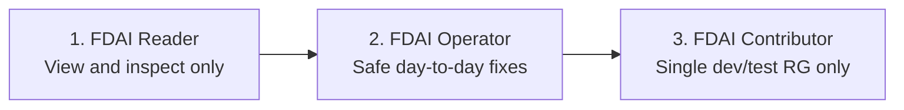

# Azure IAM 권한 그룹

Azure에 FDAI를 배포하면 클라우드 상태 조회, 서비스 실행, 승인된 조치 수행을 위해 여러 개의 Managed Identity가 생성됩니다. 이 문서는 **세 개의 간단한 Azure 권한 그룹**(`FDAI Reader`, `FDAI Operator`, `FDAI Contributor`)을 정의하고, Privileged Identity Management(PIM) 없이도 에이전트와 사람 관리자를 깔끔하게 연결하는 방법과 3단계 Rust 구현 계획을 안내합니다.

> **안전 원칙:** Azure 역할은 클라우드에서 허용되는 최대 범위만 정합니다. 역할을 부여해도 사람 승인을 건너뛰거나 자동 변경이 켜지지 않으며, FDAI 안전 검사를 우회할 수 없습니다 ([보안과 신원](security-and-identity-ko.md)).
>
> **순수 Rust 워크스페이스:** 새로운 카탈로그 코드, 검증기, CLI 명령, Azure 점검 도구는 모두 Python 없이 Rust(`Cargo.toml`, `tools_rs/fdai-xtask`)로 작성합니다.
>
> **진행 현황:** 현재 구현 상태와 남은 작업은 [구현 원장](../../roadmap-implementation/architecture/azure-iam-permission-groups.md)에서 관리합니다.

## 왜 3개 그룹으로 나누나요?

현재 FDAI는 20개 이상의 Managed Identity에 여러 Azure 기본 역할을 개별적으로 할당합니다. 이 방식에는 두 가지 불편함이 있습니다.

- **역할 할당이 너무 많음:** 여러 리소스 그룹에 기본 역할을 겹쳐 할당하면 보안 검토가 번거롭고 Azure 구독당 4,000건 한도를 빠르게 소모합니다.
- **중간 단계가 없음:** Azure 기본 역할은 `Reader`에서 삭제 권한까지 포함된 `Contributor`로 바로 건너뜁니다.

**사전 정의된 Azure 사용자 지정 역할 3개**를 쓰면 두 문제가 모두 해결됩니다. 컨테이너 이미지 가져오기, 자체 Key Vault 시크릿 읽기, Event Hubs 통신 같은 FDAI 내부 권한은 Terraform이 자동 연결하므로 별도 그룹으로 늘리지 않습니다.

## Azure 권한 그룹 3단계

세 역할 모두 동일한 **기본 차단선**을 지킵니다. Azure IAM 역할 변경, 리소스 그룹 및 잠금 삭제, 스토리지 키와 Key Vault 시크릿 조회는 어떤 단계에서도 허용되지 않습니다.

| 그룹 | 할 수 있는 작업 | 할 수 없는 작업 | 권장 사용처 |
|---|---|---|---|
| **1. `FDAI Reader`** | Azure 리소스, 태그, 상태 조회 및 (활성화한 경우) 로그, 메트릭, 비용, Activity Log, AKS 클러스터 상태 읽기 | 어떤 리소스도 변경하거나 삭제할 수 없음 | 모든 구독·리소스 그룹의 기본값 |
| **2. `FDAI Operator`** | `FDAI Reader` + 안전한 일상 운영 조치: 태그, 경고, 진단 설정, VM/앱 재시작·확장, 네트워크/TLS/백업 설정, SKU 적정 크기 조정 | 주요 리소스 삭제, IAM 변경, 시크릿 읽기 불가 | 운영·스테이징 대상 리소스 그룹 |
| **3. `FDAI Contributor`** | 단일 리소스 그룹 내 폭넓은 리소스 관리 (단, IAM 변경, RG/잠금 삭제, 시크릿 유출은 계속 차단) | 구독 전체 적용 및 권한 상승 불가 | 전용 개발·테스트·샌드박스 리소스 그룹 한정 |

> **배포기 참고:** 프로비저닝용 `deploy-runner` 신원은 위 3개 워크로드 그룹과 분리되며, Managed Identity에 위 3가지 FDAI 역할만 할당할 수 있도록 범위가 제한된 Terraform 배포 역할을 사용합니다.

## 어떤 FDAI 에이전트가 어느 그룹을 쓰나요?

FDAI의 15개 에이전트([에이전트 Pantheon](../agents/agent-pantheon-ko.md)) 중 대상 Azure 리소스를 변경할 수 있는 에이전트는 **Thor 단 하나**입니다. 나머지 14개 에이전트는 Azure 쓰기 권한을 갖지 않습니다.

| 권한 그룹 | 할당되는 FDAI 에이전트 | 하는 일 |
|---|---|---|
| **`FDAI Reader`** | **Huginn**, **Heimdall** (+ 읽기 전용 백그라운드 워커) | 이벤트 수집, 인벤토리 조회, 메트릭·로그 확인, 실행 결과 검증 |
| **`FDAI Operator`** 또는 **`FDAI Contributor`** | **Thor** 단독 (Vidar의 롤백도 Thor를 통해 실행하며, DR 리허설 잡만 전용 DR RG 사용) | `services_rs/isolated-executor`에서 Change, Resilience, FinOps용 분리된 Managed Identity로 승인된 작업 실행 |
| **대상 Azure 역할 불필요** | **나머지 12개 에이전트 전체** (`Odin`, `Forseti`, `Var`, `Bragi`, `Saga`, `Mimir`, `Muninn`, `Norns`, `Njord`, `Freyr`, `Loki`, 런타임 `Vidar`) | 대상 Azure 리소스에 직접 접근하지 않고 FDAI 내부에서 계획, 판단, 승인, 대화, 감사, 학습 수행 |

## 사람 관리자는 어느 그룹에 속하면 좋나요?

사람과 Managed Identity는 **절대 같은 그룹에 넣지 않습니다**(사람은 승인, Thor는 실행). 사람은 [사용자 RBAC 및 Entra 신원](../interfaces/user-rbac-and-identity-ko.md)의 Entra 보안 그룹(`fdai-*`)으로 로그인합니다. **Entra ID P2 / PIM은 필수가 아니며**, 기본 구성은 일반 Entra ID Free 또는 P1 환경에서 그대로 동작합니다.

| 사람 역할 | FDAI Entra 그룹 | Azure Portal IAM | PIM 없이 안전한 이유 |
|---|---|---|---|
| **조회자 / 감사** | `fdai-readers` | 없음 (Console 사용) 또는 `FDAI Reader` | 읽기 전용이라 변경 위험이 없습니다. |
| **엔지니어** | `fdai-contributors` | 운영 없음 (개발 RG `FDAI Operator` 선택) | Console/PR로 수정안을 제안하며 본인 PR은 승인할 수 없습니다. |
| **승인자** | `fdai-approvers` | 없음 (또는 `FDAI Reader`) | 강력한 MFA로 FDAI 안에서 승인만 수행하고 Azure 실행 권한과 분리됩니다. |
| **플랫폼 관리자 (Owner)** | `fdai-owners` | FDAI 앱 RG 한정 배포 역할 (상시 구독 `Owner` 없음) | FDAI 설정과 정확한 Terraform 계획 승인을 담당합니다. P2가 있는 환경에서만 필요 시 PIM을 선택 추가합니다. |
| **비상 계정 (Break-Glass)** | `fdai-break-glass` | 별도 비상용 구독 `Owner` | 잠금 복구와 킬 스위치용으로 하드웨어 키와 함께 보관하며 일상 업무나 일반 승인에 쓰지 않습니다. |

> **기존 `aw-*` 테넌트 호환:** 이미 `aw-readers`..`aw-break-glass` 이름을 쓰고 있더라도 FDAI는 그룹 `objectId`와 App Role만 확인하므로 중단 없이 동작합니다. 편할 때 표시 이름만 `fdai-*`로 바꾸시면 됩니다.

## Managed Identity 연결 방식 2가지

- **직접 연결 (기본값):** Terraform이 각 Managed Identity에 `FDAI Reader`, `FDAI Operator`, `FDAI Contributor` 중 하나를 바로 할당합니다. **Entra 보안 그룹을 만들 필요가 없습니다.**
- **Entra 보안 그룹 연결 (선택):** 여러 리소스 그룹을 관리하는 조직은 읽기 MI를 `fdai-mi-readers`에, Thor의 버티컬 MI를 `fdai-mi-exec-{change,resilience,finops}`에 넣어 두고 새 리소스 그룹마다 그룹 단위로 1회만 할당할 수 있습니다.

## 주요 설계 결정 권장안

| 항목 | 권장 방향 | 이유 |
|---|---|---|
| **사용자 지정 역할 생성 위치** | **기본은 구독(Subscription) 단위**, 대규모 다중 구독만 관리 그룹(Management Group) 선택 | 첫 배포 환경은 관리 그룹 쓰기 권한이 없는 경우가 많고, 구독당 3개 역할은 Azure 5,000개 한도 안에서 충분히 여유롭습니다. |
| **PIM 사용 여부** | **PIM을 기본 요건에서 제외.** 리소스 그룹 범위 역할 + FDAI 런타임 승인·안전장치·선택적 Azure Policy `deny`로 통제 | Entra ID P2 라이선스가 없는 환경에서도 바로 쓸 수 있고, P2가 있는 고객만 원할 때 PIM을 덧붙이면 됩니다. |
| **기존 `devgw-executor` 기본 역할** | 기존 기본 제공 `* Contributor` 3개를 **`FDAI Operator`(테스트 전용 RG는 `FDAI Contributor`)로 교체** | 개발 환경의 불필요한 삭제 권한을 없애고 운영 적용 전에 새 역할을 먼저 자체 검증할 수 있습니다. |

## 3단계 Rust 구현 계획

| 단계 | 만들 내용 | 주요 경로 | 검증 방법 |
|---|---|---|---|
| **1. 역할 카탈로그 및 검증기** | 3개 역할을 담은 단일 JSON(`config/azure-iam-permission-groups.json`)과 순수 Rust 스키마·안전 검증기 | `crates/contracts/fdai-contracts`, `crates/core/fdai-domain-core`, `tools_rs/fdai-xtask` | `cargo run --offline -p fdai-xtask`와 `cargo test --workspace --offline`으로 기본 차단선, Thor 단독 쓰기, 사람/MI 분리 검증 |
| **2. Terraform 모듈 및 Rust CLI** | `jsondecode` 기반 재사용 Terraform IAM 모듈과 `fdaictl`의 간단한 계층 옵션(`reader` / `operator` / `contributor`) | `infra/modules/iam/permission-groups/`, `tools_rs/fdai-deployment-cli/`, `infra/main.tf` | `terraform test`와 `cargo test -p fdai-deployment-cli --offline` 통과, 기본 설치 시 Entra 그룹·쓰기 역할 0건 유지 |
| **3. 시작 시 점검 및 실환경 프로브** | Rust 클라우드 어댑터의 시작 시 역할 재조회(과권한 차단), Azure Policy `deny`, Rust 테스트 프로브 | `crates/adapters/fdai-adapter-cloud/`, `services_rs/isolated-executor/`, `tools_rs/fdai-deployment-cli/` | `cargo clippy --workspace --all-targets -- -D warnings` 통과, 테스트 RG 프로브로 허용/차단 동작 확인 |

## 관련 문서

| 주제 | 문서 |
|---|---|
| 15개 에이전트 역할과 직무 분리 | [에이전트 Pantheon](../agents/agent-pantheon-ko.md) |
| 사람 로그인, `fdai-*` Entra 그룹, MFA | [사용자 RBAC 및 Entra 신원](../interfaces/user-rbac-and-identity-ko.md) |
| 실행 안전성과 7가지 안전장치 | [보안과 신원](security-and-identity-ko.md) |
| 기능 기반 권한 평가와 임시 권한 부여 | [실행 권한 온톨로지](../decisioning/execution-authorization-ontology-ko.md) |
| 구현 진행 현황과 남은 작업 | [구현 원장](../../roadmap-implementation/architecture/azure-iam-permission-groups.md) |
