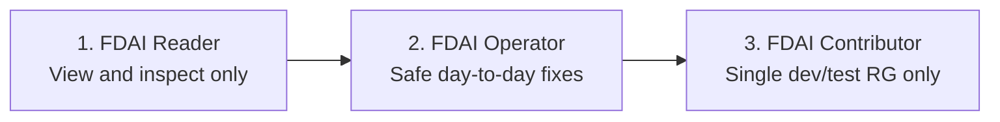

# Azure IAM Permission Groups

When you deploy FDAI on Azure, Terraform creates separate Managed Identities for reading cloud state, running services, and executing approved fixes. This guide defines **three simple Azure permission groups** (`FDAI Reader`, `FDAI Operator`, and `FDAI Contributor`), shows which agents and human admins use each one without requiring Privileged Identity Management (PIM), and sets out a three-step Rust implementation plan.

> **Safety reminder:** An Azure role only sets the upper technical limit in the cloud. It never skips human approval, never turns on automatic changes by itself, and never bypasses FDAI's safety checks ([Security and Identity](security-and-identity.md)).
>
> **Pure Rust workspace:** All new catalog code, validators, CLI commands, and Azure checks are written in Rust (`Cargo.toml`, `tools_rs/fdai-xtask`), with no Python code or scripts.
>
> **Delivery tracking:** Current status and next steps live in the [implementation ledger](../../roadmap-implementation/architecture/azure-iam-permission-groups.md).

## Why three groups?

Today FDAI assigns many individual built-in Azure roles across more than 20 Managed Identities. That creates two everyday problems:

- **Too many role assignments:** Managing dozens of built-in roles across multiple resource groups is hard for security teams to review and consumes Azure's 4,000-assignment subscription limit.
- **No middle ground:** Built-in roles jump straight from `Reader` to broad `Contributor`, which includes risky delete permissions.

Using **three pre-defined Azure Custom Roles** solves both problems. FDAI's internal service permissions (pulling container images, reading its own Key Vault secrets, using Event Hubs) stay wired automatically by Terraform and do not need extra permission groups.

## The three Azure permission groups

All three roles share the same **hard safety floor**: they can never change Azure IAM roles, delete a resource group or lock, or export storage keys and Key Vault secrets.

| Group | What it can do | What it cannot do | Where to use it |
|---|---|---|---|
| **1. `FDAI Reader`** | Read Azure resources, tags, health, and (when enabled) logs, metrics, cost, Activity Log, and AKS cluster state. | Cannot change or delete anything. | Default for every subscription or resource group. |
| **2. `FDAI Operator`** | Everything in `FDAI Reader` plus safe operational fixes: tags, alerts, diagnostics, VM/app restart or scale, network/TLS/backup settings, and SKU right-sizing. | Cannot delete primary resources, change IAM, or read secrets. | Production or staging target resource groups. |
| **3. `FDAI Contributor`** | Broad resource management inside one resource group, still blocked from IAM changes, RG/lock deletion, and secret export. | Cannot act across a whole subscription or escalate privileges. | Dedicated dev, test, or sandbox resource group only. |

> **Deployment runner note:** The provisioning identity (`deploy-runner`) stays separate from these three workload groups. It uses a scoped Terraform deployment role that can assign Managed Identities only to the three FDAI roles above.

## Which FDAI agents use which group?

FDAI has 15 fixed agents ([Agent Pantheon](../agents/agent-pantheon.md)), and **only Thor** can change target Azure resources. The other 14 agents never hold Azure write credentials.

| Permission group | Assigned FDAI agents | Plain-language role |
|---|---|---|
| **`FDAI Reader`** | **Huginn**, **Heimdall** (plus read-only background workers) | Collect events, read inventory, check metrics/logs, and verify results. |
| **`FDAI Operator`** or **`FDAI Contributor`** | **Thor** only (Vidar's rollbacks also run through Thor; only DR rehearsal jobs touch a dedicated DR RG) | Execute approved changes through `services_rs/isolated-executor` using separate Change, Resilience, and FinOps Managed Identities. |
| **No target Azure role** | **All other 12 agents** (`Odin`, `Forseti`, `Var`, `Bragi`, `Saga`, `Mimir`, `Muninn`, `Norns`, `Njord`, `Freyr`, `Loki`, and `Vidar` at runtime) | Plan, judge, approve, chat, audit, and learn inside FDAI without touching target Azure resources. |

## Which groups should human administrators join?

Humans and Managed Identities **never share the same group** (people approve; Thor executes). Humans sign in through Entra ID security groups (`fdai-*`) defined in [User RBAC and Entra Identity](../interfaces/user-rbac-and-identity.md). **Entra ID P2 / PIM is not required**; the default setup works on standard Entra ID Free or P1.

| Human role | FDAI Entra group | Azure Portal IAM | Why this works without PIM |
|---|---|---|---|
| **Viewer / Auditor** | `fdai-readers` | None (use Console) or `FDAI Reader` | Read-only access carries no mutation risk. |
| **Engineer** | `fdai-contributors` | None in prod (`FDAI Operator` on dev RG optional) | Proposes fixes via Console/PRs; cannot approve own PRs. |
| **Approver** | `fdai-approvers` | None (or `FDAI Reader`) | Approves changes in FDAI with strong MFA, staying separate from Azure execution. |
| **Platform Admin (Owner)** | `fdai-owners` | Scoped deployment role on FDAI app RG only (no standing subscription `Owner`) | Manages FDAI settings and approves exact Terraform plans; optional PIM can be added later if available. |
| **Emergency Break-Glass** | `fdai-break-glass` | Separate emergency subscription `Owner` | Kept offline with a hardware key for lockouts and kill-switch only; never used for daily work or normal approvals. |

> **Existing `aw-*` tenants:** If your tenant already uses legacy `aw-readers`..`aw-break-glass` group names, nothing breaks. FDAI checks group object IDs and App Roles, so you can rename them to `fdai-*` whenever convenient.

## Two ways to attach Managed Identities

- **Direct binding (default):** Terraform assigns `FDAI Reader`, `FDAI Operator`, or `FDAI Contributor` directly to each Managed Identity. Needs **no Entra ID group setup**.
- **Entra group binding (optional):** For teams managing many resource groups, place reader MIs in `fdai-mi-readers` and Thor's vertical MIs in `fdai-mi-exec-{change,resilience,finops}`. Onboarding a new resource group then takes one role assignment per group.

## Recommended decisions

| Topic | Recommendation | Why |
|---|---|---|
| **Where to define custom roles** | **Subscription scope by default**; Management Group optional for large multi-subscription teams. | Single-subscription installs rarely have Management Group write rights, and 3 roles per subscription easily fit Azure's 5,000-role tenant limit. |
| **PIM vs no-PIM baseline** | **No PIM required by default.** Use RG-scoped custom roles plus FDAI's runtime approval, safeguards, and optional Azure Policy `deny`. | Works on Entra ID Free/P1 without P2 licensing; teams that already own P2 can still layer PIM on top optionally. |
| **Legacy `devgw-executor` roles** | **Replace built-in `* Contributor` roles** with `FDAI Operator` (or `FDAI Contributor` on a dedicated test RG). | Removes unnecessary delete rights in dev and lets teams dogfood the new custom roles before production rollout. |

## Three-step Rust implementation plan

| Step | What we build | Main paths | How we verify |
|---|---|---|---|
| **1. Role catalog & validator** | One JSON catalog (`config/azure-iam-permission-groups.json`) for the 3 roles plus a pure-Rust schema and safety validator. | `crates/contracts/fdai-contracts`, `crates/core/fdai-domain-core`, `tools_rs/fdai-xtask` | `cargo run --offline -p fdai-xtask` and `cargo test --workspace --offline` verify the safety floor, Thor-only write rule, and human/MI separation. |
| **2. Terraform module & Rust CLI** | Reusable Terraform IAM module (`jsondecode`) and a simple tier flag (`reader` / `operator` / `contributor`) in `fdaictl`. | `infra/modules/iam/permission-groups/`, `tools_rs/fdai-deployment-cli/`, `infra/main.tf` | `terraform test` and `cargo test -p fdai-deployment-cli --offline` pass; default install still creates zero Entra groups and zero write roles. |
| **3. Startup check & live probe** | Startup role check in the Rust cloud adapter (blocks over-broad roles), matching Azure Policy `deny`, and a Rust test probe. | `crates/adapters/fdai-adapter-cloud/`, `services_rs/isolated-executor/`, `tools_rs/fdai-deployment-cli/` | `cargo clippy --workspace --all-targets -- -D warnings` passes; a test-RG probe confirms allowed actions succeed and blocked actions fail. |

## Related docs

| To learn about | Read |
|---|---|
| 15-agent roles and separation of duties | [Agent Pantheon](../agents/agent-pantheon.md) |
| Human login, `fdai-*` Entra groups, and MFA | [User RBAC and Entra Identity](../interfaces/user-rbac-and-identity.md) |
| Execution safety and the seven safeguards | [Security and Identity](security-and-identity.md) |
| Capability authorization and temporary grants | [Execution Authorization Ontology](../decisioning/execution-authorization-ontology.md) |
| Delivery status and open tasks | [Implementation ledger](../../roadmap-implementation/architecture/azure-iam-permission-groups.md) |
