# 영구 대화 전송

이 문서는 검증된 principal-to-channel 연결, 영구 outbound 회신 전달, process-loss
복구, 어댑터 health control, 읽기 전용 reliability 메트릭을 정의합니다. Console에 변경
권한을 부여하지 않으면서 Web, Slack, Teams 및 scheduled-result 이어가기에 적용됩니다.

운영 A3 시작 조립 및 전송 수명 주기는
[운영 A3 채널 런타임](production-a3-channel-runtime-ko.md)이 소유하며 이 문서는 영속 상태 machine
소유권을 유지합니다.

> 벤더 sender id는 라우팅 근거이며 principal id가 아닙니다. 모호한 프로바이더 증적은
> visible 최종 상태이며 자동으로 재시도하지 않습니다.

## 의미 요청 순서 및 격리

Operator는 각 의미 요청을 게시하기 전에 영속화합니다. Kafka partition key는 요청 id나 원시
session id가 아니라 서버에서 파생한 불투명한 session 참조
`operator-conversation:<digest>`입니다. 따라서 한 session의 turn은 broker 순서를 유지하고,
서로 다른 session은 독립 key를 사용해 별도 partition에서 진행할 수 있습니다. 로컬 Redpanda와
배포된 Event Hubs는 공유 physical topic에 partition을 두 개 이상 유지합니다.
배포된 Operator API와 독립 채널 경계도 서로 다른 고정 semantic outbox namespace를 사용합니다.
각 drainer는 자체 런타임이 영속화한 요청만 claim할 수 있으므로 채널 경계 publisher가 API의
호출자 결속 사후 수락 증표를 우회할 수 없습니다.

## 읽기 조사 최종 완료

Core는 변경할 수 없는 background-task 결과와 보류 중인 완료 발신함이 commit된 뒤에만
`read-investigation-completion` `1.0.0`을 publish합니다. 권한이 없는 계약은 결정론적 완료 id,
정본 task 및 attempt identity, 요청 멱등성 키, principal, correlation 및 origin binding, 범위가
제한된 최종 결과와 근거 참조, 사용량, 순서가 보장된 timestamp, 보존 기한,
`trusted=false`, `execution_authority=false`를 전달합니다. Task id가 partition key입니다.
Core는 Operator 구현을 import하거나 Operator conversation, inbox 또는 delivery table에 쓰지
않습니다.

Operator 완료 consumer는 exact 계약과 digest를 검증한 뒤 일치하는 영속
`read_investigation.start` 제안이 있어야 기록을 수락합니다. 하나의 Operator 소유 database
transaction이 완료 inbox 기록을 insert 또는 replay하고, 결정론적인 신뢰되지 않는 assistant
turn을 append하며, 변경할 수 없는 outbound response를 enqueue해야 합니다. Broker offset은 이
transaction 뒤에 commit합니다. 기존 delivery worker가 provider claim, send, acknowledgement,
ambiguous-send 처리 및 retry를 소유합니다. Delivery 실패는 Core에 조사를 다시 실행하거나 결과를
다시 쓰도록 요청하지 않습니다.

Operator 완료 보존 처리는 consumer와 함께 실행됩니다. 계약이 제공한 `retention_until`
기한이 지난 inbox 행만 삭제하고, 기한과 sequence 순서로 정렬한 제한된 `SKIP LOCKED`
배치를 사용합니다. 정리에 실패하면 준비 상태는 닫힌 상태를 유지하지만 수락한 완료를
버리거나 다시 실행하지 않습니다.

첫 codec은 exact `1.0.0`을 수락합니다. 가산 후속 버전은 N 및 N-1 decoder를 유지해야 하며 새
payload를 downgrade할 수 없습니다. Malformed 기록은 즉시 sibling DLQ로 이동합니다. 일치하는
제안이 아직 보이지 않는 완료는 범위가 제한된 횟수만큼 retry한 뒤 quarantine합니다. Inbox,
turn 및 outbound identity는 결정론적이므로 중복 전송은 같은 기록을 재사용합니다. Broker는 일반
기록을 1일, DLQ 기록을 7일 보존합니다. 영속 inbox 및 delivery 행은 계약이 제공한 기한과 최종
delivery 보존 규칙이 purge를 허용할 때까지 데이터를 유지합니다.

Rollback은 완료 consumer와 Core publisher를 비활성화하고 마지막 호환 Operator codec을
복원하며 Core 완료 발신함 행과 수락된 Operator inbox 및 delivery 행을 그대로 유지합니다.
호환성을 복원한 뒤 이 영속 기록에서 replay를 재개합니다. Rollback은 최종 결과를 삭제하거나,
수락된 Operator transaction 이전으로 broker offset을 되돌리거나, Core에 Operator database
writer를 부여하지 않습니다.
## 설계 개요

FDAI는 프로바이더 호출 전에 완전하고 제한된 응답을 저장합니다. 워커는 compare-and-set
(CAS)으로 변경할 수 없는 페이로드를 점유하고 한 번 전송한 뒤 confirmed 확인 응답, 범위가 제한된
재시도가 가능한 definitive 실패 또는 visible 중복 risk를 기록합니다.



## 신원 및 연결

`VerifiedChannelEndpoint`는 정본 신원과 벤더 라우팅 신원을 분리합니다.

- **정본 principal**: 명시적 권한 확인 대응이 있는 인증된 FDAI principal입니다.
- **범위**: principal이 접근 권한을 가진 narrow 범위입니다.
- **벤더 엔드포인트**: 채널 kind, 채널 id, sender id, 선택적 스레드 id입니다.
- **검증 근거**: opaque 대응 또는 Entra 검증 참조와 시각입니다.

Slack과 Teams는 `ChannelPrincipalAuthorizationMapping`을 사용합니다. Web은 인증된 Entra
principal과 별도의 브라우저 세션 참조를 사용합니다. 훅은 벤더 sender id를 principal
id로 반환하는 대응을 차단합니다. 연결 엔드포인트를 만들기 전에 범위 권한 확인을
확인합니다.

`PrincipalConversationBindingService`는 감사 event와 함께 연결을 생성하고 철회합니다.
Cross-channel 재개는 명시적하며 하나의 principal과 범위를 유지하고 출처 연결을
참조합니다. 관련 없는 스레드를 병합하지 않습니다. 전달은 전체 검증된 엔드포인트로 활성
연결을 확인합니다. 철회된 또는 mismatched 연결은 전달 맥락을 만들지 않습니다.

## 전달 원장

전달 상태 머신은 다음과 같습니다.

```text
pending -> sending -> delivered
     -> failed -> sending
     -> ambiguous
     -> abandoned
```

완전한 `OutboundResponse`, 응답 다이제스트, destination, 연산, principal, 범위,
대화, 연결, 출처 참조, 최신성 기한, 보존 기한을 전송 전에
저장합니다. 고정된 출처와 destination 및 연산으로 결정론적 멱등성 키를
만듭니다. 동일 키를 다른 응답 내용에 재사용하면 차단됩니다.

Core의 메모리 내 전달 저장소는 출처 참조를 파생된 키 안뿐 아니라 별도 필드에도 보관합니다.
출처 범위 삭제는 일치하는 본문을 삭제하기 전에 메모리 내 tombstone을 기록하고 남은 본문을
확인합니다. 본문이 남으면 삭제가 미완료 상태로 유지됩니다. 이 tombstone은 저장소가 살아 있는
동안 멱등성 키를 바꾼 늦은 쓰기를 거부합니다. 시도 및 확인 응답 행은 답변 텍스트가 아니라
시도, 시각, 프로바이더 접수 계보만 담으므로 삭제 후에도 남습니다. 관련 없는 출처, 범위와
대화는 그대로 유지됩니다. 이는 재시작 후에도 안전한 물리 삭제가 아닙니다. Operator 소유
PostgreSQL 원장에 출처 열, 영속 tombstone, 원자적 삭제와 독립 재확인을 구현해야 합니다.
타입이 지정된 채널 진행 상황 스냅샷은 이 변경할 수 없는 응답 하나에 포함됩니다. 영속 재생은
프로바이더 호출 전에 contiguous 개정 번호, 단조 증가 활동 개수 및 정본 답변과 동일한 최종
confirmed 스냅샷을 검증합니다. 스냅샷을 다시 생성하거나 조정기를 다시 실행하지 않습니다.
재생 decode는 agent 활동의 scalar 강제 변환을 차단합니다. Boolean 및 integer는 JSON 타입을
유지하고 시각은 timezone이 있는 RFC 3339를 사용하며 완료는 시작보다 빠를 수 없습니다.

다음 상태는 변경할 수 없는입니다.

| 상태 | 의미 | 자동 재시도 |
|-------|------|-------------|
| `delivered` | 프로바이더가 usable 확인 응답을 반환했고 FDAI가 저장했습니다. | 아니요 |
| `ambiguous` | 전송이 프로바이더에 도달했을 수 있으나 로컬 확인이 없습니다. | 아니요 |
| `abandoned` | Definitive 실패 이후 시도 또는 최신성을 소진했습니다. | 아니요 |

`failed`는 프로바이더가 연산을 수락하지 않았음이 확실한 상태입니다. 이 상태와 unsent
`pending` 행만 점유할 수 있습니다. 재시도는 stored 응답을 재사용하며 모델, 도구,
background 작업, scheduled 작업 또는 응답 generator를 호출하지 않습니다.

## PostgreSQL 일관성

동결된 legacy revision `20260720_0047`은 연결, 전달, 시도, 확인 응답 및 어댑터 차단기
table을 추가합니다. Operator service revision `operator_a3_channel_delivery_20260819`는 inbound
processing lease와 completed deduplication table을 추가하고 Operator role에만 grant합니다.
데이터베이스는 다음을 강제합니다.

- Unique 전달 멱등성 키 및 연결 엔드포인트 제약입니다.
- `pending`과 `failed`를 위한 due-row 인덱스, 보존, 지연 시간, duplicate-risk 인덱스입니다.
- 동시 워커를 위한 `FOR UPDATE SKIP LOCKED` row-lock CAS 점유입니다.
- 전달별 하나의 시도 순서와 delivered 기록별 하나의 확인 응답입니다.
- `delivered`, `ambiguous`, `abandoned` 행 갱신을 거부하는 트리거입니다.
- 최종 행이 `retention_until`에 도달한 뒤에만 보존 삭제를 허용합니다.

메모리 내 구현은 결정론적 테스트를 위해 동일한 전이 규칙을 따릅니다. Operator-local
PostgreSQL store와 standalone 운영 조립은 Operator distribution에 있으며 통제된 배포 근거는
열린 상태입니다.

## 비정상 종료 복구

운영 채널 시작은 소비자를 시작하기 전에 원장을 조정합니다. Standalone edge는 readiness 전에
이 작업을 호출합니다.

- 현재 조립에는 운영 인제스트기가 없으므로 첨부 활성화는 의존성을 할당하기 전에 실패합니다.
     비활성화된 첨부 턴은 전달 원장에 들어가지 않습니다.

1. 만료된 `sending` 임차 기간을 `duplicate_risk=true` 및 `process_loss`가 있는 `ambiguous`로 바꿉니다.
2. Due `pending` 및 `failed` 행을 시도, 최신성, 배치 상한 안에서 점유하고 전송합니다.
3. 기존 `ambiguous` 행은 변경하지 않습니다.

점유 전 비정상 종료는 점유 가능한 `pending` 응답을 남깁니다. 점유가 `sending` 임차 기간을 만든 뒤에는
프로바이더 호출 직전 비정상 종료도 실제 전송 여부를 증명할 수 없으므로 시작 조정이
보수적으로 `ambiguous` 최종 행으로 표시합니다. 전송 중, 프로바이더 증적 후 또는 로컬
확인 응답 전 비정상 종료도 같은 결과입니다.
FDAI는 프로바이더가 지원하지 않는 exactly-once 동작을 주장하지 않습니다.
Progressive initial 게시 이후에도 같은 규칙을 적용합니다. 첫 message가 이미 표시되므로 이후 편집에서
프로바이더가 definitive 오류를 반환해도 실패는 `ambiguous`입니다. 원장은 완전한 응답을
다른 게시로 다시 시도하지 않습니다.

## 어댑터 health

`AdapterHealthService`는 범위가 제한된 실패 구간을 기록하고 구성된 임계값에서 차단기를
엽니다. Open 및 manually paused 어댑터는 새 점유를 중단합니다. Timer나 successful 탐색으로
자동 재개하지 않으며 authorized 운영자가 명시적 재개해야 합니다.

대체 경로 health notification은 다른 어댑터의 authorized A2 operational-alert 경로로 제한됩니다.
거부된 또는 실패한 대체 경로는 audited됩니다. 대체 경로 실패는 전달을 다시 열거나 실행
권한을 부여하지 않습니다.

일시 중지, 재개 및 상태 명령은 별도로 인증된 채널 명령 앱의
`/commands/adapters/*`에 있어야 합니다. 해당 명령 앱은 구현되지 않았으며 이러한 제어를
Console Operator API에 탑재해서는 안 됩니다.

## 대화 및 scheduled integration

`ConversationChannelGateway`는 Core 쪽 보호 인제스트 계약을 유지하지만 독립 Operator A3 edge는
그 구현 경로를 연결하지 않습니다. 현재 edge는 비활성화된 첨부를 queue 유입 전에 차단하고,
첨부가 있는 직접 queue 레코드를 영속 점유 또는 의미 게시 전에 차단합니다.
[conversation-attachments-ko.md](conversation-attachments-ko.md)를 참조하세요. 향후 버전이 지정된
서비스 전달은 응답 영속화 전에 통제된 인제스트를 완료하고 변경할 수 없는 응답에 순서가 보존된
인용만 넣어야 합니다.

통제된 첨부 인제스트 후 downstream 세션 또는 도구가 실패하면 게이트웨이는 inbound 점유를
유지하고 범용 오류 응답을 반환합니다. 따라서 재전달이 동일 벤더 message에 대해 다른
문서 버전을 만들지 않습니다. 첨부 완료 전 실패는 점유를 release하고 한
턴으로 격리하므로 채널 소비자가 계속 동작합니다.

Direct 프로바이더 전송, delivery-context 조회 또는 영속 제출 실패도 originating 턴으로
격리되고 정제된 `delivery.submit` transition을 발행합니다. 채널 수신 loop를 종료하거나
프로바이더 응답 텍스트를 노출하지 않습니다.

`ScheduledContinuationDeliveryCoordinator`는 고정된 앵커 id를 출처로 사용해 외부 Slack 및
Teams 결과를 제출합니다. 이미 저장된 결과 요약, 다이제스트, 근거, 대화 참조, 스레드 모드를
재생하며 briefing을 다시 생성하거나 예약 작업을 다시 실행하지 않습니다. 호출자가 들고 있는
복사본을 신뢰하지 않고 앵커를 다시 읽으므로 예약과 전달 사이에 발생한 삭제를 관측합니다.
Fence가 걸린 앵커 id, 없거나 만료된 앵커, 외부가 아닌 채널, 이제 다른 저장 내용을 담은 오래된
출처를 거부하고, 삭제 fence를 읽을 수 없으면 닫힘 실패합니다. 저장 요약 상한이 채널 텍스트
상한보다 크므로 초과 요약은 결정적으로 잘라 내고 기록 데이터에 표시합니다. 반면 채널 봉투
한도를 넘는 식별자는 앵커 id가 전달 신원을 담기 때문에 다시 쓰지 않고 거부합니다. 반복 제출은
하나의 영속 outbound 기록으로 합쳐집니다. 이 조정기를 운영 채널 어댑터와 시작 조립에 연결하는 작업은 남아 있고,
Web 이어가기는 멱등적 대화 턴을 유지합니다.
[scheduled-result-continuations-ko.md](scheduled-result-continuations-ko.md)를 참고하세요.

## 읽기 전용 operations 화면

`ConversationDeliveryPanel`은 전달 스냅샷 하나에 대한 GET 전용 투영이며 다음을 보고합니다.

- 전달 지연 시간 개수, average 및 p95입니다.
- 상태 개수, duplicate-risk 개수, 재시도 및 abandonment입니다.
- 시도 및 확인 응답 개수입니다.
- 어댑터 차단기 상태 개수입니다.
- 조립이 범위가 제한된 수집기를 Web 또는 채널 발행기와 공유할 때 선택적 집계
 progressive-conversation 개수와 first-progress, first-confirmed, 가지 지연 시간입니다.

해당 페이로드는 `read_only=true` 및 `mutations_available=false`를 설정하고 집계만 담으므로
답변 본문과 주체, 범위, 대화, 전달, 시도, 공급자 식별자를 포함하지 않습니다. 패널은 스냅샷
읽기 능력에만 도달하며 Console은 일시 중지, 재개, 재시도, 중복 위험 재정의 또는 재전송 제어를
노출해서는 안 됩니다. 아직 Core 패널 클래스 자체를 운영 저장소에 연결하지는 않았습니다. 독립 Operator의 `RuntimeProjectionReader`는 기존 Console 경로에 영속 전달 테이블의 집계를 직접 제공하며, `conversation_adapter_breaker.mode`별 개수도 포함합니다. 빈 맵은 조회 결과에 기록된 차단기가 없다는 뜻입니다. 조회 실패나 잘못된 모드는 빈 맵으로 대체하지 않고 사용 불가로 표시합니다.

## 검증

Focused 커버리지에는 전송 전 비정상 종료, 전송 중 비정상 종료, 프로바이더 증적 후 비정상 종료, 로컬 확인 응답
전 비정상 종료, 중복 입력 및 완료, 동시 점유, stale 임차 기간, cross-principal 및
cross-scope denial, 철회된 권한 확인, 차단기 임계값, 수동 재개, 대체 경로 실패, 재시도
storm, Slack/Teams 게시, 편집, 스트림, reaction 성능 저하, 삭제 fence 거부와 반복 제출 합치기를
포함한 예약 결과 재생이 포함됩니다.

## 관련 문서

| 학습 항목 | 문서 |
|-----------|------|
| 구현 상태 및 남은 작업 | [구현 원장](../../roadmap-implementation/interfaces/durable-conversation-delivery.md) |
| 대화 조정기 및 도구 권한 | [Operator 콘솔](operator-console-ko.md) |
| 채널 trust 및 rich 전달 | [채널 및 notification](channels-and-notifications-ko.md) |
| Exact scheduled-run anchor | [Scheduled 결과 이어가기](scheduled-result-continuations-ko.md) |
| 신원 및 least 권한 | [Security 및 신원](../architecture/security-and-identity-ko.md) |
