# Durable Conversation Delivery

This document defines verified principal-to-channel bindings, durable outbound reply delivery,
process-loss recovery, adapter health controls, and read-only reliability metrics. It applies to
web, Slack, Teams, and scheduled-result continuations without granting the console mutation
authority.

Production A3 startup composition and transport lifecycle are owned by
[Production A3 channel runtime](production-a3-channel-runtime.md); this document remains the
durable state-machine owner.

> A vendor sender id is routing evidence, not a principal id. Ambiguous provider receipt is a
> visible terminal state and is never retried automatically.

## Semantic request ordering and isolation

Operator persists each semantic request before publication. The Kafka partition key is the
server-derived opaque `operator-conversation:<digest>` reference for the session, not the request
id or raw session id. Turns in one session therefore retain broker order, while different sessions
use independent keys and can progress on separate partitions. Local Redpanda and deployed Event
Hubs keep at least two partitions for the shared physical topic.
The deployed Operator API and standalone channel edge also use distinct fixed semantic outbox
namespaces. Each drainer can claim only requests persisted by its own runtime, so a channel-edge
publisher cannot bypass the API's caller-bound post-acceptance witness.

## Read-investigation terminal completion

Core publishes `read-investigation-completion` `1.0.0` only after the immutable background-task
result and its pending completion outbox commit. The authority-free contract carries a
deterministic completion id, canonical task and attempt identity, request idempotency key,
principal, correlation and origin binding, bounded terminal result and evidence references,
usage, ordered timestamps, retention deadline, `trusted=false`, and
`execution_authority=false`. The task id is the partition key. Core never imports an Operator
implementation or writes an Operator conversation, inbox, or delivery table.

The Operator completion consumer validates the exact contract and digest, then requires the
matching durable `read_investigation.start` proposal before it accepts the record. One
Operator-owned database transaction must insert or replay the completion inbox record, append the
deterministic untrusted assistant turn, and enqueue the immutable outbound response. Broker offset
commit follows that transaction. The existing delivery worker owns provider claim, send,
acknowledgement, ambiguous-send handling, and retry. A delivery failure never asks Core to rerun
the investigation or rewrite its result.

Operator completion retention runs beside the consumer. It deletes only inbox rows whose
contract-provided `retention_until` deadline has passed, orders cleanup by deadline and sequence,
and uses a bounded `SKIP LOCKED` batch. A cleanup failure keeps readiness closed but does not discard
or replay the accepted completion.

The first codec accepts exact `1.0.0`. An additive successor must keep N and N-1 decoders and may
not downgrade a newer payload. Malformed records go directly to the sibling DLQ. A completion whose
matching proposal is not yet visible is retried with a bounded count before quarantine. Inbox,
turn, and outbound identities are deterministic, so duplicate transport delivery reuses the same
records. The broker retains normal records for one day and DLQ records for seven days; the durable
inbox and delivery rows retain data until the contract-provided deadline and terminal delivery
retention rules permit purge.

Rollback disables the completion consumer and Core publisher, restores the last compatible
Operator codec, and leaves Core completion outbox rows plus accepted Operator inbox and delivery
rows intact. After compatibility is restored, replay resumes from those durable records. Rollback
never deletes a terminal result, rewinds a broker offset past an accepted Operator transaction, or
grants Core an Operator database writer.
## Design at a glance

FDAI persists the complete bounded response before a provider call. A worker claims that immutable
payload with compare-and-set (CAS), sends it once, and records either a confirmed acknowledgement,
a definitive failure eligible for bounded retry, or visible duplicate risk.



## Identity and binding

`VerifiedChannelEndpoint` keeps canonical identity and vendor routing identity separate:

- **Canonical principal**: an authenticated FDAI principal with an explicit authorization mapping.
- **Scope**: the narrow scope that the principal is authorized to access.
- **Vendor endpoint**: channel kind, channel id, sender id, and optional thread id.
- **Verification evidence**: an opaque mapping or Entra verification reference and timestamp.

Slack and Teams use `ChannelPrincipalAuthorizationMapping`; web uses its authenticated Entra
principal plus a distinct browser session reference. A hook rejects a mapping that returns the
vendor sender id as the principal id. Scope authorization is checked before a binding endpoint can
be created.

`PrincipalConversationBindingService` creates and revokes bindings with audit events. Cross-channel
resume is explicit, preserves one principal and scope, and references the source binding. It does
not merge unrelated threads. Delivery resolves an active binding by the complete verified endpoint;
a revoked or mismatched binding produces no delivery context.

## Delivery ledger

The delivery state machine is:

```text
pending -> sending -> delivered
                   -> failed -> sending
                   -> ambiguous
                   -> abandoned
```

The complete `OutboundResponse`, response digest, destination, operation, principal, scope,
conversation, binding, origin reference, freshness deadline, and retention deadline are stored
before send. The stable origin plus destination and operation derive one deterministic idempotency
key. Reusing that key with different response content is rejected.

The Core in-memory delivery store keeps the origin reference as its own field, not only inside
that derived key. Its origin-scoped purge records an in-memory tombstone before deleting the
matching bodies, then checks for surviving bodies; a survivor keeps the purge pending. The
tombstone rejects late writes with a changed idempotency key while that store lives. Attempt and
acknowledgement rows survive because they carry attempt, timing, and provider-receipt lineage,
never answer text. Unrelated origins, scopes, and conversations are untouched. This is not
restart-safe physical deletion: the Operator-owned PostgreSQL ledger still needs an origin
column, durable tombstone, atomic deletion and independent readback before that claim is made.
Typed channel progress snapshots are part of that one immutable response. Durable replay validates
contiguous revisions, monotonic activity counts, and a final confirmed snapshot equal to the
canonical answer before a provider call. It never regenerates snapshots or reruns the coordinator.
Replay decoding rejects scalar coercion in agent activities. Booleans and integers retain their
JSON types, timestamps use RFC 3339 with a timezone, and completion cannot precede start.

The following states are immutable:

| State | Meaning | Automatic retry |
|-------|---------|-----------------|
| `delivered` | Provider returned a usable acknowledgement and FDAI stored it. | No |
| `ambiguous` | A send may have reached the provider, but local confirmation is unavailable. | No |
| `abandoned` | Attempts or freshness were exhausted after definitive failures. | No |

`failed` means the provider definitively did not accept the operation. Only this state and unsent
`pending` rows are claimable. Retries reuse the stored response and never invoke a model, tool,
background task, scheduled task, or response generator.

## PostgreSQL consistency

Frozen legacy revision `20260720_0047` adds binding, delivery, attempt, acknowledgement, and
adapter breaker tables. Operator service revision `operator_a3_channel_delivery_20260819` adds the
inbound processing lease and completed deduplication table and grants only the Operator role. The
database enforces:

- Unique delivery idempotency keys and binding endpoint constraints.
- Due-row indexes for `pending` and `failed`, plus retention, latency, and duplicate-risk indexes.
- Row-lock CAS claims with `FOR UPDATE SKIP LOCKED` for concurrent workers.
- One attempt sequence per delivery and one acknowledgement per delivered record.
- A trigger that rejects updates to `delivered`, `ambiguous`, and `abandoned` rows.
- One processing lease per inbound message digest, reclaim only after lease expiry, permanent
    completed deduplication, and release only while processing.
- Retention deletion only after a terminal row reaches `retention_until`.

The in-memory implementation follows the same transition rules for deterministic tests. The
Operator-local PostgreSQL stores and standalone production composition are present in the Operator
distribution; governed deployed evidence remains open.

## Crash recovery

Production channel startup reconciles the ledger before starting consumers. The standalone edge
invokes that operation before readiness:

- the current composition rejects attachment enablement before allocating dependencies because no
    production ingestor is bound; disabled attachment turns never enter the delivery ledger;

1. Expired `sending` leases become `ambiguous` with `duplicate_risk=true` and `process_loss`.
2. Due `pending` and `failed` rows are claimed and sent within attempt, freshness, and batch caps.
3. Existing `ambiguous` rows remain untouched.

A crash before claim leaves a claimable `pending` response. Once claim creates a `sending` lease,
even a crash immediately before the provider call cannot prove whether send occurred, so startup
reconciliation conservatively exposes an `ambiguous` terminal row. Crashes during send, after
provider receipt, or before local acknowledgement have the same outcome.
FDAI does not claim exactly-once behavior from a provider that cannot support it.
The same rule applies after a progressive initial post: any later edit failure is `ambiguous`, even
when the provider returned a definitive error for that edit, because the first message is already
visible. The ledger never retries the complete response as another post.

## Adapter health

`AdapterHealthService` records bounded failure windows and opens a breaker at the configured
threshold. Open and manually paused adapters stop new claims. They never resume from a timer or a
successful probe; an authorized operator must explicitly resume them.

Fallback health notification is limited to authorized A2 operational-alert routes on another
adapter. A denied or failed fallback is audited. Fallback failure does not reopen delivery or grant
execution authority.

Pause, resume, and status commands must live in a separately authenticated channel command app
under `/commands/adapters/*`. That command app is not implemented and these controls must not be
mounted in the console Operator API.

## Conversation and scheduled integration

`ConversationChannelGateway` retains the Core-side protected-ingestion contract, but the standalone
Operator A3 edge does not bind that implementation path. The current edge rejects disabled
attachments before queue admission and rejects a direct attachment-bearing queue record before
durable claim or semantic publication. See [conversation-attachments.md](conversation-attachments.md).
A future versioned service handoff must complete governed ingestion before response persistence and
place only ordered citations in the immutable response.

If a downstream session or tool fails after governed attachment ingestion, the gateway keeps the
inbound claim and returns a generic error response. This prevents redelivery from creating another
document version for the same vendor message. Failures before attachment completion release the
claim and are isolated to one turn so the channel consumer continues.

A direct provider send, delivery-context lookup, or durable submit failure is also isolated to its
originating turn and emits a sanitized `delivery.submit` transition. It does not terminate the
channel receive loop or expose provider response text.

`ScheduledContinuationDeliveryCoordinator` submits external Slack and Teams results with the
stable anchor id as the origin. It replays the already persisted result summary, digest, evidence,
conversation reference, and thread mode; it never regenerates a briefing and never re-runs
scheduled work. The coordinator re-reads the anchor instead of trusting a caller-held copy, so a
deletion that landed between scheduling and delivery is observed. It refuses a fenced anchor id, a
missing or expired anchor, a non-external channel, and a stale origin that now carries different
persisted content, and it fails closed when the deletion fence is unreadable. The stored summary
cap exceeds the channel text cap, so an oversized summary is truncated deterministically and
flagged in the record data, while an identifier that exceeds the channel envelope is refused
instead of being rewritten, because the anchor id carries delivery identity. A repeated submit
collapses onto the one durable outbound record. Binding the coordinator to production channel
adapters and startup composition remains open, and Web continuations remain idempotent
conversation turns. See [scheduled-result-continuations.md](scheduled-result-continuations.md).

## Read-only operations view

`ConversationDeliveryPanel` is a GET-only projection over one delivery snapshot. It reports:

- Delivery latency count, average, and p95.
- State counts, duplicate-risk count, retries, and abandonment.
- Attempt and acknowledgement counts.
- Adapter breaker state counts.
- Optional aggregate progressive-conversation counts and first-progress, first-confirmed, and branch
    latency when composition shares the bounded collector with Web or channel publishers.

Its payload sets `read_only=true` and `mutations_available=false` and stays aggregate-only, so it
carries no answer text and no principal, scope, conversation, delivery, attempt, or provider
identifier. The panel reaches only the snapshot read capability, and the console must expose no
pause, resume, retry, duplicate-risk override, or resend control. No console route or production
store binds that Core panel class yet. The independent Operator `RuntimeProjectionReader` serves the existing Console route directly from its durable delivery tables, including grouped `conversation_adapter_breaker.mode` counts. An empty map means the query returned no recorded breakers; read failures and invalid modes are unavailable, not a fabricated empty map.

## Verification

Focused coverage includes crash before send, during send, after provider receipt, before local
acknowledgement, duplicate input and completion, concurrent claim, stale lease, cross-principal and
cross-scope denial, revoked authorization, breaker threshold, manual resume, fallback failure,
retry storm, Slack/Teams post, edit, stream, reaction degradation, and scheduled-result replay with
deletion-fence refusal and repeated-submit collapse.

## Related docs

| To learn about | Read |
|----------------|------|
| Delivery status and remaining work | [Implementation ledger](../../roadmap-implementation/interfaces/durable-conversation-delivery.md) |
| Conversation coordinator and tool authority | [Operator console](operator-console.md) |
| Channel trust and rich delivery | [Channels and notifications](channels-and-notifications.md) |
| Exact scheduled-run anchors | [Scheduled result continuations](scheduled-result-continuations.md) |
| Identity and least privilege | [Security and identity](../architecture/security-and-identity.md) |
