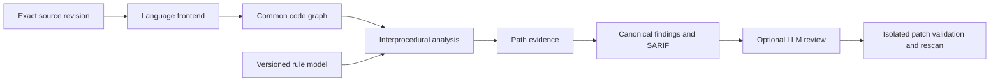

# 코드 보안 분석 엔진

이 문서는 FDAI가 자체 소유할 코드 표현과 함수 간 분석 엔진의 계획을 정의합니다. 이미 동작하는
스캐너를 대체하지 않고, 기존의 격리 스캐너, SARIF, 검증, 점검 결과 파이프라인에 재현 가능한
소스-싱크 근거를 추가합니다.

> **상태:** 패키지 0 계약, 구성 요소 인벤토리, 분할 벤치마크, Python 함수 간 SQL 삽입
> 시나리오가 구현되었습니다. TypeScript, 증분 무효화, 추가 약점 분류, 검증된 LLM 수정은 아직
> 구현되지 않았으며 CodeQL 동등성 주장이 아닙니다. 연결된
> [구현 원장](../../roadmap-implementation/operations/code-security-analysis-engine.md)을 참조하세요.
>
> **권한:** 분석은 정확한 소스 리비전을 읽고 근거를 만듭니다. Heimdall은 코드 보안 관찰의
> 책임 에이전트로 유지됩니다. 엔진은 기계적인 워커이며 승인, 저장소 쓰기, 실행, 배포 권한을
> 부여하지 않습니다.

## 설계 개요

FDAI는 현재 스캔 작업 경계 뒤에 언어 프런트엔드, 버전이 지정된 공통 코드 그래프, 결정론적
그래프 분석을 추가합니다. 기존 도구는 빠른 패턴, 비밀, 의존성, 컨테이너, 인프라 점검 결과를
계속 제공합니다. 자체 엔진은 빠져 있던 파일 간 의미 근거를 제공하고, 그 결과를 동일한 정본
이슈, 심각도, 커버리지, SARIF, 검토, 조치 팩 계약으로 전달합니다.

첫 번째 결정적 시나리오는 의도적으로 범위를 좁힙니다. 웹 요청을 소스로 인식하고, 파일과 함수
호출을 가로질러 값을 추적하며, SQL 실행 싱크에 도달하고, 매개 변수화된 쿼리를 구분합니다.
재스캔에서 해당 경로가 더 이상 없다는 사실을 입증한 경우에만 점검 결과를 제거합니다.

## 현재 기준선과 미비점

FDAI는 분석을 둘러싼 안전 및 제품 경계를 이미 소유하고 있습니다. 새 엔진은 별도의 이슈 또는
권한 모델을 만들지 않고 이 경계를 재사용하는 것이 좋습니다.

| 기능 | 현재 상태 | 계획된 변경 |
|------|-----------|-------------|
| 정확한 리비전, 읽기 전용 전달, 샌드박스, 커버리지 증적 | 스캔 작업에 구현됨 | 변경 없이 재사용하고 프런트엔드 및 그래프 버전을 증적에 추가 |
| 패턴, 비밀, 의존성, 컨테이너, IaC 스캔 | 설치된 스캐너 어댑터 | 명시적 커버리지를 가진 독립 생산자로 유지 |
| Python 약점 검증 | 하나의 포함 함수 내부에서 흐름에 민감한 분석 수행 | 측정 기반 승격 이후에만 분석 한계를 그래프 기반 함수 간 검증기로 교체 |
| JavaScript, TypeScript, Java, C# 검증 | Opengrep 오염 규칙과 범위가 제한된 반증 사용 | 자체 프런트엔드가 승격 게이트를 통과할 때까지 근거로 유지 |
| 정본 점검 결과, 심각도, 우선순위, SARIF, 조치 팩 | 구현됨 | 권한 의미를 바꾸지 않고 자체 엔진 경로를 소비 |
| 공통 코드 표현, 호출 그래프, 파일 간 데이터 흐름 | 구현되지 않음 | 이 설계의 핵심으로 추가 |
| 문맥에 민감한 호출, points-to 사실, 증분 무효화 | 구현되지 않음 | 첫 번째 수직 시나리오 이후 제한된 단계로 추가 |

현재 Python 검증기는 하나의 함수 본문에서 may-taint 분석을 수행한다고 명시합니다. 이 구현을
측정 기준선과 회귀 오라클로 사용하고, 공통 그래프 모델로 간주하지 않습니다.

## 범위와 제외 사항

이 설계에는 다음 항목이 포함됩니다:

- **자체 소유 의미 체계:** FDAI가 버전을 지정하고 테스트할 수 있는 언어 중립 그래프 스키마,
  경로 근거, 분석 알고리즘, 규칙 모델, 결정론적 결과 수락을 정의합니다.
- **프런트엔드 재사용:** 파서와 컴파일러 API는 좁은 어댑터 뒤에서 구문, 심볼, 타입을 제공할
  수 있습니다. FDAI 검증을 통과하지 않은 출력은 권위 있는 근거가 아닙니다.
- **단계별 언어 깊이:** Python과 TypeScript를 먼저 지원합니다. 다른 언어는 단순 지원 여부가
  아니라 실제 파싱, 심볼, 호출, 흐름, 프레임워크 커버리지를 보고합니다.
- **측정 기반 승격:** 언어 또는 약점 분류는 독립적인 `dev` 및 `holdout` 근거가 선언된 게이트를
  충족할 때까지 `shadow` 상태로 유지됩니다.

이 설계에는 다음 항목이 포함되지 않습니다:

- CodeQL 엔진 코드를 복사하거나 CodeQL CLI를 포함하는 작업, 또는 서드 파티 라이선스로 비공개
  코드를 분석할 권한이 있다고 암시하는 작업
- gitleaks, Trivy, OSV-Scanner 또는 다른 전문 스캐너를 더 약한 자체 복제본으로 대체하는 작업
- LLM 판단을 취약점 판정, 정책 결정 또는 수정 성공의 입증으로 사용하는 작업
- 기존 선택형 입증 레인 밖에서 분석 대상 저장소 코드를 실행하는 작업
- 각 언어에 별도 근거가 생기기 전에 언어 간 정밀도가 같다고 주장하는 작업

## 엔진 아키텍처

### 수집과 빌드 맥락

기존 확보 경계는 정확한 커밋 또는 콘텐츠 주소 기반 로컬 스냅샷을 제공합니다. 엔진은 감지된
언어 루트, 매니페스트, 생성 코드 정책, 컴파일러 구성 참조, 소스 제외 항목을 담는 범위가 제한된
빌드 맥락 매니페스트를 추가합니다. 모든 입력은 경로를 정규화하고 다이제스트에 연결하며, 기존의
네트워크 없는 분석 경계 안에 유지합니다.

컴파일러 구성이 없거나 의존성을 해결할 수 없으면 커버리지 제한으로 기록합니다. 이를 최선 노력
방식의 깨끗한 결과로 바꾸지 않습니다.

### 언어 프런트엔드

각 프런트엔드는 동일한 단계별 계약을 구현합니다:

1. **구문:** Tree-sitter 또는 컴파일러 파서가 소스 범위와 구문 구조를 제공합니다.
2. **심볼과 타입:** Python 프런트엔드는 표준 AST와 가져오기 모델에서 시작합니다. TypeScript
   프런트엔드는 TypeScript Compiler API를 사용합니다. 이후 프런트엔드는 Roslyn, Java 컴파일러
   API 또는 Go 타입 API를 사용할 수 있습니다.
3. **프레임워크 의미:** 버전이 지정된 모델이 라우트, 요청 값, 쿼리 API, 인증 미들웨어, 템플릿
   출력, 명령 실행, 파일 접근을 공통 소스, 싱크, 정화기, 가드 개념으로 매핑합니다.

Tree-sitter만 사용한 결과를 완전한 의미 지원으로 설명하지 않습니다. 컴파일러 출력도 신뢰할 수
없는 입력입니다. 어댑터는 경로를 검증하고 그래프 크기를 제한하며 진단을 기록하고, 심볼 해석이
불완전하면 판단을 보류합니다.

### 공통 코드 그래프

공통 그래프는 버전이 지정된 분석 산출물이며, 운영 온톨로지가 아니고 그래프 데이터베이스를
도입해야 하는 이유도 아닙니다. 결정론적 계약을 보존한다면 인덱스가 있는 관계형, 온디스크 또는
혼합 표현을 사용할 수 있습니다.

| 노드 | 필요한 신원과 근거 |
|------|--------------------|
| `File` | 저장소 상대 경로, 언어, 콘텐츠 다이제스트, 정확한 리비전 |
| `Function` | 안정적인 프런트엔드 신원, 시그니처, 소스 범위, 타입 상태 |
| `Symbol` | 선언 신원, 종류, 타입 사실, 소스 범위 |
| `CallSite` | 호출자, 후보 피호출자, 인자, 반환 대상, 해석 상태 |
| `BasicBlock` | 소유 함수, 문장, 선행 및 후행 순서 |
| `DataFlowNode` | 정의, 사용, 변환, 소스 범위, 값 분류 |
| `Source`, `Sink`, `Sanitizer` | 규칙 및 프레임워크 모델 참조와 보안 맥락 |

필수 관계는 `DECLARES`, `CALLS`, `CONTROLS`, `DEFINES`, `USES`, `FLOWS_TO`,
`ARGUMENT_TO`, `RETURNS_TO`, `ALIASES`, `SANITIZES_FOR`입니다. 추론한 각 간선에는
프런트엔드, 모델 버전, 신뢰도 분류, 해결되지 않은 대안을 기록합니다. 알 수 없는 동적 디스패치와
리플렉션은 명시적인 미비점으로 남깁니다.

그래프 신원은 소스 리비전, 프런트엔드 버전, 프레임워크 모델 다이제스트, 그래프 스키마 버전,
빌드 맥락 다이제스트에 연결됩니다. 동일한 입력은 바이트가 같은 정규화 그래프 레코드와 안정적인
경로 신원을 만들어야 합니다.

### 분석 코어

엔진은 다음 순서로 정밀도를 추가합니다:

1. **함수 간 오염 분석:** 범위가 제한된 호출 그래프에서 인자와 반환을 통해 값을 전파하고,
   완전한 소스-싱크 경로를 만듭니다.
2. **제어 흐름 민감도:** 완전한 기호 실행을 주장하지 않으면서 도달할 수 없는 분기, 종료 가드,
   예외, 경로 조건을 구분합니다.
3. **문맥 민감도:** 범위가 제한된 call string 수를 구분해 안전한 호출자가 다른 호출자의 오염을
   상속하지 않도록 합니다.
4. **Points-to 및 별칭 사실:** 로컬 할당과 필드에 민감한 사실에서 시작하고, 디스패치 또는 힙
   신원을 알 수 없으면 명시적으로 범위를 넓힙니다.
5. **증분 무효화:** 변경된 파일과 호출자, 피호출자, 프레임워크 모델, 규칙 의존 그래프 조각을
   다시 계산합니다. 프런트엔드, 스키마, 규칙, 빌드 맥락이 바뀌면 영향을 받는 캐시 항목을 모두
   무효화합니다.

각 분석에는 그래프 노드, 호출 깊이, 문맥, 경로, 메모리, 시간에 대한 결정론적 작업 예산이
있습니다. 예산 소진은 이름이 있는 커버리지 제한과 부분 경로 근거를 만들며, 깨끗한 스캔을
만들지 않습니다.

## 버전이 지정된 내부 계약

구현은 넓은 언어 커버리지를 추가하기 전에 다음 세 가지 엄격한 기계 계약을 정의하는 것이
좋습니다:

| 계약 | 목적 |
|------|------|
| FDAI Code Graph Schema | 노드, 간선, 신원, 출처, 해결되지 않은 사실, 스키마 이행 |
| FDAI Code Security Rule Spec | 언어 및 프레임워크 선택기, 소스, 싱크, 전파기, 맥락별 정화기, 조건, CWE 매핑, 심각도 입력, 취약 및 안전 사례 |
| FDAI Path Evidence | 소스, 순서가 있는 흐름 단계, 호출 문맥, 싱크, 고려한 정화기, 커버리지 제한, 그래프 및 규칙 버전, 재현 다이제스트 |

경로 근거 계약은 기존 정본 점검 결과를 확장합니다. 점검 결과 스키마를 대체하거나, 생산자
심각도를 다시 해석하거나, 분석기가 승격 게이트 통과 전에 `verified` 신뢰도를 부여하도록 하지
않습니다.

규칙은 AST 또는 타입 기반 검사와 그래프 흐름 검사를 구분해야 합니다. 정화기는 선언된 보안
맥락에만 적용됩니다. SQL 매개 변수 바인딩, HTML 출력 인코딩, 경로 정규화, 셸 인용은 서로
교환할 수 없습니다.

## 표준과 라이선스 경계

출력은 공개 보안 생태계와 계속 호환됩니다:

- **분류:** 승격된 모든 규칙을 정확한 CWE 식별자에 매핑합니다. OWASP Top 10과 ASVS 매핑은
  실행 가능한 약점 신원이 아니라 보고 및 요구 사항 교차 참조로 유지합니다.
- **알려진 취약점:** CVE, NVD, OSV 권고 신원을 소스 코드 흐름 규칙과 분리합니다.
- **교환:** SARIF 2.1.0을 만들고, 더 풍부한 경로 근거는 범위가 제한된 수집기가 검증할 수 있는
  버전 지정 속성에 보존합니다.
- **공급망:** 구성 요소, 라이선스, 파서 grammar, 데이터베이스, 재배포 규칙 자산에 대해 SPDX와
  CycloneDX 인벤토리를 유지합니다.
- **프로세스:** 제공 통제를 NIST SSDF에 매핑하되, 프로세스 준수를 스캔 결과로 제시하지 않습니다.

후보 의존성은 도입 전에 고정된 버전 단위의 검토가 필요합니다:

| 후보 | 의도한 사용 | 도입 조건 |
|------|-------------|-----------|
| Tree-sitter와 언어별 grammar | 구문 프런트엔드 | 엔진과 각 grammar 라이선스를 별도로 확인 |
| Joern | 아키텍처 연구 또는 격리된 비교 | 포함 전에 저장소, 모듈, 전이 의존성, 배포 라이선스 검토 |
| Opengrep 또는 Semgrep 호환 규칙 | 기존의 빠른 규칙 및 오염 레인 | 현재 프로세스 격리 및 라이선스 의무 유지 |
| Gitleaks, Trivy, OSV-Scanner, Bandit | 전문 독립 생산자 | 버전, 라이선스, 데이터베이스 약관, 커버리지를 분리 유지 |
| CodeQL 문서와 공개 쿼리 | 연구 및 공정한 벤치마크 설계 | 쿼리 소스, CLI, 엔진, 비공개 코드 사용 약관을 별도로 검토 |

의존성 레지스트리는 SPDX 식별자, 소스 리비전, 산출물, 수정 사항, 연결 또는 프로세스 경계,
재배포 모드, 데이터베이스 약관, 릴리스 승인을 기록합니다. 이 표는 엔지니어링 지침이며 법적
승인이 아닙니다.

## LLM 검토와 검증된 수정

LLM은 결정론적 분석이 끝난 뒤에만 최소화된 근거 패키지를 받습니다. 패키지는 범위가 제한된 코드
맥락, 순서가 있는 경로 단계, 규칙 ID, 그래프 미비점, 테스트, 정확한 리비전을 포함합니다. 저장소
텍스트와 주석은 신뢰할 수 없는 데이터로 유지됩니다. 모델에는 스캐너 신원, 저장소 쓰기 권한,
셸 권한, 배포 신원, 비밀 접근 권한이 없습니다.

유용한 모델 출력에는 설명, 오탐 가설, 패치 후보, 테스트 제안이 포함됩니다. 모두 주장으로
유지됩니다. 패치는 격리된 워크트리, 기존 diff guard, 프로젝트 테스트, 동일하거나 더 새로운 엔진
재스캔, 동등하거나 더 나은 커버리지에서의 경로 제거를 모두 통과해야 진행할 수 있습니다. 모델이
동의하지 않거나 추론을 뒷받침할 수 없으면 사람 검토로 보내며 점검 결과를 숨기지 않습니다.

## 언어별 분석 깊이

| 계층 | 언어 | 출구 근거 |
|------|------|-----------|
| 1 | Python, JavaScript, TypeScript | 초기 약점 분류에 대한 타입 기반 프레임워크 모델과 파일 간 소스-싱크 경로 |
| 2 | Java, C# | 별도의 holdout 게이트를 갖춘 컴파일러 기반 심볼 및 프레임워크 모델 |
| 3 | Go, PHP, Ruby | 서버 프레임워크 커버리지와 언어별 벤치마크 증적 |
| 4 | C, C++, Rust, Swift, Kotlin | 언어별 메모리, 소유권, 디스패치, 빌드 맥락 근거 |
| 5 | Shell, IaC, 워크플로 및 추가 언어 | 공통 명령형 코드 모델로 부족할 때의 전용 의미 체계 |

각 언어는 파싱 커버리지, 심볼 및 타입 해석, 분석 가능한 함수, 호출 해석, 함수 간 경로 지원,
프레임워크 모델 커버리지, 지원되지 않는 구문, 정밀도, 재현율, 시간, 최대 메모리를 공개합니다.

## 제공 패키지

순서는 근거를 기준으로 정합니다. 저장소 크기, 프런트엔드 처리량, 벤치마크 비용을 패키지 0에서
측정한 뒤에만 일정 추정치를 추가할 수 있습니다.

### 패키지 0: 계약, 라이선스, 벤치마크 기준선

- 그래프, 규칙, 경로 근거 계약 버전 1을 고정합니다.
- 파서 grammar와 벤치마크 약관을 포함한 의존성 및 데이터 라이선스 인벤토리를 기록합니다.
- 취약 및 안전 쌍, `dev` 및 `holdout` 분할, 현재 FDAI 검증기, 자체 엔진 후보, 허용된 외부
  기준선을 동일 조건에서 비교하는 실행기를 추가합니다.

출구: 스키마가 잘못되거나 모호한 레코드를 거부하고, 결정론적 재현이 안정적이며, 기준선 증적이
동등성 주장 없이 정밀도, 재현율, 지원되지 않는 커버리지, 시간, 메모리를 보고합니다.

### 패키지 1: Python SQL 삽입 수직 시나리오

- Python 파일, 심볼, 제어 흐름, 호출, 데이터 흐름 레코드를 만듭니다.
- Flask 또는 FastAPI 요청 데이터를 최소 두 파일과 세 함수를 지나 SQL 싱크까지 추적합니다.
- 매개 변수화된 쿼리 바인딩을 맥락별 정화기로 모델링하고, 알 수 없는 라이브러리 호출을
  명시적으로 유지합니다.
- 경로 근거를 기존 정본 점검 결과 및 SARIF 파이프라인에 `shadow` 상태로 전달합니다.

출구: 취약 및 안전 쌍, 여러 호출자, 별칭, 가드, 재귀 제한, 해결되지 않은 디스패치 사례를
통과하고, 동일한 커버리지의 재스캔에서만 수정 후 경로가 사라집니다.

### 패키지 2: TypeScript 동등 기능

- 동일한 그래프 계약 뒤에 TypeScript Compiler API 심볼, 타입, 모듈 해석, Express 방식
  프레임워크 모델을 추가합니다.
- 그래프 탐색에 언어 조건문을 추가하지 않고 분석 코어를 재사용합니다.
- 일치 여부만으로 결과를 자동 승격하지 않으면서 자체 엔진 근거와 현재 Opengrep 레인을
  비교합니다.

출구: 패키지 1 시나리오가 TypeScript에서 통과하고, 별도의 정밀도, 재현율, 커버리지, 시간,
메모리 증적을 만듭니다.

### 패키지 3: 정밀도와 증분 분석

- 범위가 제한된 call string 문맥, 필드에 민감한 별칭, 정화기 맥락, 결정론적 widening을
  추가합니다.
- SQL 삽입이 게이트를 통과한 뒤 명령 삽입, 경로 조작, XSS를 추가합니다.
- 의존성 기반 무효화를 추가하고 변경되지 않은 점검 결과와 경로 ID가 안정적으로 유지됨을
  입증합니다.

출구: 각 언어와 약점 분류가 고정된 `dev` 및 보지 않은 `holdout` 데이터에서 독립적으로 승격
게이트를 충족하고, 전체 및 증분 실행이 동등한 점검 결과를 만듭니다.

### 패키지 4: 제품 통합과 검증된 수정

- 범위가 제한된 산출물과 기존 Code Security 검토 화면에서 경로 근거, 명시적 커버리지 미비점,
  엔진 버전을 제공합니다.
- 선택형 LLM 레인에는 최소화된 근거 패키지만 제공합니다.
- 격리된 환경에서 테스트, diff guard, 결정론적 재스캔으로 생성 패치를 검증합니다.

출구: 모델 단독 판정으로 점검 결과 상태를 바꿀 수 없고, 재현으로 표시된 모든 경로를 복원할
수 있으며, 테스트 실패, 약해진 커버리지, 남아 있는 경로는 이슈를 열린 상태로 유지합니다.

### 패키지 5: 추가 언어

먼저 Java와 C#을 추가하고, 각 파서, 타입, 프레임워크, 벤치마크, 라이선스 선행 조건이 준비된
경우에만 이후 계층을 추가합니다. 동일한 근거 계약을 만들 수 없거나 별도 holdout 게이트를
충족하지 못한 프런트엔드는 실험 상태로 유지됩니다.

## 측정과 승격

초기 목표는 계획 기준이며 현재 결과가 아닙니다:

| 측정값 | 초기 승격 목표 |
|--------|----------------|
| 승격되는 각 언어 및 약점 분류의 정밀도 | `dev` 및 `holdout`에서 최소 0.90 |
| 승격되는 각 언어 및 약점 분류의 재현율 | 코퍼스 크기와 함께 최소 0.85 보고 |
| 재현 가능한 소스-싱크 경로가 있는 점검 결과 | 그래프 흐름 규칙에서 최소 0.95 |
| 수정 회귀와 동일하거나 더 새로운 엔진 재스캔 | 수락된 수정 주장에 대해 1.00 |
| 지원되지 않는 파일과 구문을 명시적으로 보고 | 1.00 |

증적은 F1, 저장소 전체 및 증분 소요 시간, 최대 메모리, 그래프 크기, 분석된 함수 비율, 파일 간
경로 재현율, 프레임워크 커버리지, 수정 회귀율도 기록합니다. 언어 또는 약점 분류를 합산할 때는
항상 분리된 값도 함께 보존합니다.

CodeQL과의 공정한 비교는 두 도구가 모두 지원하는 언어와 약점 분류, 동일한 소스 및 빌드 맥락,
정규화된 근본 원인 매칭, 중복 제거된 점검 결과, 별도 보고된 자원 비용만 사용합니다. 공개 문서나
쿼리 소스가 있다는 사실은 CodeQL 엔진을 포함하거나 운영할 권한을 의미하지 않습니다.

## 보안과 운영 통제

- 분석 대상 소스, 빌드 파일, 생성 파일, 주석, 분석 출력은 신뢰할 수 없는 입력입니다.
- 프런트엔드와 분석 워커는 불필요한 네트워크, 신원, 비밀, 호스트 마운트, 소스 쓰기 권한 없이
  실행합니다.
- 컴파일러 플러그인, annotation processor, 패키지 스크립트, 프로젝트 빌드는 정적 레인에서
  실행하지 않습니다. 향후 빌드 보조 레인에는 별도의 선택형 샌드박스 설계가 필요합니다.
- 테넌트 소스, 그래프 레코드, 경로 근거, 캐시, LLM 패키지를 서로 격리하고 리비전에 연결합니다.
- 엔진, 프런트엔드, 프레임워크 모델, 규칙, 취약점 데이터, 그래프 스키마 버전을 고정해 같은
  리비전을 재현할 수 있게 합니다.
- 캐시는 정확한 입력 및 의존성 다이제스트가 일치할 때만 재사용합니다. 무효화 범위가 모호하면
  오래된 깨끗한 결과를 유지하지 않고 캐시를 버립니다.

## 결정이 필요한 사항

- 패키지 0에서 동일 계약으로 메모리, 인덱스 기반 온디스크, 관계형 옵션을 벤치마크한 뒤에만
  그래프 저장 형식을 선택합니다.
- 소스 호환성과 위치 정확도를 측정한 뒤 Tree-sitter를 Python의 구문 전용으로 유지할지 표준
  AST를 대체할지 결정합니다.
- 다른 분석기의 기본값을 복사하지 않고 측정된 정밀도와 메모리로 최대 문맥 깊이와 widening
  정책을 정의합니다.
- 전체 라이선스 및 의존성 검토가 끝난 뒤 Joern을 비교 전용으로 둘지 선택형 프런트엔드로 둘지
  결정합니다.
- 메트릭을 수락하기 전에 언어별 공개 코퍼스를 선택하고 재배포, 레이블, 중복, 학습-테스트 누출
  통제를 기록합니다.

## 관련 문서

| 알아볼 내용 | 읽을 문서 |
|-------------|-----------|
| 제공 상태와 관찰 가능한 남은 작업 | [구현 원장](../../roadmap-implementation/operations/code-security-analysis-engine.md) |
| 기존 스캐너 격리와 검증 | [코드 보안 스캔](code-security-scanning-ko.md) |
| 정본 점검 결과, 심각도, 조치 팩 | [코드 보안 점검 결과](code-security-findings-ko.md) |
| 카탈로그 출처와 라이선스 처리 | [Rule Catalog 수집](../rules-and-detection/rule-catalog-collection-ko.md) |
| 모델 신뢰 및 데이터 경계 | [LLM 전략](../architecture/llm-strategy-ko.md) |
