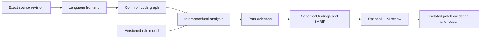

# Code Security Analysis Engine

This document defines the planned FDAI-owned code representation and interprocedural analysis
engine. It extends the existing isolated scanner, SARIF, verification, and findings pipeline with
reproducible source-to-sink evidence instead of replacing the scanners that already work.

> **Status:** This is an accepted delivery plan, not an implementation or a CodeQL parity claim.
> The linked [implementation ledger](../../roadmap-implementation/operations/code-security-analysis-engine.md)
> keeps every engine package at `not-started` until source and focused evidence exist.
>
> **Authority:** Analysis reads an exact source revision and emits evidence. Heimdall remains the
> accountable agent for code-security observation. The engine is a mechanical worker and grants no
> approval, repository-write, execution, or deployment authority.

## Design at a glance

FDAI will add language frontends, a versioned common code graph, and deterministic graph analyses
behind the current scan-job boundary. Existing tools continue to provide fast pattern, secret,
dependency, container, and infrastructure findings. The owned engine supplies the missing
cross-file semantic evidence and sends its results through the same canonical issue, severity,
coverage, SARIF, review, and remediation-pack contracts.

The first decisive scenario is deliberately narrow: recognize a web request as a source, follow
its value across files and function calls, reach a SQL execution sink, distinguish parameterized
queries, and remove the finding only when a rescan proves that the path no longer exists.

## Current baseline and gap

FDAI already owns the safety and product boundaries around analysis. The new engine should reuse
them rather than create another issue or authority model.

| Capability | Current state | Planned change |
|------------|---------------|----------------|
| Exact revision, read-only handoff, sandbox, and coverage receipt | Implemented in the scan job | Reuse unchanged; add frontend and graph versions to the receipt |
| Pattern, secret, dependency, container, and IaC scanning | Installed scanner adapters | Keep as independent producers with explicit coverage |
| Python weakness verification | Flow-sensitive analysis inside one enclosing function | Replace only its analysis limit with a graph-backed interprocedural verifier after measured promotion |
| JavaScript, TypeScript, Java, and C# verification | Opengrep taint rules plus bounded vetoes | Keep as evidence while owned frontends reach their promotion gates |
| Canonical findings, severity, priority, SARIF, and remediation packs | Implemented | Consume owned-engine paths without changing their authority semantics |
| Common code representation, call graph, and cross-file data flow | Not implemented | Add as the core of this design |
| Context-sensitive calls, points-to facts, and incremental invalidation | Not implemented | Add in bounded stages after the first vertical slice |

The current Python verifier explicitly performs may-taint analysis over one function body. Treat
that implementation as a measured baseline and regression oracle, not as the common graph model.

## Scope and non-goals

This design includes:

- **Owned semantics:** a language-neutral graph schema, path evidence, analysis algorithms, rule
  model, and deterministic result acceptance that FDAI can version and test.
- **Reused frontends:** parser and compiler APIs may supply syntax, symbols, and types behind a
  narrow adapter. Their output never becomes authoritative without FDAI validation.
- **Tiered language depth:** Python and TypeScript lead. Every other language reports its actual
  parsing, symbol, call, flow, and framework coverage instead of a binary supported label.
- **Measured promotion:** a language or weakness class remains in shadow until independent `dev`
  and `holdout` evidence meets its declared gate.

This design does not include:

- copying CodeQL engine code, bundling the CodeQL CLI, or implying permission to analyze private
  code with a third-party license;
- replacing gitleaks, Trivy, OSV-Scanner, or other specialized scanners with weaker local copies;
- treating an LLM judgment as a vulnerability verdict, policy decision, or proof that a fix works;
- executing analyzed repository code outside the existing opt-in proof lane;
- claiming equal precision across languages before each language has separate evidence.

## Engine architecture

### Ingestion and build context

The existing acquisition boundary supplies an exact commit or content-addressed local snapshot.
The engine adds a bounded build-context manifest containing detected language roots, manifests,
generated-code policy, compiler configuration references, and source exclusions. Every input is
path-normalized, digest-bound, and kept inside the existing no-network analysis boundary.

A missing compiler configuration or unresolved dependency is a coverage limit. It never becomes a
best-effort clean result.

### Language frontends

Each frontend implements the same staged contract:

1. **Syntax:** Tree-sitter or a compiler parser supplies source spans and syntax structure.
2. **Symbols and types:** the Python frontend starts with the standard AST and import model. The
   TypeScript frontend uses the TypeScript Compiler API. Later frontends may use Roslyn, Java
   compiler APIs, or Go type APIs.
3. **Framework semantics:** versioned models map routes, request values, query APIs,
   authentication middleware, template output, command execution, and file access to common
   source, sink, sanitizer, and guard concepts.

Tree-sitter alone is never described as complete semantic support. Compiler output is also
untrusted input: the adapter validates paths, bounds graph size, records diagnostics, and abstains
when symbol resolution is incomplete.

### Common code graph

The common graph is a versioned analysis artifact, not the operating ontology and not a reason to
adopt a graph database. An indexed relational, on-disk, or mixed representation is acceptable when
it preserves the same deterministic contract.

| Node | Required identity and evidence |
|------|--------------------------------|
| `File` | repository-relative path, language, content digest, exact revision |
| `Function` | stable frontend identity, signature, source span, type status |
| `Symbol` | declaration identity, kind, type facts, source span |
| `CallSite` | caller, candidate callees, arguments, return target, resolution status |
| `BasicBlock` | owning function, statements, predecessor and successor order |
| `DataFlowNode` | definition, use, transform, source span, value class |
| `Source`, `Sink`, `Sanitizer` | rule and framework-model references plus security context |

Required relationships include `DECLARES`, `CALLS`, `CONTROLS`, `DEFINES`, `USES`, `FLOWS_TO`,
`ARGUMENT_TO`, `RETURNS_TO`, `ALIASES`, and `SANITIZES_FOR`. Every inferred edge records the
frontend, model version, confidence class, and any unresolved alternatives. Unknown dispatch and
reflection remain explicit gaps.

Graph identity binds the source revision, frontend versions, framework-model digests, graph schema
version, and build-context digest. The same inputs must produce byte-equivalent normalized graph
records and stable path identities.

### Analysis core

The engine adds precision in this order:

1. **Interprocedural taint:** propagate values through arguments and returns across a bounded call
   graph and emit a complete source-to-sink path.
2. **Control-flow sensitivity:** distinguish unreachable branches, terminating guards, exceptions,
   and path conditions without claiming full symbolic execution.
3. **Context sensitivity:** separate a bounded number of call strings so a safe caller does not
   inherit another caller's taint.
4. **Points-to and alias facts:** start with local allocation and field-sensitive facts, then widen
   explicitly when dispatch or heap identity is unknown.
5. **Incremental invalidation:** recompute changed files plus callers, callees, framework models,
   and rule-dependent graph slices. A changed frontend, schema, rule, or build context invalidates
   every affected cache entry.

Every analysis has deterministic work budgets for graph nodes, call depth, contexts, paths,
memory, and time. Exhaustion yields a named coverage limit and partial path evidence, never a clean
scan.

## Versioned internal contracts

The implementation should define three strict machine contracts before adding broad language
coverage:

| Contract | Purpose |
|----------|---------|
| FDAI Code Graph Schema | Nodes, edges, identities, provenance, unresolved facts, and schema migration |
| FDAI Code Security Rule Spec | Language and framework selectors, sources, sinks, propagators, context-specific sanitizers, conditions, CWE mapping, severity inputs, and positive and safe cases |
| FDAI Path Evidence | Source, ordered flow steps, call contexts, sink, sanitizers considered, coverage limits, graph and rule versions, and reproducibility digests |

The path-evidence contract extends the existing canonical finding. It does not replace the finding
schema, reinterpret producer severity, or let an analyzer grant `verified` confidence before its
promotion gate passes.

Rules must distinguish AST or typed checks from graph-flow checks. A sanitizer applies only to its
declared security context. SQL parameter binding, HTML output encoding, path normalization, and
shell quoting are not interchangeable.

## Standards and license boundary

Output remains compatible with public security ecosystems:

- **Classification:** map every promoted rule to exact CWE identifiers. Keep OWASP Top 10 and ASVS
  mappings as reporting and requirements crosswalks, not as executable weakness identities.
- **Known vulnerabilities:** keep CVE, NVD, and OSV advisory identity separate from source-code
  flow rules.
- **Exchange:** emit SARIF 2.1.0 while preserving richer path evidence in versioned properties that
  bounded ingestion can validate.
- **Supply chain:** retain SPDX and CycloneDX inventory for components, licenses, parser grammars,
  databases, and redistributed rule assets.
- **Process:** map delivery controls to NIST SSDF without presenting process conformance as a scan
  result.

Candidate dependencies require a pinned-version review before adoption:

| Candidate | Intended use | Adoption condition |
|-----------|--------------|--------------------|
| Tree-sitter and language grammars | Syntax frontends | Verify the engine and every grammar license separately |
| Joern | Architecture study or isolated comparison | Review repository, module, transitive, and distribution licenses before any inclusion |
| Opengrep or Semgrep-compatible rules | Existing fast rule and taint lane | Preserve current process isolation and license obligations |
| Gitleaks, Trivy, OSV-Scanner, Bandit | Specialized independent producers | Keep version, license, database terms, and coverage distinct |
| CodeQL documentation and public queries | Research and fair benchmark design | Treat query-source terms, CLI terms, engine terms, and private-code use as separate reviews |

The dependency register records SPDX identifiers, source revision, artifacts, modifications,
linkage or process boundary, redistribution mode, database terms, and release approval. This table
is engineering guidance, not legal approval.

## LLM review and verified fixes

The LLM receives a minimized evidence package only after deterministic analysis: bounded code
context, ordered path steps, rule id, graph gaps, tests, and exact revision. Repository text and
comments remain untrusted data. The model has no scanner identity, repository-write authority,
shell authority, deployment identity, or secret access.

Useful model outputs include an explanation, false-positive hypothesis, patch candidate, and test
proposal. They remain claims. A patch can advance only through an isolated worktree, the existing
diff guard, project tests, a same-or-newer engine rescan, and path disappearance with equivalent or
better coverage. Model disagreement or unsupported reasoning sends the issue to human review and
never suppresses the finding.

## Language depth

| Tier | Languages | Exit evidence |
|------|-----------|---------------|
| 1 | Python, JavaScript, TypeScript | Typed framework models and cross-file source-to-sink paths for the initial weakness classes |
| 2 | Java, C# | Compiler-backed symbols and framework models with separate held-out gates |
| 3 | Go, PHP, Ruby | Server framework coverage and per-language benchmark receipts |
| 4 | C, C++, Rust, Swift, Kotlin | Language-specific memory, ownership, dispatch, and build-context evidence |
| 5 | Shell, IaC, workflows, and additional languages | Dedicated semantics where a common imperative-code model is insufficient |

Each language publishes parsing coverage, symbol and type resolution, analyzable functions, call
resolution, interprocedural path support, framework-model coverage, unsupported constructs,
precision, recall, time, and peak memory.

## Delivery packages

The sequence is evidence-driven. Calendar estimates can be added only after Package 0 measures
repository size, frontend throughput, and benchmark cost.

### Package 0: Contracts, licenses, and benchmark baseline

- Freeze version 1 of the graph, rule, and path-evidence contracts.
- Record the dependency and data-license inventory, including parser grammars and benchmark terms.
- Add vulnerable and safe pairs, `dev` and `holdout` splits, and same-condition comparison runners
  for the current FDAI verifier, owned-engine candidate, and permitted external baselines.

Exit: schemas reject malformed or ambiguous records; deterministic replay is stable; the baseline
receipt reports precision, recall, unsupported coverage, time, and memory without a parity claim.

### Package 1: Python SQL injection vertical slice

- Build Python file, symbol, control-flow, call, and data-flow records.
- Follow Flask or FastAPI request data through at least two files and three functions to a SQL sink.
- Model parameterized query binding as a context-specific sanitizer and keep unknown library calls
  visible.
- Feed path evidence into the existing canonical finding and SARIF pipeline in shadow.

Exit: vulnerable and safe twins, multiple callers, aliasing, guard, recursion-limit, and unresolved
dispatch cases pass; a fix removes the path only on an equivalent-coverage rescan.

### Package 2: TypeScript parity

- Add TypeScript Compiler API symbols, types, module resolution, and Express-style framework
  models behind the same graph contract.
- Reuse the analysis core without language conditionals in graph traversal.
- Compare owned-engine evidence with the current Opengrep lane without letting agreement promote a
  result automatically.

Exit: the Package 1 scenario passes in TypeScript with separate precision, recall, coverage, time,
and memory receipts.

### Package 3: Precision and incremental analysis

- Add bounded call-string contexts, field-sensitive aliases, sanitizer context, and deterministic
  widening.
- Add command injection, path traversal, and cross-site scripting after SQL injection reaches its
  gate.
- Add dependency-based invalidation and prove unchanged findings and path ids remain stable.

Exit: each language and weakness class independently meets its promotion gate on frozen `dev` and
unseen `holdout` data; full and incremental runs produce equivalent findings.

### Package 4: Product integration and verified repair

- Expose path evidence, explicit coverage gaps, and engine versions through bounded artifacts and
  the existing Code Security review surface.
- Give the optional LLM lane only minimized evidence packages.
- Validate generated fixes in isolation with tests, diff guard, and deterministic rescan.

Exit: no model-only verdict can change finding state; replay reconstructs every displayed path;
failed tests, weaker coverage, or a remaining path leaves the issue open.

### Package 5: Additional languages

Add Java and C# first, then later tiers only when their parser, type, framework, benchmark, and
license prerequisites are ready. A frontend stays experimental when it cannot produce the same
evidence contract or meet a separate held-out gate.

## Measurement and promotion

Initial targets are planning thresholds, not current results:

| Measure | Initial promotion target |
|---------|--------------------------|
| Precision for each promoted language and weakness class | At least 0.90 on `dev` and `holdout` |
| Recall for each promoted language and weakness class | At least 0.85, reported with the corpus size |
| Findings with a reproducible source-to-sink path | At least 0.95 for graph-flow rules |
| Fix regression and same-or-newer rescan | 1.00 for accepted fixed claims |
| Unsupported files and constructs reported explicitly | 1.00 |

Receipts also record F1, repository and incremental duration, peak memory, graph size, analyzed
function share, multi-file path recall, framework coverage, and fix-regression rate. Scores are
never aggregated across languages or weakness classes without retaining the disaggregated values.

A fair CodeQL comparison uses only mutually supported languages and weakness classes, the same
source and build context, normalized root-cause matching, deduplicated findings, and separately
reported resource cost. Public documentation or query source does not establish permission to
bundle or operate the CodeQL engine.

## Security and operational controls

- Analyzed source, build files, generated files, comments, and analysis output are untrusted.
- Frontends and analysis workers run without unnecessary network, identity, secrets, host mounts,
  or write access to source.
- Compiler plugins, annotation processors, package scripts, and project builds do not run in the
  static lane. A future build-assisted lane needs a separate opt-in sandbox design.
- Tenant source, graph records, path evidence, caches, and LLM packages remain isolated and
  revision-bound.
- Engine, frontend, framework-model, rule, vulnerability-data, and graph-schema versions are pinned
  so the same revision can be replayed.
- Cache reuse requires exact input and dependency digests. Ambiguous invalidation discards the
  cache instead of retaining a stale clean result.

## Open decisions

- Choose the graph storage format only after Package 0 benchmarks in-memory, indexed on-disk, and
  relational options against the same contract.
- Decide whether Tree-sitter remains syntax-only for Python or replaces the standard AST after
  measuring source compatibility and location fidelity.
- Define the maximum context depth and widening policy from measured precision and memory, not a
  copied default from another analyzer.
- Decide whether Joern is comparison-only or an optional frontend after the complete license and
  dependency review.
- Select public corpora per language and record redistribution, labeling, duplication, and
  train-test leakage controls before accepting a metric.

## Related docs

| To learn about | Read |
|----------------|------|
| Delivery state and observable remaining work | [Implementation ledger](../../roadmap-implementation/operations/code-security-analysis-engine.md) |
| Existing scanner isolation and verification | [Code Security Scanning](code-security-scanning.md) |
| Canonical issues, severity, and remediation packs | [Code Security Findings](code-security-findings.md) |
| Catalog provenance and license handling | [Rule Catalog Collection](../rules-and-detection/rule-catalog-collection.md) |
| Model trust and data boundaries | [LLM Strategy](../architecture/llm-strategy.md) |
