# 운영과 검증(Operating and Verification)

새로 프로비저닝한 시점부터 FDAI가 **실행 중이고, 올바르게 정상 동작하는지** 확인하는
방법을 설명합니다. 이 문서는 시스템이 자신의 상태를 보고하는 **자체 관측성(self-observability)**을
다룹니다. 시스템이 **감시 대상 환경에서 감지하는 내용**을 다루는
[observability-and-detection-ko.md](../rules-and-detection/observability-and-detection-ko.md)와는 구별됩니다.
표현 방식과 대시보드 배치는 이 문서의 범위 밖입니다.

[deploy-and-onboard-ko.md](../deployment/deploy-and-onboard-ko.md) (프로비저닝) 과
[startup-and-lifecycle-ko.md](startup-and-lifecycle-ko.md)(부트스트랩)을 보완합니다. Azure를 대상으로 하며,
비-Azure 공급자는 추후 검토 대상입니다
([Always-On 룰](../../../.github/copilot-instructions.md#fdai-core-principles-must)).

## 자체 헬스 신호(Self-Health Signals)

정상적인 배포가 지속적으로 발행해야 하는 신호입니다. 모든 신호는 알림 규칙에 1:1로 연결합니다 (
[경보 라우팅](#경보-라우팅) 참조).

| 신호 | 목적 | 잡히는 실패 모드 |
|------|------|----------------|
| **생존 탐색** (컨테이너별) | 컨테이너 프로세스 살아있음 | 비정상 종료 루프 |
| **준비 상태 탐색** (컨테이너별) | 의존성 도달 가능 | Kafka 브로커 / Key Vault 참조 / DB 없이 부팅 |
| **어댑터 상태 검사** (공급자 어댑터별) | Kafka 브로커 도달 가능 (Event Hubs `:9093`), Key Vault 참조 해석 가능, Diagnostic Settings 전달기 정상, OPA에 카탈로그 로드, T2 모델 엔드포인트 도달 가능 | 드러나지 않는 의존성 연결 끊김 |
| **Event lag** (ingest부터 첫 티어 결정까지) | 티어별 지연 | 유입 backpressure |
| **DLQ 깊이** (큐/토픽별) | dead-letter 누적 | poison 메시지, 컨슈머 실패 |
| **콜드 스타트 비율 + 소요 시간** | scale-to-zero 예열 비용 | 기한 초과 (HIL로 라우팅) |
| **검증기 실패 비율** | T2 검증기 abstain / fail 비율 | 검증기 정확도 드리프트 |
| **Mixed-model disagreement 비율** | 교차 검사 불일치 | 모델 저하 |
| **Rollback 비율** | 나중에 되돌린 액션 | 잘못 조정된 규칙이나 액션 |
| **재정의 비율** | 규칙당 재정의 생성/수정 | 잘 맞지 않는 규칙 (발견 루프에 공급) |
| **발견 루프 통과 비율** | 후보 → quality 게이트 통과 % | 루프 드리프트 |
| **비상 정지 상태** | on / off | 억제된 비상 자세 |
| **카나리 결과** | 합성 루프 왕복 | 드러나지 않는 이벤트 유입 중단 |
| **마지막 카나리 성공 이후 경과 시간** | 최신성 | 모니터 자체의 상태 감시 |

### 로컬 수집원 연결

운영 구성은 열린 상태 확인 수신기에서 생존 상태를 읽고, `/ready`와 동일한 보호된 상태에서
준비 상태를 읽으며, 권위 있는 StateStore 키에서 비상 정지 상태를 읽습니다. 구성 필드는
시작할 때 실제로 사용한 검증된 런타임 정책 값을 식별합니다. 재시작이 필요한 대기 중 설정이
적용되었다는 뜻은 아닙니다. 버전 필드는 설치된 Core 배포판을 식별하며, 배포 또는 소스 리비전
증명을 뜻하지 않습니다.
이러한 프로세스 내부 관측만으로 다른 복제본이나 서비스의 상태를 확인할 수는 없습니다.

콜드 스타트 소요 시간은 Core 런타임 진입부터 시작 구성을 마친 뒤 처음 관측한 보호된 준비
완료 상태까지의 해당 프로세스 시간을 측정합니다. 단조 시계로 경과 시간을 측정하고 원래의
UTC 관측 시각과 불투명한 프로세스 인스턴스 출처 ID를 보존합니다. 첫 관측 전, 종료 후, 수명 주기 연결이 없을 때는 unavailable로
유지합니다. 다시 수집해도 관측의 최신성은 갱신하지 않습니다. 단일 프로세스 표본으로 전체
복제본의 콜드 스타트 비율이나 완전한 설치 단위 측정 구간을 제공하지 않습니다.

#### 프로세스가 관측한 최초 판정 지연

표준 Core 단계 발행기는 수집을 수락한 뒤 첫 T0, T1 또는 T2 검증이 끝날 때까지의
`event_lag`를 프로세스의 단조 시계로 측정할 수 있습니다. 경로 선택, 브로커 수락, 합성
카나리는 계층 판정이 아닙니다. 실제 런타임의 `canary-no-op` 경로와 관측된 수집 쌍만 제외하며 호출자가 붙인 이벤트 타입 이름은 지연을 숨길 수 없습니다. 최근 완료 지연의 최댓값과 미완료 이벤트의 현재 대기 시간을
모두 유지하므로 빠른 완료가 멈춘 다른 이벤트를 숨기지 못합니다. 상태 한도 초과, 불완전한
단계 쌍, 시계 역행은 정상 상태가 아니라 사용 불가로 표시합니다. 연결 누락, 관측 없음,
완료 표본의 최신성 만료와 종료도 구분합니다. 단계 상세, 공급자 신원, 이벤트 본문은 보관하지 않습니다.

이는 현재 프로세스의 측정값이며 브로커 적체, 다른 복제본의 지연, 검증기 정확도나 운영 효과의
근거가 아닙니다. 검토한 설계는 경로 선택 시간을 대체 지표로 쓰지 않으며 중복 수집이 최초
시작 시각을 바꾸지 못하게 합니다. 기존 파이프라인 발행 동작은 유지합니다.

#### 감사로 확인한 카나리 경과 시간

경과 시간 수집원은 구성된 Core 저장소에서 커밋된 `control_loop.canary` 성공 감사를 추가
순번 기준 최신 순서로 읽으며, 한 행과 8 KiB의 항목 전송 한도를 적용합니다.
전용 부분 인덱스로 읽기 범위를 제한하며, 오래된 기록부터
읽는 이행용 인터페이스로 대신하지 않습니다. 정규 행위자, 이벤트, 상관관계, 결과, 시각,
지연과 선택한 행의 해시를 검증한 뒤 경과 시간을 측정합니다. 근거 누락, 오류, 미래 시각,
접근 실패는 이전 행으로 대체하지 않고 unavailable로 유지합니다.

경과 시간은 감사 추가 전에 수집한 원래 UTC `recorded_at`을 사용하므로 완료 이후 시간을
보수적으로 더 길게 측정할 수 있습니다. 호출자의 정밀도 설정에 의존하지 않는 정확한
Decimal 값을 만들어 정책의 600초 경계를
보존합니다. 관측 시각은 현재 경과 시간의 측정 시각이지, 카나리 성공 시각의 갱신이 아닙니다.
따라서 반복해서 읽으면 경과 시간이 늘어나 결국 경고하며, 과거 성공을 계속 Healthy로
갱신하지 않습니다. 최신 시도의 결과, 왕복 지연, 전체 감사 이력이나 실행 권한을 증명하지
않습니다. 경과 시간 수집원만으로는 `canary_result`나 그 상태 필드를 검증할 수 없습니다.

| 초기 선택 | 비평 | 수집원 경계 |
|---|---|---|
| 발행기 또는 시작 브로커 성공 사용 | 카나리 경로를 통한 소비를 증명하지 못함 | 독립적으로 저장된 소비 카나리 감사를 읽음 |
| 오래된 기록부터 감사 일부 읽기 | 일부 구간으로 최신 성공 카나리를 식별할 수 없음 | 인덱스로 최신 성공을 조회 |
| 과거 성공을 최신 불리언 값으로 재사용 | 카나리 중단을 무기한 가릴 수 있음 | 원래 시각부터 늘어나는 경과 시간을 측정하고 최신 시도 상태는 분리 |

#### 소비 시도의 수명 주기와 스케줄 관측 경계

Core는 카나리 단계를 발행하기 전에 `control_loop.canary.attempt` 감사에 `started` 결과를
추가합니다. 이후 같은 작업 종류로 `failure` 또는 `cancelled`를 기록하거나, 기존
`control_loop.canary` 성공 감사를 남깁니다. 시작과 종료 기록은 Core가 생성한 동일한
`attempt_id`, 원래 이벤트 식별자와 `started_at`을 보존하며, 저장소가 정식 감사 순번을
부여합니다. 이 기록은 소비 과정을 나타내며 스케줄러 실행이나 발행 수락을 증명하지 않습니다.
종료 기록 저장에는 시간 제한이 있습니다. 저장 실패, 반복 취소 또는 프로세스 종료로
시작 기록만 남으면 미완료 상태이며 성공으로 취급하지 않습니다. 실패 기록에는 예외
클래스만 남기고 예외 메시지나 공급자 응답 본문은 보관하지 않습니다.
종료 저장의 커밋 여부가 불확실하면 모순되는 결과를 추가하지 않으며, 커밋 이후 단계 알림
실패도 저장된 성공을 철회하지 않습니다. 수명 주기 기록의 작업 종류를 분리하여 배포
검증기의 단일 성공 행 계약을 유지합니다.

이 변경으로 최신 예약 실행 결과의 수집원이 완성되지는 않습니다. 발행기는 명시적인
`FDAI_CANARY_SLOT` 또는 아래에서 설명하는 플랫폼 실행 식별자 하나를 사용하며, 현재 시각에서
식별자를 만들지 않습니다. 발행하지 못한 작업은 여전히 소비 이벤트를 남기지 않습니다.
컨트롤러 UID나 Container Apps 실행 이름은 실제 실행 하나를 식별하지만 최신 예정 실행이나 실행 누락을 증명하지는
않습니다. Core의 시계로 5분 슬롯을 계산해도 독립적인 관측을 대신하거나 발행기 취소와
실행 누락을 구별할 수 없습니다.

독립적인 스케줄러 관측이 없으면 `canary_result`와 카나리 운영 상태 필드는 unavailable로
유지합니다. 최근의 성공이나 이 수명 주기 기록만으로는 두 항목을 검증할 수 없습니다.
발행기에 데이터베이스 권한을 추가하지 않습니다.

#### 독립적으로 관측한 AKS 결과

AKS 수집원은 발행기가 아니라 기본 API에서 지정한 CronJob과 메타데이터만 담은 Job 목록을
읽습니다. 명시적인 UTC 스케줄로 최신 예정 시각을 계산하고 Kubernetes 1.32 이상에서 제공하는
예약 시각 주석과 현재 컨트롤러 UID로 그 시각의 Job 하나를 식별합니다. 관측이 누락되거나
중복되고, 실행이 일시 중지되거나, 형식이 잘못되거나, 목록이 잘리면 사용 불가로 유지합니다.
이전 Job이나 이전 컨트롤러 세대는 최신 결과를 대신하지 못합니다. 응답당 256 KiB와 완전한
목록당 Job 16개로 제한하며 페이지를 더 읽거나 재시도하지 않습니다. 네임스페이스 내부 Role은
지정한 CronJob의 `get`과 Job의 `list`만 허용합니다. 워크로드 변경, Secret 조회, 실행기 권한이나
발행기의 데이터베이스 권한을 부여하지 않습니다.

Core는 그 기본 실행에 결합된 정본 감사 행을 최대 64개와 잘림 확인용 한 행까지 읽습니다.
모든 행은 식별자와 해시가 일치하고 순서는 증가하며 시각은 거꾸로 흐르지 않아야 합니다. 재시도마다 고유한 시작과
그에 대응하는 종료가 하나씩 있어야 합니다. 미완료 시도나 겹친 재시도는 이전 성공을 재사용하지
못합니다. 확인된 실패는 통과하지 않은 결과로 표시합니다. 취소는 수치 결과를 만들지 않고
사용 불가 상태인 `canary_cancelled`로 명시합니다. 원래 관측 시각을 유지합니다. 예약 실행 관측이
검증되지 않은 Container Apps 등 지원하지 않는 수집원은 실행 이름으로 추정하지 않고 사용
불가로 유지합니다.

검토에서는 메타데이터, 감사 조회, 게시 사이의 틈을 처리합니다. Job 목록 전후에 CronJob 세대를
다시 읽고, 데이터베이스 조회 전후의 독립적인 스케줄러 관측을 비교합니다. 마지막 비동기 대기
후에는 예정 실행이 바뀌거나 다음 슬롯의 배타적 마감에 도달하면 수락하지 않습니다. 결과와
상태는 실패를 포함해 하나의 제한된 수집 결과를 공유하며 공급자 실패를 각각 재시도하지
않습니다. 수집 시각을 재사용하거나 시계가 역행하면 Healthy 결과를 재사용하지 못합니다.
기존 최신성, 조회 권한, 승인, 승격, 실행 경계는 유지합니다. 로컬 소스 검사는 설치된
런타임이나 실제 훈련을 검증하지 않습니다.

#### 재시도에도 유지되는 발행기 식별자

명시적으로 식별한 실행에서는 비어 있지 않은 정확한 `FDAI_CANARY_SLOT`이 계속 우선합니다.
그 외 AKS 카나리는 Downward API가 `metadata.labels['batch.kubernetes.io/controller-uid']`에서
주입한 `FDAI_CANARY_JOB_UID`를 `aks-job:<uid>` 슬롯으로 사용합니다. 재시도 Pod는 분이나
5분 경계를 넘어 지연되어도 컨트롤러 Job UID를 공유합니다. 보호된 CronJob 다이제스트는
실행 시점의 값이 아니라 이 정확한 필드 참조를 포함합니다. Kubernetes API 조회,
데이터베이스 접근이나 추가 역할은 필요하지 않습니다.

Pod UID는 재시도마다 달라지고 현재 시각을 내림하면 지연된 재시도를 분리하거나 별도 실행을
합칠 수 있습니다. 어느 방법도 대체 수단으로 사용하지 않습니다. Container Apps는 작업
정의 이름이나 복제본 이름 대신 자동으로 제공되는 `CONTAINER_APP_JOB_EXECUTION_NAME`을
`aca-execution:<name>`으로 사용합니다.
[Microsoft Learn의 기본 제공 Jobs 변수 표](https://learn.microsoft.com/en-us/azure/container-apps/environment-variables#jobs)는
이 변수를 실행 이름으로 명시합니다(문서 날짜 2026-03-31). 템플릿 환경 변수 재정의나 추가
권한은 필요하지 않습니다. 카나리는 슬롯의 100자 한도를 지키도록 양 끝이 영숫자인 소문자
영숫자 및 하이픈 토큰을 정확히 1-86자로 제한합니다.

명시적인 슬롯이 없는데 두 플랫폼 식별자 키를 함께 설정하면 모호한 입력으로 처리하고 공급자
접근 전에 실패합니다. 한 값이 비어 있거나 잘못되어도 같습니다. 식별자가 하나뿐이어도 누락되거나
형식이 잘못되면 실패하며 다른 식별자나 현재 시각으로 대체하지 않습니다. 비어 있지 않은
명시적인 `FDAI_CANARY_SLOT`은 플랫폼 메타데이터보다 계속 우선합니다. 실행 식별자는 재시도
중복 제거만 수정합니다. 누락된 예약 실행을 관측하거나 결과와 상태를 사용 가능하게 만들지는 않습니다.

카탈로그의 범위 구분이 없는 `adapter_healthcheck`는 구성된 어댑터 전체의 집계 상태입니다.
출처 ID로 이 집계를 `t1.embedding`으로 좁힐 수 없습니다. 권위 있는 전체 어댑터 관측 범위가
충족되지 않으면 카탈로그 신호는 unavailable입니다. 구성된 어댑터 2개의 반례에서 잘못된
전체 Healthy가 재현되어 앞선 단일 어댑터 연결을 철회했습니다.
실제 모델 관측은 기존 응답의 변경하지 않은 `snapshot`과 별개인 타입 지정
`model_provider_scope`, `model_provider_registration` 항목으로 노출합니다.
시작 등록 정보는 미관측 역할을 포함해 구성된 모델 역할을 모두 보존합니다. 기존 Operator
읽기자는 독립된 등록 정보, 정확한 역할과 연결 집합, 상위 스냅숏 다이제스트, 시각, 관측
범위, 최신성을 검증합니다. 등록 정보나 역할의 관측이 없으면 하위 범위의 상태도 unknown이며,
모델 하위 범위로 전체 어댑터 Healthy를 정당화할 수 없습니다. 복제본이나 설치 전체의 관측도 아닙니다.
수집원은 정상 임베딩 호출과 역할을 명시적으로 연결한 교차검사 SDK 호출을 관측합니다.
겹치는 호출은 모두 종결될 때 닫히는 하나의 묶음으로 다룹니다. 기존 HTTP 및 유한 벡터 또는
최종 유한 JSON 검사를 통과해야 정상입니다. 결과가 모두 알려진 묶음에 HTTP나 응답 실패가
하나라도 있으면 비정상입니다. 신원, 프롬프트 예산, 도구, 게이트웨이 관측, 호출 후 처리에만
로컬 문제가 있거나 호출이 취소되면 다른 동시 호출이 성공해도 unknown으로 유지합니다. 관측을 위해 검사,
재시도, 비율, 추정 분모를 추가하지 않습니다. 교차검사 역할은 선택적인 프롬프트 구성기와
별개로 조립 루트가 지정합니다. 지연 기반 풀은 구성된 모든 구성원을 연결 다이제스트에
보존하며, 각 구성원의 ID와 시각을 검증한 뒤 가장 오래된 관측을 사용합니다. 미관측, 미지원,
최신성 만료, 역할 불일치 구성원을 건너뛰고 선택된 모델만으로 Healthy로 표시하지 않습니다.
역할 수집원이 중복되면 진단 후 보류하며 마지막 등록으로 덮어쓰지 않습니다. 마지막으로 완료된 호출
묶음의 관측만 보존하며, 진행 중 호출, 미관측, 닫힌 클라이언트, 카탈로그 최신성 한도 만료는
unavailable로 유지합니다. 새 연결은 이전 인스턴스의 결과를 재사용하지 않고 미관측으로
시작합니다. API 계약 성공은 의미 품질, 모델 역할 전체의 관측 범위, 준비 완료를 뜻하지
않습니다. 기존 `OperationalStateSnapshotV1` 스키마와 다이제스트는 바꾸지 않으며 선택적인
하위 범위 근거는 별도의 타입 지정 계약과 다이제스트를 사용합니다.

수집원은 카탈로그의 가장 짧은 최신성 한도의 절반 주기로 수집합니다. 비용이 큰 시작 검사
새로 고침과는 별개이며, 모델 호출, 비상 정지 변경, 작업 실행을 하지 않습니다.
수집원 기록이 없거나 잘못되었거나 접근할 수 없으면 정해진 이유 코드와 함께 unavailable로
유지합니다. 기존 관측이 오래되었거나 미래 시점이면 원래의 최신성 판정을 유지합니다.
수집원 실패 코드에는 `source_missing`, `source_malformed`, `source_unreachable`, `source_incomplete`, `source_stale`, `source_from_future`가 있습니다.
프로바이더 오류 본문은 읽기 결과의 이유로 노출하지 않습니다.

#### 혼합 모델 비교 관측

측정 단위는 모두 종결된 Core 교차검사 한 회이며, 모델 표나 독립적인 운영 사건이 아닙니다.
분자는 정확한 불일치가 하나 이상인 검사 횟수이고 분모는 결과가 모두 관측된 검사 횟수입니다.
기존 Core 비교 결과만 관측하며 비교, 모델 호출, 재시도를 추가하지 않습니다. 불완전하거나
잘못되었거나 후보가 변경되었거나 취소된 검사는 불일치나 성공으로 바꾸지 않고 구간을 사용
불가로 유지합니다. 실제 등록된 기본 및 보조 SDK 수집원이 필요하며 로컬 가짜 모델이나
사람 승인 대체 모델로 비율을 제공하지 않습니다. 제품에 포함된 SDK 어댑터와 그 어댑터로만
구성된 풀만 자동으로 적격성을 인정합니다. 빌린 수집원 정보, 래퍼, 하위 클래스를 실제 호출 생산자로 인정하지
않습니다. 이들의 게이트 동작은 유지하지만 기본 수집원은 사용 불가입니다. 각 검사는 적격
모델 객체 집합을 정확히 결속하며 진행 중 검사도 이전 정상 구간을 보류합니다.
완전한 정책 구간 하나에 기존 10% 임계값을
적용합니다. 준비 구간, 관측 공백, 현재 결과 미확인, 모호한 연결, 시계 장애, 재시작, 종료는
수집원을 보류합니다. 원래 관측 시각을 유지하며 모델 정확도, 작업 성공이나 독립적으로
측정한 정책 효과를 뜻하지 않습니다. 실행 또는 승격 권한도 부여하지 않습니다.

#### 결정론적 T2 검증기 관측

기본 Core 품질 게이트 구성은 기존 `VerifierPolicy` 주입 경계를 통해 실제
`RuleBasedVerifier`를 감쌉니다. 완료된 호출 중 `False` 또는 `None`을 반환한 건수가 분자이며,
결과가 확인된 전체 검증기 호출 건수가 분모입니다. 완전한 고정 관측 구간 하나는 카탈로그
최신성 한도인 현재 300초와 같습니다. 기존 5% 임계값은 바꾸지 않습니다.
준비 구간, 호출 없음, 결과 미확인 예외, 모호한 연결, 시계 장애, 종료는 사용 불가로 유지합니다.
현재 결과를 알 수 없으면 이전 정상 구간도 보류합니다. 재수집은 실제 마지막 관측 시각을
유지합니다. 프로세스별 카운터는 재시작 시 비우고 기존 모니터는 비식별 스냅샷을 저장합니다.
이는 검증기의 정확도나 작업 및 복구 성공을 측정하지 않습니다. 재시도는 호출이지 독립적인
운영 사건이 아니며 추가 모델 호출은 없습니다.

나머지 연결은 담당 수집원이 필요한 관측을 제공할 때까지 명시적으로 unavailable로 유지합니다.
브로커 큐 깊이에는 여전히 브로커 관측이 필요하며 최초 판정 지연은 위에서 연결한 Core 프로세스만 관측합니다.
콜드 스타트 비율에는 완전한 수명 주기 측정 구간과 분모가 필요합니다.
롤백, 재정의, 발견 통과 비율에는 시간 구간이 명확한 분자와 분모가 필요합니다.
전체 어댑터 상태에는 등록된 의존성 검사가 필요합니다. 카나리 결과와 상태에는 위에서 정의한
독립적인 AKS 관측과 완전한 감사 순서가 필요하며 경과 시간 읽기자만으로는 부족합니다.
오래된 기록부터 읽는 기존 감사 이행용 인터페이스로는 최신 카나리를 확인할 수 없습니다.
규칙 효과, 재정의, 발견, 긴급 액세스 필드에는 여전히
각 담당 수집원의 변환 결과가 필요합니다.

### 남아 있는 수집원 경계

조건을 충족한 AKS 설치에서는 신호 항목 15개 중 최대 9개와 필드 8개 중 4개에 실제 수집원
구현과 런타임 연결이 있습니다. 스케줄러 관측을 검증할 수 없으면 기존 8개와 3개 한도를 유지합니다.
비교 관측에는 위의 기본 생산자 연결과 결과가 모두 알려진 완전한 구간이 필요합니다.
수집원 구현은 설치 검증이나 Healthy 보장이 아닙니다. 인덱스로 읽은
마지막 성공의 경과 시간만으로 최신 예약 시도나 완전한 카나리 상태를 확인할 수 없습니다.
검증된 경로에서도 다른 신호 6개와 필드 4개는 사용 불가이며 누락된 관측이나 분모를 실패 0건 또는 성공으로 보지
않습니다. 게시 횟수는 브로커 대기열 깊이를, 시작 소요 시간은 전체 복제본 콜드 스타트 비율을,
승격 기록은 실행된 롤백이나 규칙별 재정의 비율을 입증하지 않습니다.

## 구현 상태

런타임 상태, 시작 준비 상태, 전이 텔레메트리, 합성 카나리 경로는 구현되어 집중 테스트로
검증됩니다. 배포 작업 흐름은 이제 발행기 완료 후 정확한 소비 카나리 감사 행과 30초 수치형
지연 예산을 요구합니다. 보존된 실제 증적, 전체 경보, 고정본 재생, 훈련 및 안정화 자동화는
미완성이므로 운영 환경에서 완전히 검증된 영역으로 표시하지 않습니다.

### 구현 범위

| 영역 | 상태 | 근거 | 참고 |
|------|------|------|------|
| 재시도에도 유지되는 Container Apps 카나리 발행기 식별자 | implemented | Microsoft Learn의 기본 제공 Jobs 변수 공식 문서(2026-03-31), `canary_cli.py`, `test_canary_cli.py`, 오프라인 카나리 집중 검사 83개 통과 | 작업 정의나 복제본 이름 대신 자동으로 제공되는 실행 이름을 사용합니다. 이름을 정확히 보존하고 길이와 네임스페이스를 제한하며, 명시적인 슬롯 없이 두 플랫폼 키가 함께 있으면 안전하게 거절합니다. API, 권한이나 Terraform 변경은 필요하지 않습니다. |
| 재시도에도 유지되는 AKS 카나리 발행기 식별자 | implemented | `canary_cli.py`, `aks_workload_jobs.py`, `aks_job_execution.py`, AKS 워크로드 Terraform, 오프라인 카나리 및 배포 집중 검사 80개 통과 | 명시적인 슬롯을 우선하고, 없으면 Downward API로 컨트롤러 Job UID를 받습니다. 보호된 다이제스트는 정확한 필드 참조를 포함합니다. 식별자가 없거나 잘못되면 공급자 접근 전에 실패하며, 현재 시각이나 검증되지 않은 Container Apps 식별자로 대체하지 않습니다. |
| Core 소비 시도의 수명 주기 | implemented | `_canary.py`, `test_canary_lifecycle.py`, `test_postgres_canary.py`, 로컬 카나리 집중 검사 62개 통과 | 단계 발행 전 시작을 저장하고 실패와 취소의 저장 시간을 제한합니다. 정식 성공 감사는 별도로 유지하며 저장 결과가 불확실해도 모순된 결과를 추가하지 않습니다. 소비 기록이며 스케줄러 실행 근거는 아닙니다. |
| 최신 예약 카나리 결과와 타입 지정 상태 | implemented | `delivery/kubernetes_canary.py`, `delivery/canary_sequence.py`, `delivery/self_health_canary_result.py`, 인덱스 기반 PostgreSQL 순서 조회, 기본 준비 상태 연결, AKS 한정 Role, 실제 격리 PostgreSQL을 포함한 집중 검사 153개 | 독립적으로 관측한 AKS 예정 실행의 소스 구현입니다. 누락, 잘못된 형식, 오래되거나 잘린 기록, 실패, 취소, 겹친 시도, 세대 변경, 재사용한 시각, 마감 초과는 보류하거나 통과하지 않은 결과로 명시합니다. 검증하지 못한 수집원은 사용 불가이며 설치 검증이나 H01 전체 완료가 아닙니다. |
| 예약 생성 의도의 재시도 | implemented | `creation.py`; 공통 예약 저장소의 중복 오류; PostgreSQL 어댑터; 생성, 청사진 및 재시도 검사 108개 통과, 생성 모듈의 줄 및 분기 커버리지 100% | 실행 진행 상태와 저장된 예약 종류 표현은 보존하면서, JSON이나 정책 의도가 바뀌면 같은 등록으로 처리하지 않습니다. 새 격리 PostgreSQL 사례 4개와 검토된 구체화의 체크포인트 실패를 포함합니다. 일일 작업 등록이나 H02 운영 결정을 완료한 것은 아닙니다. |
| 실제 결정론적 T2 검증기 비율 | implemented | `delivery/self_health_verifier.py`, 기본 게이트 및 준비 상태와 자원 소유 경계, 집중 검사 20개, 분기 포함 수집원 커버리지 100% | 정책에 따른 완전한 프로세스 관측 구간과 실제 반환 결과를 사용합니다. 분모나 학습 결과를 만들지 않고 게이트 판정을 유지하며 타입 지정 저장 결과와 종료를 검증합니다. 배포나 운영 품질 개선을 주장하지 않습니다. |
| 안정화 스케줄러 숫자 입력 검증 | implemented | #2254, 공통 예약 모델, 호환 도구 및 실제 생성 명령 검사, 집중 검사 110개, 모델 및 도구 분기 포함 커버리지 92.62%/97.63% | 유한하지 않은 잘못된 간격은 저장하거나 유효한 작업을 교체하지 못합니다. 기존 주기와 정상 실행 요청은 유지합니다. 선행 조건의 하드닝이며 일일 작업 등록이나 안정화 검증 완료를 뜻하지 않습니다. |
| 런타임 `/live` 및 `/ready` 엔드포인트와 시작 준비 상태 평가, 저장, 전이, 보호된 새로 고침 | implemented | [`runtime/health.py`](../../../services/core-control-plane/src/fdai/runtime/health.py), [`runtime/readiness.py`](../../../services/core-control-plane/src/fdai/runtime/readiness.py), [`test_readiness.py`](../../../services/core-control-plane/tests/runtime/test_readiness.py), [`test_startup_coordinator.py`](../../../services/core-control-plane/tests/core/readiness/test_startup_coordinator.py) | 프로세스 핵심 실패는 준비 상태를 닫고, 저하된 기능은 권한을 낮추며 복구 시 권한을 높이지 않습니다. |
| 범위가 제한된 전이 구간과 메트릭 및 안전한 OTLP 구성 | implemented | [`transitions.py`](../../../services/core-control-plane/src/fdai/shared/telemetry/transitions.py), [`test_transition_telemetry.py`](../../../services/core-control-plane/tests/shared/test_transition_telemetry.py) | 안정적인 허용 목록 속성은 페이로드와 프로바이더 오류가 텔레메트리 레이블이 되지 않도록 합니다. |
| 합성 카나리 발행기, 정규 소비자, no-op 감사 경로, 예약된 Container Apps 작업 | implemented | [`canary_cli.py`](../../../services/core-control-plane/src/fdai/delivery/canary_cli.py), [`_canary.py`](../../../services/core-control-plane/src/fdai/core/control_loop/_canary.py), [`canary_job.tf`](../../../infra/modules/compute/container-apps/canary_job.tf), 카나리 집중 테스트 | 카나리는 T0/T1/T2, risk, 실행, 인시던트, 학습 경로와 격리됩니다. |
| 배포 후 승격 smoke | in-progress | [`deploy-dev.yml`](../../../.github/workflows/deploy-dev.yml), `scripts/deployment/azure/verify_canary_audit.py`, 집중 검증기 테스트 | 작업 흐름은 발행기에 결정론적 slot을 지정한 뒤 30초 안에 하나의 정확한 Core 감사 행을 요구합니다. 검증기는 데이터베이스 자격 증명을 노출하지 않고 모호하거나 잘못되거나 종결되지 않았거나 미래 시점이거나 예산을 넘은 행을 거부합니다. 보존된 실제 증적, 고정본 재생, 비상 정지 주기 및 사람 승인 예행 실행은 남아 있습니다. |
| 전체 자체 상태 신호 정책 및 라우팅 매핑 | implemented | `config/self-health-signals.yaml`, `core/readiness/self_health.py`, 운영 시작 연결, 집중 자체 상태 및 준비 상태 테스트 | 필수 신호 15개를 각각 하나의 메트릭, 임계값 방향, 신선도 한도, 일반 담당 경로, 알림 route, 실패 시 안전한 대체 경로에 연결합니다. 범위 누락이나 route 불일치는 시작을 차단하며 어떤 결정도 실행 권한을 부여하지 않습니다. |
| 감사로 확인한 카나리 경과 시간 수집원 | implemented | #2250, `delivery/self_health_canary.py`, `delivery/persistence/postgres_canary.py`, 동시 부분 인덱스 Core 마이그레이션, 실제 격리 PostgreSQL 사례 4개를 포함한 집중 검사 99개 | 최신 소비 성공 감사, 선택 행의 해시와 시각 및 신원 검사, 정확한 600초 및 8192/8193바이트 경계, 오래된 512행 구간을 벗어난 인덱스 조회, 기본 준비 상태 구성, 데이터 보존 인덱스 롤백을 로컬에서 검증했습니다. 호출자의 Decimal 정밀도가 임계값 위반을 반올림해 숨기지 않습니다. 보수적인 경과 시간이며 최신 시도 결과나 운영 검증을 뜻하지 않습니다. |
| 전체 자체 상태 exporter 레지스트리, 경보 전달, 운영 훈련 | in-progress | 전체 신호 정책, 정확한 15개 신호 및 8개 필드 exporter 레지스트리, 런타임 수집원, 타입 지정 모델 역할 등록 및 범위, 영속 운영 상태 스냅숏, 인증된 Operator 읽기 route | 조건을 충족한 AKS에서는 최대 신호 9개와 필드 4개이며 그 외에는 8개와 3개입니다. 신호 6개와 필드 4개, 추가 기본 스케줄러 관측, 설치 환경의 전달과 훈련 증적은 미완료입니다. 이벤트 지연은 현재 프로세스 측정이며 비교에는 적격 생산자 집합과 완전한 구간이 필요합니다. 경과 시간만으로 카나리 결과를 알 수 없고 모델 API 관측도 전체 어댑터 상태가 아닙니다. |
| 상관관계 기반 감사 조사와 통합 버전 및 구성 노출 | implemented | [`rule_fire_trace.py`](../../../services/core-control-plane/src/fdai/core/audit/rule_fire_trace.py), [`audit_rca.py`](../../../services/core-control-plane/src/fdai/core/reporting/datasources/audit_rca.py), `core/readiness/self_health_runtime.py`, 인증된 `GET /operations/runtime-state` | 비식별화된 계약 하나가 버전, 구성, 규칙 효과, 재정의, 발견, 카나리, 비상 정지, 긴급 액세스, 모든 자체 상태를 제공합니다. 각 필드는 출처, 신선도, 명시적인 unavailable 상태를 포함하며, route는 승인 또는 실행 권한을 부여하지 않습니다. |
| 출시 전 지연 측정과 고정 시나리오 재생 | implemented | [`latency_budget.py`](../../../services/core-control-plane/src/fdai/core/measurement/latency_budget.py), [`baseline_run.py`](../../../tools/baseline_run.py), 집중 테스트 | 기본 기능은 범위가 제한된 측정과 릴리스 게이트 결과를 만듭니다. 외부 부하 생성기와 배포별 예산은 운영자 입력으로 남습니다. |
| 라이브 Azure 읽기 조사 시나리오 | in-progress | [Azure 읽기 조사](../interfaces/azure-read-investigations-ko.md#검증-및-release-근거) | 범위가 제한된 읽기 전용 시나리오 4개는 통과했지만 게스트 이벤트 일치, 실제 프로바이더 `429`, 서비스 간 동등성 증적은 릴리스 근거로 남아 있습니다. |
| ActionType 운영자 런북 스키마와 커버리지 | implemented | [`check-action-runbooks.py`](../../../scripts/quality/documentation/check-action-runbooks.py), [`incident-mitigation-and-rollback-ko.md`](../../runbooks/incident-mitigation-and-rollback-ko.md), [`test_check_action_runbooks.py`](../../../tests/integration/scripts/test_check_action_runbooks.py) | 제공되는 모든 ActionType은 선언된 전제조건, 절차, 검증, 롤백, 감사 섹션이 존재하는 제네릭 업스트림 런북 하나와 정확히 일치합니다. 배포별 명령은 포크가 소유합니다. |
| 근거에 기반한 반복 질의 입력 | implemented | #2271 / PR #2273; `post_turn_procedure.py`; `norns_recurrent_queries.py`; 격리 PostgreSQL 시나리오 4개를 포함한 집중 회귀 검사 571개 통과 | 타입이 지정된 실제 사람 질의의 실행 형태를 Operator 검증과 Bragi 메타데이터 전송을 거쳐 Norns에 전달합니다. 서로 다른 principal을 영속 집계하고 기존 Mimir 비활성 입력만 생성하며, 원문 공유 동의와 현재 게시 게이트는 그대로 유지합니다. |
| 출시 후 안정화 조합 | in-progress | [`core/scheduler/`](../../../services/core-control-plane/src/fdai/core/scheduler), 측정 기본 기능과 등록된 반복 질의 입력 | 수락된 구성 검토 청사진은 승인된 캠페인, 기준선, 범위, 실행, cron, 시간대를 구체화까지 보존합니다. 일일 상태, 드리프트, 배포 기준선 작업은 여전히 미등록입니다. 설치 환경의 집단 및 전송, 운영 정책, 안정화 시작 및 권한 하향과 종료 근거도 미완료이며 이 선행 조건만으로 H02를 완료하지 않습니다. |

### 구현 이력

| 날짜 | 상태 | 변경 | 근거 | 남은 작업 |
|------|------|------|------|-----------|
| 2026-10-21 | implemented | 독립적으로 관측한 AKS 최신 예정 실행을 완전한 정본 소비 순서와 공유 결과 및 상태에 연결했습니다. 네임스페이스 내부 메타데이터 조회, 명시적 UTC 보호 템플릿, 이력을 바꾸지 않는 동시 인덱스, 시각 재사용과 세대 변경 및 마지막 비동기 대기 후 마감 검사를 추가했습니다. | `current change`, 소스·실제 루프백 PostgreSQL·기본 생산자 및 인덱스와 롤백·런타임 저장·배포 계약의 집중 검사 153개 통과, 변경 소스 9개 mypy 통과, 서명과 잠금을 유지한 공급자로 백엔드나 Azure 작업 없이 Terraform 형식 및 구성 검증 통과. 공식 Kubernetes CronJob과 메타데이터 전용 API 계약을 확인했습니다. | 추가 스케줄러 관측, 설치 후 확인, H01 전체 수집원과 전달 및 훈련, 운영 효과는 미검증입니다. 입력 누락은 통과 결과가 아니며 취소는 수치를 만들지 않습니다. 실제 Kubernetes·Azure·모델 요청, 배포, 승격이나 실행 권한 확대는 없습니다. |
| 2026-10-20 | implemented | 공식 문서에 명시된 기본 제공 실행 이름을 사용해 앞선 AKS 전용 발행기 변경이 만든 Container Apps 예약 실행 회귀를 수정했습니다. 명시적인 슬롯을 우선하고 모호한 두 플랫폼 메타데이터는 공급자 접근 전에 거절합니다. | 현재 변경. Microsoft Learn의 기본 제공 Jobs 변수 공식 문서 날짜 2026-03-31. 수정 전 ACA 및 모호한 입력의 회귀 검사 8개가 실패했고 오프라인 집중 검사 83개, 소스와 테스트의 strict mypy, Ruff를 통과했습니다. | 앞선 행의 Container Apps 식별자 미비점만 해소했습니다. 최신 예약 시도의 독립적인 관측, 제한된 정식 감사 순번 조회 결과와 전체 결과 및 상태는 #2251에 미완료로 남깁니다. 실제 환경이나 배포 근거는 주장하지 않습니다. |
| 2026-10-20 | implemented | 예약된 AKS 카나리를 Downward API와 보호된 템플릿 계약을 통해 컨트롤러 Job UID에 연결하여 분 경계를 넘긴 재시도의 식별자 변경을 수정했습니다. 명시적인 `FDAI_CANARY_SLOT` 입력은 유지하며 식별자가 없는 예약 발행기는 안전하게 실패합니다. | 현재 변경. CLI, 예약 작업 빌더, 보호된 템플릿, Terraform 연결 및 회귀 검사. 수정 전 검사 5개가 실패했고 이후 오프라인 카나리 및 배포 집중 검사 80개가 통과했습니다. 변경 소스 모듈 3개와 CLI 테스트의 strict mypy 및 Terraform 형식 검사를 통과했습니다. | 최신 예약 시도의 독립적인 관측, 제한된 정식 감사 순번 조회 결과, 전체 결과와 상태는 #2251에 미완료로 남깁니다. 현재 Container Apps 경로에는 검증된 실행 식별자 연결이 없습니다. 실제 환경이나 배포 근거는 주장하지 않습니다. |
| 2026-10-20 | in-progress | Core 소비 시도의 시작과 시간 제한이 있는 실패 및 취소 감사를 추가했습니다. 기존 단일 성공 감사 계약과 경과 시간만 제공하는 런타임 연결은 유지했습니다. | 현재 변경. `_canary.py`, `test_canary_lifecycle.py`, `test_postgres_canary.py`, `test_canary_cli.py`. 수정 전 회귀 검사 4개가 실패했고 이후 오프라인 및 격리 PostgreSQL 집중 검사 62개가 통과했습니다. | #2251에는 고정한 스케줄과 출처, 독립적으로 관측하고 재시도에도 유지되는 슬롯, 범위가 제한된 정식 감사 순번 조회 결과가 필요합니다. 실제 환경이나 배포 근거는 주장하지 않습니다. |
| 2026-10-20 | implemented | 비평 13회차에서 일반 이벤트가 카나리 타입 이름을 빌려 6초 정체를 지연 0인 다른 이벤트 뒤로 숨기는 결함을 재현했습니다. 이름만으로 제외하지 않고 관측된 수집과 실제 런타임의 카나리 무변경 경로가 일치할 때만 제외합니다. 실제 Core 카나리 경로와 수집 없는 경로의 회귀도 추가했습니다. | 현재 변경. 수정 전 정확한 단일 검사는 6초가 아닌 0초를 관측해 실패했습니다. 기존 단계 발행과 권한 없음 계약은 유지하며 최종 집중 결과는 #2286에 기록합니다. | 수집원의 정확성 수정이며 전체 복제본 상태, 실제 카나리 수용이나 나머지 H01 수집원·검증 기준의 완료가 아닙니다. |
| 2026-10-20 | implemented | 실제 Core 수집과 첫 T0/T1/T2 검증 단계를 프로세스 소유 이벤트 지연 수집원에 연결하고 상태 수집 및 자원 종료가 같은 수집원을 사용하도록 했습니다. 모델이나 공급자를 추가 호출하지 않고 기존 전송 호출과 대기·불완전 상태를 보존합니다. | 현재 변경, #2286. 수집원·조립·상태·Core 단계 집중 검사 67개 통과, 새 수집원 행·분기 커버리지 100%, 소스 6개 strict mypy 통과. 실제 판정과 경로 선택, 최초 시작, 동시 정체, 중복 완료, 최신성, 누락·순서 변경, 출처, 카나리 제외, 메모리 한도, 시계 역행, 종료, 기존 발행·권한 없음의 서로 다른 가설 12개를 검토했습니다. | 신호 항목 8개와 필드 3개에 실제 수집원이 있습니다. 신호 7개와 필드 5개, 설치 환경의 전달·훈련과 운영 효과는 미완료입니다. H01 전체, 복제본 전체 상태나 기능 준비 완료를 주장하지 않습니다. |
| 2026-10-19 | implemented | 승인된 구성 검토 예약 경로에서 의도가 손실되는 결함을 수정했습니다. 후보 저장, 감사, 구체화가 정확한 시간대와 고정된 캠페인, 기준선, 범위, 실행 페이로드를 보존하며 감사에는 페이로드 내용을 노출하지 않습니다. | `현재 변경`; 집중 단위 검사 26개, 실제 격리 PostgreSQL 검사 2개, Ruff, strict mypy, 12개 관점의 하드닝 검토 | 예약을 등록하지 않았습니다. 승인된 설치 입력, 일일 상태 및 배포 기준선 경로, 운영 정책, 전송, 안정화 수명주기 근거는 미완료입니다. |
| 2026-10-19 | implemented | 실제 Core의 정확한 교차검사 결과를 기본 생산자의 적격성을 검증한 논리적 검사 단위의 불일치 수집원에 연결했습니다. 진행 중이거나 결과를 알 수 없는 검사는 보류하고 검증기의 구간 처리를 재사용하며 원래 모델 호출, 출력, 정책, 자원 소유 경계를 유지합니다. | 현재 변경, 수집원/Core 검사 303건 통과, 비교 도우미와 두 구간 수집원의 분기 포함 커버리지 100%, 런타임/안전/SDK 검사 529건 통과. 각 12개 통제를 검토한 비평 3회에서 적격 관측기를 다른 모델 집합에 재사용하는 결함과 가짜 직접/풀 생산자가 실제 SDK 수집원을 빌리는 Medium 결함 2개를 수정했습니다. 기존 10% 경계, 실제 게이트/시작 구성/저장 계약과 종료를 검증했습니다. | 구현된 수집원 연결은 신호 7개와 필드 3개이며 운영 검증된 관측 7개를 뜻하지 않습니다. 다른 신호 8개와 필드 5개, 전체 설치 및 전달과 훈련 근거, 측정된 성과는 미완료입니다. 실제 모델 호출, 배포, 활성화는 수행하지 않았습니다. |
| 2026-10-19 | implemented | 일일 등록에 사용하는 실제 예약 생성의 선행 조건을 강화했습니다. 실행 및 재시작 뒤에도 같은 정의를 재시도할 수 있고, 타입이 지정된 중복 경쟁은 하나로 수렴하며, 페이로드를 분리해 검증하고 정책 변경은 차단합니다. | `현재 변경`; 최초 반례 13개; 새 실제 PostgreSQL 사례 4개를 포함한 집중 검사 108개; 생성 모듈의 분기 포함 커버리지 100%; strict mypy | 일일 상태 및 드리프트와 배포 기준선 작업 등록, 승인된 기준선 및 정책과 안정화 검증은 미완료입니다. |
| 2026-10-19 | implemented | 실제 정상 교차검사 SDK 및 전체 지연 기반 풀의 관측을 기존 타입 지정 모델 하위 범위에 연결했습니다. 조립 루트는 프롬프트 구성기 없이도 역할을 명시하고 준비 상태 구성은 등록된 의무를 모두 보존하며 중복을 진단합니다. | 현재 변경, SDK/구성/Reader 집중 검사 211건 통과, SDK 모듈 3개의 분기 포함 커버리지 93.82%. 각 12개 통제를 검토한 비평 3회에서 미래 시점 구성원의 관측이 가려지는 결함과 HTTP 실패 후 최종 계측 중 취소를 잘못 분류하는 결함을 재현한 뒤 수정했으며 새 SDK/풀 검사 38건이 통과했습니다. | 카탈로그 수집원 연결은 신호 6개와 필드 3개이며 신호 9개와 필드 5개가 unavailable입니다. 다른 모델 역할과 복제본에는 실제 수집원이 필요합니다. 전체 H01, 설치 검증, 운영 효과는 입증하지 않았습니다. |
| 2026-10-19 | implemented | 이번 변경에서 추가한 실제 반복 질의 수집원에 운영 담당 문서를 맞췄습니다. 기존의 신호 미등록 설명은 원문 없는 입력에 한해 대체되며 일일 작업이나 운영 검증까지 완료한 것은 아닙니다. | #2271 / PR #2273; 타입 지정 계획 증적, 실제 Operator/Bragi/Norns/Mimir 경로, 집중 회귀 검사 571개와 실제 격리 PostgreSQL 시나리오 4개 | 일일 작업 등록, 실제 설치 집단 및 전송, 승인된 운영 결정과 안정화 수명주기 증적이 남아 있습니다. H02 전체를 Ready로 표시하지 않습니다. |
| 2026-10-19 | implemented | 실제 기본 T2 검증기를 완전한 구간의 상태 수집원에 연결했습니다. 반환 판정을 바꾸거나 다른 모델을 호출하지 않습니다. 현재 연결 범위는 신호 6개 및 필드 3개이며 철회한 성공 증적 기반의 신호 6개 및 필드 4개 해석과 다릅니다. | 이번 변경, `delivery/self_health_verifier.py`, `tests/delivery/test_self_health_verifier.py`: 20개 통과, 분기 포함 수집원 커버리지 100%. 직접 비평으로 결과 미확인 뒤 이전 정상 구간 재사용과 레지스트리 신원 불일치를 재현하고 수정했습니다. | 신호 9개 및 필드 5개, 설치 환경의 전달 및 훈련 증적, 측정된 운영 결과는 미완료입니다. 카운터는 의도적으로 프로세스별 상태이며 재시작 시 이전 정상 비율을 재사용하지 않고 준비 구간으로 돌아갑니다. |
| 2026-10-19 | withdrawn | 보호된 #2253을 통합하면서 이 작업 브랜치의 이전 신호 6개 및 필드 4개 주장을 철회하고 성공 증적만 사용하는 카나리 결과 및 상태 내보내기를 제거했습니다. 최신 성공 증적은 최신 예약 시도나 완전한 카나리 상태를 입증하지 못하므로 더 강한 인덱스 경과 시간 생성기를 재사용합니다. | 이전 로컬 `adcbf54cc6` 및 `c7a7a8bdfa`의 테스트는 증적 유효성만 확인했습니다. 보호된 main `3917df4297`은 인덱스, 바이트 한도와 해시 검사 경과 시간 원본을 제공합니다. 독립적으로 소유한 최신 시도 구간은 없습니다. | 현재 신호 5개와 필드 3개가 연결됩니다. 최신 시도 결과 및 상태, 신호 생성기 10개와 필드 5개는 미완료이며 fixture 통과를 운영 자격으로 보지 않습니다. |
| 2026-10-19 | implemented | 새 원본 회귀 검사의 보호 조건을 완화하는 대신 임시 CI 데이터베이스의 호스트 포트와 서비스 DSN을 격리 검증 포트 5433에 맞췄습니다. 정적 CI 계약 회귀는 5433 구성을 수락하고 런타임 포트 5432 구성을 거절합니다. 컨테이너 내부 PostgreSQL 포트는 5432입니다. | 현재 변경, 정확한 후보 `50bd2a1bffe10edcb29c0700445470ee8299f42d`의 CI `39196349170` 시도 1, 완료된 통합 작업 `117879915744`의 9단계에서 포트 불일치 14건을 확인했습니다. 데이터베이스 장애나 불안정한 테스트로 분류하지 않습니다. 로컬 `check-ci-contracts.py`와 CI, 산출물, 집중 범위 회귀 159개가 통과했으며 실제 원본 백엔드 테스트의 루프백 5433 검사는 그대로 유지합니다. | 수정된 정확한 후보의 CI가 최종 기준입니다. 테스트 기반만 바꾸며 런타임 데이터베이스, 배포된 상태, H01 연결 범위나 운영 자격은 바꾸지 않습니다. |
| 2026-10-19 | implemented | 정규 소비 카나리 감사 근거를 결과, 마지막 성공 경과 시간, 카나리 필드에 연결했습니다. 범위가 제한된 읽기 전용 최신 행 쿼리 하나, 완전한 이력 대체 조회, 정확한 증적 검증, 결과 최신성 보존, 명시적인 수집원 실패를 적용했습니다. 당시 신호 연결은 15개 중 6개, 필드 연결은 8개 중 4개였으며 H01 완료를 뜻하지 않았습니다. | `current change`, `delivery/self_health_canary.py`, `delivery/self_health_sources.py`, `tests/delivery/test_self_health_canary.py`, 집중 pytest 65개 통과 및 분기 포함 원본 커버리지 100%, Ruff 및 엄격한 mypy 통과 | 당시 카탈로그 생산자 9개와 완전한 필드 변환 결과 4개가 누락됐으며 예약 시도 완전성과 운영 증적도 미완료였습니다. 이 로컬 연결 주장은 위 철회 행으로 정정합니다. |
| 2026-10-19 | implemented | 당시 최신 카나리 조회의 실제 PostgreSQL 회귀를 추가했습니다. 격리 스키마에서 최신 순번, 잘못된 최신 근거, 빈 이력, 최소 데이터 조회와 읽기 전용 및 시간 제한을 확인했습니다. | `current change`, 당시 `tests/persistence/test_self_health_canary_postgres.py`, 검증 데이터베이스 래퍼를 통한 루프백 5433 검사 4개 통과, Ruff 및 서식 검사 통과 | 당시 수치인 신호 6개 및 필드 4개를 운영 자격으로 보지 않았으며 위 철회 행이 현재 범위를 정정합니다. 배포, 알림 전달, 운영 훈련의 근거는 아닙니다. |
| 2026-10-19 | implemented | 일일 안정화 작업 연결에 앞서 공통 예약 간격 검증을 보강했습니다. 잘못된 NaN 및 무한대가 예약 상태에 들어가거나, 큰 숫자 변환이 호환 도구에서 처리되지 않은 오류로 빠지는 문제를 수정했습니다. | `current change`, #2254, 수정 전 실패한 회귀 14개, 집중 검사 110개, 실제 생성 명령과 검토된 블루프린트 구체화, 정확한 60초 경계, 수정 차단 시 상태 보존, 정상 실행 요청과 RBAC 및 격리 검사, 모델 및 도구 커버리지 92.62%/97.63% | 일일 상태 및 드리프트와 배포 기준선 작업 등록, 반복 질의 신호, 운영 정책과 운영 증적은 미완료입니다. 권한이나 모드를 높이지 않습니다. |
| 2026-10-19 | implemented | 기존 카나리 경과 시간 메트릭을 바이트 한도가 있는 인덱스 PostgreSQL 읽기자로 최신 커밋된 Core 성공 감사에 연결했습니다. 발행기, 시작 검사나 오래된 일부 감사 기록으로 대신하지 않습니다. 호출자의 정밀도 반올림이 1마이크로초 임계값 위반을 숨기는 반례도 재현하고 제거했습니다. | `current change`, #2250, 실제 격리 PostgreSQL 사례 4개를 포함한 집중 검사 99개, 수집원과 조회의 분기 포함 커버리지 100%, 실제 부분 인덱스 계획, 정확한 Decimal 및 바이트 경계, 실제 Core 생성기와 기본 준비 상태 구성, 동시 인덱스 SQL, 공식 Core 마이그레이션 검증 | 신호 항목 5개와 필드 3개가 연결되며 나머지 10개 및 5개는 unavailable입니다. 운영 검증 전 서비스 소유 인덱스를 적용해야 합니다. 최신 시도 결과와 상태, 전체 감사 이력, 전달 및 훈련과 실제 운영 증적은 미완료입니다. |
| 2026-10-19 | withdrawn | `e58fbf5674`의 단일 임베딩 관측을 전체 `adapter_healthcheck`에 연결한 동작과 신호 항목 5개 연결 주장을 철회했습니다. 구성된 임베딩 성공과 미관측 추론기를 함께 두자 잘못된 전체 Healthy가 재현됐습니다. | 현재 수정, 실패 후 통과한 수집기 회귀, 실제 SDK producer, 완전한 시작 역할 등록 정보, 엄격한 Operator 범위 소비자 검사 | 전체 카탈로그 수집원 연결은 항목 4개와 필드 3개이며 항목 11개와 필드 5개가 unavailable입니다. 모델 하위 관측은 별도 타입으로 구분하며 전체 어댑터 및 복제본 관측은 미구현입니다. |
| 2026-10-19 | implemented | 정상 임베딩 SDK 호출의 실제 결과를 기록하는 producer를 등록 역할과 연결 다이제스트에 한정된 어댑터 상태 항목으로 연결했습니다. 겹친 호출이 모두 종결되어야 관측을 제공하며 취소나 미완성 결과를 다른 성공으로 덮어쓰지 않습니다. | `current change`, 임베딩 producer, `provider_observations.py`, 실제 MockTransport 호출부터 기존 스냅숏 및 읽기 계약까지의 집중 테스트 | 수집원이 연결된 항목은 신호 5개와 필드 3개입니다. 어댑터는 `t1.embedding`에 한정되며 다른 역할과 복제본은 알 수 없습니다. 신호 10개와 필드 5개는 unavailable입니다. 비율, 의미 품질, 전체 준비 완료, 배포 근거는 주장하지 않습니다. |
| 2026-10-19 | implemented | 실제 런타임 진입부터 구성을 마친 뒤 첫 보호된 준비 완료까지의 시간을 단조 시계 경과 시간, 고정된 관측 시각, 불투명한 프로세스 인스턴스 ID로 연결했습니다. 초기 및 종료 상태는 unavailable로 유지하고 추가 검사는 하지 않습니다. | `current change`, `runtime/startup_observation.py`, 시작 및 리소스, 준비 상태, 수집원 구성, 집중 시작, 수집, 종료, 초기화 테스트 | 신호 4개와 필드 3개가 수집원에 연결되며 신호 11개와 필드 5개는 unavailable로 유지합니다. 모델 상태의 재시도 대기와 이동 지연 표본에는 결과 비율의 분모가 없으므로 전체 어댑터 상태를 입증하지 않습니다. 전체 복제본의 콜드 스타트 비율과 배포 경보 및 훈련 근거는 남아 있습니다. |
| 2026-10-17 | implemented | 자체 상태 신호 15개와 통합 운영 상태 필드 8개에 대한 정확한 exporter 레지스트리를 추가했습니다. 런타임은 출처가 명시되고 신선도를 검사한 스냅숏 하나를 저장하며, Operator는 기존의 인증된 Reader 역할 변환 경계를 통해서만 이를 제공합니다. 운영 환경은 각 책임 수집원 어댑터가 조합될 때까지 명시적인 unavailable binding을 사용하므로 누락된 텔레메트리가 정상으로 표시되지 않습니다. | `current change`, 서비스 계약, Core monitor, 운영 bootstrap, Operator 변환 및 route, 집중 검사 171개, 엄격한 mypy | 명시적인 unavailable binding을 수집원별 운영 exporter로 교체하고 기본 및 대체 전달과 복구 훈련 증적을 보존합니다. |
| 2026-10-15 | implemented | 정확히 소비된 카나리 감사와 수치형 지연 예산을 읽기 전용으로 제한된 범위에서 검증하는 배포 후 검사를 추가했습니다. 발행기 완료만으로는 이 smoke 단계를 충족할 수 없습니다. | `current change`, `verify_canary_audit.py`, 배포 작업 흐름 연결, 집중 테스트 10개 | 배포 환경에서 통과한 증적을 보존하고 고정본 재생, 비상 정지 활성화 및 비활성화, 실행 없는 HIL 예행 실행 근거를 추가합니다. |
| 2026-10-15 | implemented | 전체 15개 자체 상태 신호 정책 카탈로그, 실패 시 안전한 신선도 및 임계값 평가, 알림 route 대체 경로 검증, 필수 운영 시작 연결을 추가했습니다. | `current change`, 자체 상태 카탈로그, 판정 코어, 준비 상태 및 bootstrap 연결, 집중 테스트. | 모든 메트릭 내보내기를 연결하고 기본 및 대체 전달과 복구 훈련 근거를 보존합니다. |
| 2026-08-14 | in-progress | 구현 원장을 도입하고 테스트된 자체 관측성 기본 기능과 미완성 운영 근거를 분리했습니다. 이전 구현 이력은 재구성하지 않았습니다. | 현재 변경과 구현 범위 표에 인용한 준비 상태, 텔레메트리, 카나리, 지연, 기준선 실행기 집중 테스트. | 배포 왕복 근거, 경보와 훈련 범위, 통합 노출, 안정화 연결을 완료합니다. |
| 2026-08-14 | implemented | 운영자 런북 front matter 스키마를 정의하고 제공되는 모든 ActionType에 CI 커버리지를 추가했습니다. | 현재 변경의 `check-action-runbooks.py`와 `test_check_action_runbooks.py`. | 배포 소유 명령과 절차를 같은 필수 의미 섹션에 맞게 유지합니다. |
| 2026-10-18 | implemented | 실제 로컬 상태 수신기, 보호된 준비 상태, 저장된 비상 정지, 설치된 버전, 실제로 사용한 정책 수집원을 연결했습니다. 느린 시작 검사와 별개로 직렬화된 30초 수집원 새로 고침, 비식별화된 수집원 실패 이유, 실행 권한 없는 취소 정리를 추가했습니다. | `current change`, `delivery/self_health_sources.py`, `runtime/health.py`, `runtime/readiness.py`, `runtime/bootstrap_core.py`, `tests/delivery/test_self_health_sources.py`, `tests/runtime/test_self_health_sources.py`, 집중 pytest 검사 92개 통과, Ruff 린트 및 서식 검사 통과, 변경 소스 파일 6개의 엄격한 mypy 통과 | 신호 수집원 12개와 운영 상태 수집원 5개에는 여전히 담당 관측이나 변환 결과가 필요합니다. 기본 및 대체 알림 전달과 실제 복구 훈련 증적은 남아 있습니다. |

### 남은 작업

- [x] 고정한 AKS 스케줄 및 컨트롤러 관측과 완전한 정본 순서로 #2251의 범위가 제한된
  최신 결과 수집원을 구현했습니다. 집중 검사 153개로 사용 불가 및 미통과 사례와 이전 성공
  재사용 차단을 검증했습니다. 지원하지 않거나 구성하지 않은 관측은 사용 불가로 유지합니다.
- [ ] Container Apps를 포함한 추가 기본 스케줄러 관측을 연결하고 검증합니다. 실행 이름이나
  발행기 수락을 최신 예정 실행의 증거로 사용하지 않습니다.
- [x] 발행기 완료 후 30초 수치형 지연 예산 안에서 정확한 소비 카나리 감사 항목을 요구하고,
  모호하거나 잘못되거나 종결되지 않았거나 미래 시점이거나 예산을 넘은 행을 거부합니다.
- [ ] 배포 환경에서 통과한 카나리 증적을 보존하고 shadow 고정본을 재생하며, 비상 정지를
  on/off로 실행하고, 연결된 감사 증적이 있는 실행 없는 사람 승인 예행 실행을 완료합니다.
- [x] 모든 자체 상태 신호를 구체적인 임계값, 일반 담당 경로, 알림 route, 실패 시 안전한 대체
  경로에 연결하고 운영 시작 시 전체 카탈로그를 검증합니다.
- [ ] 모든 카탈로그 신호를 런타임 내보내기에 연결하고 하나의 관리되는 배포에서 기본 및 대체
  전달과 복구 훈련 증적을 보존합니다.
- [x] 프로세스 내부의 생존 상태, 보호된 준비 상태, 저장된 비상 정지 상태와 설치된 버전,
  실제로 사용한 런타임 정책을 연결하고 시작 검사를 반복하지 않는 주기적 새로 고침을 테스트합니다.
- [x] 콜드 스타트 비율을 만들거나 최신성을 갱신하거나 모델, 네트워크, 데이터베이스를 추가
  검사하지 않고 프로세스별 실제 런타임 진입부터 첫 보호된 준비 완료까지의 시간을 관측합니다.
- [x] 전체 버전, 구성, 규칙 효과, 재정의, 발견, 카나리, 비상 정지, 긴급 액세스 상태를 하나의
  권한 있는 읽기 표면에서 제공하고 필드 신선도를 테스트합니다.
- [x] 필수 런북 스키마를 정의하고 모든 자동화된 ActionType에 검증 및 롤백 지침이 있는 제네릭
  업스트림 또는 배포 소유 런북이 존재하는지 검사합니다.
- [x] 실제 타입 지정 계획 및 Operator/Bragi/Norns/Mimir 경로에 원문 없는 반복 질의 입력을
  등록합니다 (#2271 / PR #2273; 로컬 동작만 검증).
- [ ] 일일 안정화 작업을 등록하고, 구간이 열리며 guard 메트릭 위반 시 권한을
  낮추고 구성된 종료 조건을 충족한 후에만 닫히는지 입증합니다.
- [ ] Azure 읽기 조사 소유자 문서에서 추적하는 라이브 게스트 이벤트, 프로바이더 제한,
  서비스 간 동등성 근거를 완료합니다.

### 시작 준비 상태 대응

프로세스가 응답할 수 있는지는 `/live`로 확인하고 이벤트를 처리할 수 있는지는 `/ready`로
확인합니다. `503` 응답은 프로세스에 필수적인 시작 탐색이 누락되었거나, 오래되었거나,
시간 초과, 비정상 종료 또는 실패 상태라는 뜻입니다. `/ready`가 닫힌 동안 소비자나 Pantheon을 수동으로 다시 시작하지
않는 것이 좋습니다.

1. StateStore 키 `runtime:startup-readiness:latest`에서 정제된 최신 보고를 읽습니다. 먼저
  `decision`, `missing_probe_ids`, `stale_probe_ids` 및 각 결과의 `failure_class`를 확인합니다.
2. 결정 변경을 `startup_readiness.transition` 감사 기록 및 스키마로 검증한
  `readiness_transition` 이벤트와 연관시킵니다. Publish 실패에는 별도
  `startup_readiness.transition_publish_failed` 감사 기록이 있습니다.
3. 이름이 지정된 의존성 또는 기능을 FDAI 프로세스 밖에서 복구합니다. 프로바이더 오류
  텍스트, 엔드포인트 값, 토큰 또는 고객 식별자를 보고서나 운영자 메모에 넣지 않습니다.
4. 구성된 주기적 새로 고침을 기다립니다. 복구된 process-critical 탐색은 `/ready`를 다시 열고
  guarded 워커를 재시작합니다. 복구된 기능은 배포 승격 상태보다 권한을
  높이지 않습니다.

`degraded`이면 `/ready`는 열어 두되 `authority_ceilings`를 확인합니다. `shadow`,
`human_approval`, `deterministic_fallback` 및 `disabled`는 예상된 안전 대응이며 quality 게이트 또는
승격 레지스트리를 우회할 권한이 아닙니다. 탐색 예산과 registered-destination 계약은
[startup-and-lifecycle-ko.md](startup-and-lifecycle-ko.md#제공되는-런타임-경계)를 참조하세요.

신호는 OpenTelemetry를 통해 구성된 백엔드로 발행합니다
([deployment-ko.md#관측성-slo-알림](../deployment/deployment-ko.md#관측성-slo-알림)).

`OTEL_EXPORTER_OTLP_ENDPOINT`는 OTLP/gRPC 추적 및 메트릭 내보내기를 활성화합니다. Loopback 밖에서는
HTTPS가 필수이며 엔드포인트의 자격 증명, 조회 문자열, 조각은 거부됩니다. 엔드포인트가 없으면
로컬 콘솔 구간 및 in-memory 메트릭이 기본값으로 유지됩니다.

채널, 확장, 모델, 스케줄러, 보안 수명 주기 구성 요소는 프로세스당 하나인 발행기를 통해
같은 `fdai.transition` 구간 및 `fdai.transition.count` 메트릭을 발행합니다. 속성은 범위가 제한된
허용 목록에 있는 도메인, 이름, 결과, 구성 요소별 스칼라 키를 사용하며 프로바이더 오류 텍스트,
페이로드, 자격 증명, 임의 레이블은 허용되지 않습니다. 발행은 최선 노력 방식이므로 내보내기 도구
실패가 라우팅 또는 안전성 결정을 차단할 수 없습니다.

## 합성 카나리 이벤트(Synthetic Canary Event)

대부분 이벤트 기반으로 동작하는 시스템에는 **이벤트가 도착하지 않음 -> 정상처럼 보임**이라는
조용한 실패 모드가 있습니다. 별도로 권한을 부여한 토픽의 주기적 canary로 완화합니다.

- **합성 이벤트**는 Container Apps 작업에서 5분마다 같은 Event Hubs 이름 공간의
  `fdai.control.canary`로 게시됩니다.
- 전용 UAMI는 이미지를 pull하고 Event Hubs에 전송할 수만 있습니다. 코어의 별도 canary 소비자는
  `source=fdai.canary-job`과 `event_type=fdai.control.canary`만 허용합니다.
- Canary 경로는 ingest, 경로, 감사 단계와 no-op 감사 항목을 기록합니다. T0/T1/T2, risk 게이트,
  실행, IRP, learning 루프에는 진입하지 않습니다.
- **전체 루프** - `ingest → correlation → tier decision → audit entry` - 는 정해진 예산 안에
  완료되어야 합니다. 실패하면 [운영 경보 라우팅](#경보-라우팅)에서 SLO 소진 알림을 발생시킵니다.
- 카나리는 **버전을 관리하고 전송 비율을 제한**하며 실제 이벤트와 다른 멱등성 키를 사용합니다.
  따라서 카나리 표본이 회귀 측정이나 자율 발견 루프의 관측 단계를 오염시킬 수 없습니다.
- 각 5분 자리는 고정된 UUID와 `canary:<slot>` 멱등성 키를 생성합니다. Container Apps는
  발행기 실행을 120초로 제한하고 감사 행은 측정된 지연 시간을 기록합니다.

> 배포 작업 흐름은 즉시 실행한 canary 발행기가 실패하거나 정확한 소비 Core 감사 행이 없거나
> 모호하거나 잘못되거나 종결되지 않았거나 미래 시점이거나 30초 지연 예산을 넘으면 차단됩니다.
> 보존된 실제 증적과 예약된 비상 정지 on/off 훈련은 production-readiness 근거로 남아 있습니다.

## Post-Deploy Smoke 테스트 계약

목표 자동화 모음은 모든 승격 후 라이브 배포에 대해 실행됩니다. 실패한 smoke 테스트는 **승격을
중단하고 트래픽을 롤백**하는 것이 좋습니다
([deployment-ko.md#릴리스와-롤백release-and-rollback](../deployment/deployment-ko.md#릴리스와-롤백release-and-rollback)).

1. **어댑터 도달성** - Kafka 왕복 (Event Hubs `:9093` 프로브 토픽에 produce + consume),
   Key Vault 참조 해석, 탐색 테이블에 DB 쓰기 + 삭제,
   T2 모델 엔드포인트 저비용 ping (모델별, 교차 검사 대상 포함).
2. **구성 로드** - 배포된 이미지가 보고하는 버전, 카탈로그 참조, 구성 해시가
   예상 릴리스 매니페스트와 일치하는지 확인합니다.
3. **카나리 왕복** - 합성 이벤트 하나를 보내고 예산 안에 감사 항목이 기록되는지 검증합니다.
4. **Shadow 결정 정확성** - 대표 이벤트 고정본 집합을 shadow 모드로 공급하고, 판정이 기준
   기대값과 일치하는지 회귀 테스트로 확인합니다.
5. **비상 정지 검사** - 비상 정지를 **on**으로 전환하고 구간 내 모든 액션이 판단을 보류하는지
   카나리로 검증합니다. **off**로 전환한 뒤 정상 판정을 재개하는지 검증합니다. 두 상태 모두 감사 항목을 남깁니다.
6. **HIL 예행 실행** - 합성 고위험 발견 사항을 HIL 채널로 라우팅하고 승인자가 실행 없는
   예행 실행 장치에서 승인합니다. 감사 이력에 두 단계를 모두 기록합니다.

현재 적용 작업 흐름은 스키마 이행, 선택적 HTTP 상태 엔드포인트, 발행기 완료, 30초 예산 안의
정확한 소비 카나리 감사를 검증합니다. 보존된 실제 증적, 고정본 재생, 비상 정지 훈련, HIL
예행 실행은 운영 승격 전에 여전히 필요합니다.

## 경보 라우팅

두 개의 독립된 경로에 각각 담당자와 채널을 지정합니다. 구체적인 채널 이름과 담당 체계
매트릭스는 포크가 관리합니다. 채널 선택, 신뢰 계층, 대체 경로 규칙은
[channels-and-notifications-ko.md](../interfaces/channels-and-notifications-ko.md)에 정의하며,
이 섹션은 그 모델을 알림 관점에서 설명합니다.

| 라인 | 신호 소스 | 라우트 |
|------|-----------|--------|
| **Operational** | SLO burn, DLQ 깊이, 검증기 실패율, cold-start 데드라인 미스, 어댑터 불건강, canary miss, IaC 표류, 시크릿 만료 임박 | on-call 로테이션 (paging 채널) |
| **HIL** | 고위험 발견 사항, enforce-promotion 요청, 재정의 요청, exemption-expiry 경고, break-glass 요청 | Teams HIL 채널 |

모든 알림에 적용되는 규칙:

- 알림은 **대응할 수 있는 내용**이어야 합니다. 각 알림은 (a) 대시보드 패널, (b) 런북,
  (c) 해당하는 경우 상관관계가 있는 감사 ID에 연결합니다.
- **De-duplication**:
  [observability-and-detection-ko.md](../rules-and-detection/observability-and-detection-ko.md) 의 상관관계 규칙에
  따라 상관된 알림을 합칩니다. 하나의 원인에서 발생한 알림 폭주에는 여러 번이 아니라 한 번만 긴급 알림을 보냅니다.
- **대체 경로 채널**: 주 채널(Teams / paging) 도달 불가 시 HIL 항목은 상태 저장소에 큐잉되고
  보조 채널로 알립니다. 대체 경로에서도 자동으로 실행하지 않습니다.

> **열림 결정**: 구체적인 channel-ownership 매트릭스와 대체 경로 채널을 포크별로 선택합니다.

## 감사 조사 흐름

상관관계 ID 또는 감사 ID가 있으면 운영자는 정해진 경로로 조사할 수 있습니다. 각 단계는
검색이 아니라 **쓰기 시점에 저장한 링크**를 사용하며, 각 조회는 O(1)입니다.

감사 기록은 [security-and-identity-ko.md](../architecture/security-and-identity-ko.md) 에 따라 추가 전용이며
해시 체인으로 연결됩니다. 같은 조사 경로를 shadow와 강제 적용 이벤트에 모두 사용할 수 있으며,
모든 항목에 모드를 기록합니다.

## 런북 세트

모든 자동 액션에는 운영자 대상 런북이 있는 것이 좋습니다. 상류는 `docs/runbooks/` 아래에
제네릭 운영 런북을 제공합니다. 배포별 값과 절차는
[generic-scope.instructions.md](../../../.github/instructions/generic-scope.instructions.md)에 따라
fork-local 런북 세트에 유지합니다. `fdai_runbook` front matter 블록은 스키마 버전, 담당
ActionType 패턴, 전제조건, 절차, 검증, 롤백, 감사 지침을 제공하는 제목을 선언합니다.
`check-action-runbooks.py`는 제공되는 ActionType에 런북이 없거나 둘 이상과 일치하거나 선언된
필수 제목이 없으면 CI를 실패시킵니다.

| 런북 | 목적 | 트리거 |
|------|------|--------|
| **비상 정지 훈련** | 모든 auto-execution 중단, 모든 경로가 abstain 검증 | 운영 인시던트, 스케줄 드릴 |
| **DLQ 배출** | dead-lettered 이벤트 검사, 리플레이, 또는 폐기 (idempotency-key 가드 포함) | DLQ 깊이 알림 |
| **표류 조정** | IaC 표류를 PR로 조정 (조용한 적용 없음) | 스케줄 표류 알림 |
| **애플리케이션 롤백** | 이전 컨테이너 개정 번호로 트래픽 시프트 | SLO burn, 에러 스파이크, smoke-test 실패 |
| **액션 롤백** | 액션당 변경 되돌리기(git revert, 스냅샷 복원, replica-promotion undo) | 롤백 요청, auto-demotion |
| **DR 장애 조치** | 상태 + 백업으로부터 컨트롤 플레인을 대체 리전으로 실패 이관 | 리전 장애 |
| **재정의 철회** | 활성 재정의 제거, 해당 스코프의 기저 규칙 재활성화 | 규칙 개정, 리스크 변경 |
| **카탈로그 롤백** | 이전 rule-catalog 버전으로 되돌리기 | 나쁜 규칙 세트 승격 |
| **Break-glass** | 감사 + 자동 만료 하에 범위된 비상 접근 부여 | 검증된 비상 |

모든 런북이 명시해야 하는 것:

- **전제조건** (권한, 선행 알림).
- **정확한 명령**(또는 정확한 Console 이동 경로). 복사해 사용할 수 있어야 합니다.
- **검증**. 동작했음을 입증하려면 무엇을 확인해야 하는지 명시합니다.
- **런북 자체의 롤백**. 운영자가 수행한 단계를 되돌리는 방법을 명시합니다.
- 런북이 남기는 **감사 트레일**.

> **배포 경계**: 업스트림 스키마와 제네릭 절차는 CI에서 강제합니다. 포크는 프로바이더 명령,
> 정확한 리소스 값, 더 좁은 배포 소유 런북을 제공합니다.

## 버전과 설정 노출

시스템은 다음 정보를 언제든 특별한 접근 권한 없이 기계와 사람이 읽을 수 있는 형태로 제공해야 합니다:

- 배포된 이미지 **다이제스트** 와 의미 버전 태그.
- 규칙 카탈로그 **버전 태그 + 컨텐트 해시**.
- **구성 해시** (라이브 런타임 설정에 대한 안정 합; 시크릿 제외).
- 규칙별 **효과 + 적용 플래그** - 각 규칙/스코프에 대해 "지금 무엇이 강제 적용 되는가".
- 스코프별 **재정의 카운트** (리스트 뷰에 링크).
- **자율 발견 루프 상태** (활성/비활성, 마지막 사이클 타임스탬프, 마지막 사이클 통과율).
- **마지막 성공 카나리** 이후 경과 시간.
- **비상 정지 상태** 와 현재 윈도우의 **break-glass 사용**.

여기서는 내용만 정의하며, 표현 방식과 대시보드 배치는 별도로 정의합니다.

## 오픈 전 검증 (성능 + 통합)

서비스를 공개하기 전에는 FDAI를 감시 대상 워크로드의 **성능 / 통합 테스트와 함께 shadow로**
실행할 때 가장 유용합니다. FDAI가 아니라 외부 부하 생성기(Azure Load Testing, k6,
JMeter)가 트래픽을 만듭니다. 트래픽이 흐르는 동안 컨트롤 플레인은 액션을 실행하지 않고
실제와 유사한 조건에서 감지와 판정을 입증합니다:

- **실제 부하에서 shadow 판정.** 새 규칙과 액션은 판단과 기록만 수행하므로
  ([architecture.instructions.md § Shadow -> 강제 적용](../../../.github/instructions/architecture.instructions.md#seven-autonomous-action-safeguards)),
  부하 테스트로 결정론적 계층과 T2 quality gate를 검증할 수 있습니다. 모든 판정은
  기록하지만 실행하지 않습니다.
- **예산 대비 감지 지연 측정.** 부하가 만든 이벤트가 계층 별 `LatencyBudgetMonitor`
  ([`core/measurement/latency_budget.py`](../../../services/core-control-plane/src/fdai/core/measurement/latency_budget.py))
  에 공급되므로, 부하가 있을 때 p95 예산을 초과하는 계층을 실제 가동 이후가 아니라 이전에 확인할 수 있습니다.
- **canary + smoke 왕복.** [합성 canary](#합성-카나리-이벤트synthetic-canary-event)와
  [배포 후 smoke 테스트 계약](#post-deploy-smoke-테스트-계약)으로 부하가 있는 환경에서 전체
  `ingest -> tier -> gate -> audit` 루프가 예산 안에 완료되는지 확인합니다.
- **시나리오 재생.** `tools/baseline_run.py` 가 동결 시나리오 세트
  ([goals-and-metrics-ko.md](../architecture/goals-and-metrics-ko.md)) 를 재생해
  실제 출시할 바로 그 빌드에서 라우팅과 auto/HIL 분류 정확도를 정량화합니다.

결과는 정확도, 지연 시간, 정책 위반 누출 0건을 담은 shadow 근거 묶음입니다. 운영자는
어떤 액션이든 shadow에서 강제 적용으로 승격하기 **전에** 이 근거를 검토합니다.

## Azure read-investigation release 근거

실제 운영 검사는 기존 리소스와 읽기 담당 자격 증명을 사용합니다. Azure 리소스를 생성, 갱신,
시작, stop 또는 삭제하지 않습니다. 실제 운영 구독에서 안전하게 유도할 수 없는 실패 경로는
customer-neutral synthetic 페이로드를 사용하는 저장소 테스트로 검증합니다.

| 시나리오 | 근거 등급 | 결과 |
|----------|----------------|------|
| Successful 호출자 귀속 | 실제 운영 | 통과했습니다. Exact 해석 및 projected Activity Log 읽기가 user와 service-principal 행위자를 일치했으며 opaque 행위자 및 상관관계 참조만 유지했습니다. |
| Resource Health | 실제 운영 | 통과했습니다. 비어 있는 ARG 변환 결과가 현재 Resource Health REST 엔드포인트로 대체 경로하여 정규화된 가용성 근거를 반환했습니다. |
| 승인되지 않은 범위 | 실제 운영 | 통과했습니다. 접근할 수 없는 범위가 실패한 범위가 제한된 증적과 함께 `unavailable`로 변환되었습니다. |
| 모호한 리소스 이름 | 실제 운영 | 통과했습니다. 중복 이름 하나가 범위가 제한된 후보 4개, exact 리소스 연결 없음 및 이력 조회 없음으로 반환되었습니다. |
| 게스트 OS 종료 | 실제 운영 및 계약 | 완료되지 않았습니다. 접근 가능한 workspace 16개에는 available 이력 전체에서 retained Event 또는 Syslog 종료 기록이 없었습니다. 실제 운영 missing-workspace 행동은 `unavailable`을 반환했고 matched Event 및 Syslog 정규화는 계약 테스트만 통과했습니다. |
| 프로바이더 throttling | 계약 | 동작은 통과했습니다. Synthetic `429` 응답이 범위가 제한된 재시도 및 최종 실패를 검증했습니다. Deliberate throttling은 bounded-read 정책을 위반하므로 실제 운영 `429`는 유도하지 않았습니다. |
| 보존 부족 | 계약 | 통과했습니다. 구성된 Activity Log 또는 guest-log 보존을 넘는 조회 구간은 HTTP 전에 실패하고 프로바이더 경계에서 사용 불가로 normalize됩니다. |

완료되지 않은 guest-event 행과 자연스럽게 발생한 실제 운영 `429` 부재는 구현 defect가 아니라
release 근거로 남습니다. Dedicated 검증 환경이 Azure 변경 없이 해당 관측을
제공할 때까지 issue를 열림 상태로 유지합니다.

## 오픈 후 안정화 윈도우(Stabilization 구간)

서비스를 공개한 뒤에는 처음 며칠 동안 관찰 강도를 높여 FDAI를 **계속 실행해 둘 때** 가장
유용합니다. 이 기간이 안정화 구간입니다. 별도 모드가 아니라 30일
[측정 윈도우](../architecture/goals-and-metrics-ko.md#정의definitions)의 시작 부분이며, 기존
기본 요소를 조합합니다:

> **구현 상태**: 스케줄러 및 측정 기본 요소와 원문 없는 `console.recurrent_query` 입력은
> 구현되어 있습니다. 일일 상태/드리프트/배포 기준선 작업, 설치 환경의 전송 및 집단 검증과
> 전체 안정화 수명주기 근거는 미완료입니다. 아래 목록은 완료된 운영 구성이 아니라 목표로
> 하는 안정화 구성을 정의합니다.

- **Shadow-first를 기본으로 유지합니다.** 새로 도입한 액션은 구간 동안 shadow로 유지하고,
  아래 안정화 신호에 문제가 없어질 때까지 강제 적용 승격을 미룹니다. 불안정한 서비스 공개
  기간에 자동 실행하지 않습니다.
- **기준선 대비 스케줄 비교.** 스케줄 태스크([`core/scheduler`](../../../services/core-control-plane/src/fdai/core/scheduler))
  가 일일 상태 검사, 구성 드리프트 비교, 배포 검증을 문서화된 기준선(지식
  베이스에 업로드한 **리소스 플랜** 포함)과 비교해 수행합니다. 서비스 공개 직후 운영자에게
  필요한 "기준선과 비교" 검사입니다.
- **실트래픽에서 패턴 승격.** Month-1 관찰 도구와 `console.recurrent_query` 신호
  ([operator-console-ko.md § 9.3](../interfaces/operator-console-ko.md)) 가 반복된 조사를
  규칙 후보로 바꾸므로, 서비스 공개 후 실제로 드러난 내용을 바탕으로 카탈로그가 성장합니다.
- **guard-metric 밀착 감시.** guard-metric 드리프트
  ([goals-and-metrics-ko.md § 가드 메트릭](../architecture/goals-and-metrics-ko.md#가드-메트릭회귀-금지))
  를 구간 내내 집중적으로 감시합니다. 위반이 발생하면 자동으로 shadow로 강등합니다. 신호가
  안정되면 정상 주기로 돌아갑니다.

안정화 구간은 서비스 공개 직후의 불안정한 상황을 최소한의 사람 개입으로 처리하고,
안정화 신호가 유지되면 정상 운영으로 인계합니다.

## 열림 Decisions

- [ ] 합성 카나리 audit-freshness 및 수치형 round-trip 경보 예산. 발행기 cadence는 기본
  5분이고 정본 페이로드/멱등성 형태는 구현되어 있습니다.
- [ ] Smoke-테스트 스위트 구성(픽스처 세트, 스텝별 예산, 승격-게이트 배선).
- [ ] 알림 채널 소유권 매트릭스(포크 vs 상류) 와 대체 경로 채널 선택.
- [x] 런북 템플릿 - 필수 섹션, 포맷, 모든 자동 액션에 런북 존재 여부 CI 검사.
- [ ] 감사 조사 흐름을 위한 보존 윈도우와 쿼리 모델.
- [ ] Cold-start 데드라인 값
      ([startup-and-lifecycle-ko.md](startup-and-lifecycle-ko.md#콜드-스타트-scale-to-zero-세부사항) 와 공유).
- [ ] 오픈 후 안정화 윈도우 길이(기본 "며칠") 와 이를 종료시키는 구체적 안정화 신호
      (guard-metric 정지, canary 연속 성공, 시나리오 재생 통과).
- [ ] 오픈 전 부하 테스트 통합 표면(어느 부하 생성기, 부하 하에서 assert 할 계층 별
      지연 예산).
