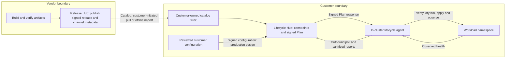
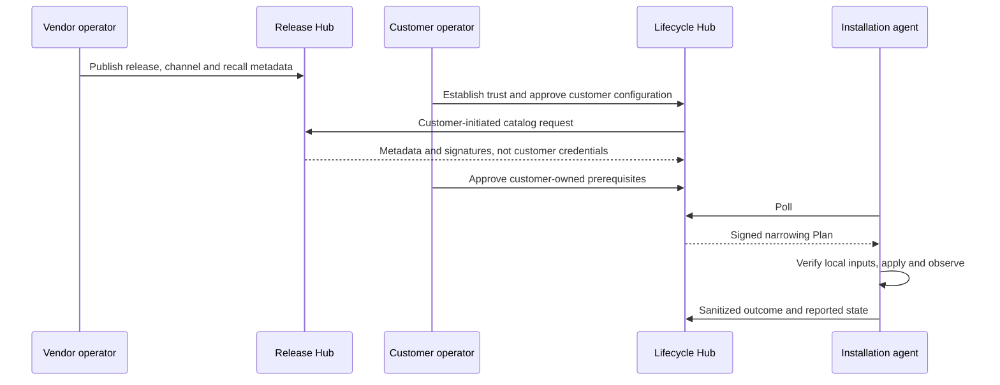

# Hub 수명 주기 운영자 가이드

이 가이드는 누가 release를 준비하고, 누가 설치본을 승인하며, 누가 변경을 적용하는지
설명합니다. 현재 개발 검증 절차와 목표 운영 절차를 구분합니다. 등록 성공을 배포 서비스
전체의 완성으로 오해하지 않도록 실제 가능한 작업과 중단할 지점을 안내합니다.

> **범위:** Hub 관리 수명 주기는 완성된 운영용 설치 경로가 아닙니다. 구현된 FDAI 설치
> 계약에는 [소스 배포](../roadmap/deployment/source-deployment-ko.md) 또는 서명된 오프라인
> 설치 경로를 사용하세요. 이 문서는 클라우드 변경, 발행, 키 반출, 워크로드 적용을 승인하지 않습니다.

## 이 문서에서 다루는 내용

FDAI Release Hub는 공급자용입니다. Lifecycle Hub는 설치본 운영자용입니다.
수명 주기 에이전트는 설치본의 AKS 클러스터 안에서 실행하며, 허용된 워크로드
네임스페이스만 변경합니다. Azure 변경을 담당하는 별도 인프라 에이전트는 설계에 포함돼
있습니다. 보이지 않는 곳에서 이미 실행 중인 서비스라고 가정하지 마세요.

| 담당자 또는 구성 요소 | 담당하는 일 | 담당하지 않는 일 |
|----------------------|-------------|------------------|
| 공급자 release 담당자 | 매니페스트 검토, 서명 발행, 채널 구성, release 회수 | 고객 등록 승인, 고객 워크로드 접근 |
| 고객 초기 설정 담당자 | 실행 신원, 네임스페이스 권한, 신뢰할 공개키, 영구 저장소 연결 | 비밀키 반출, 소유권 근거 날조 |
| 고객 승인자 | 설치본 신원 확인, 허용된 변경 승인 | 에이전트 실행 신원으로 작업 |
| Lifecycle Hub | 제약 평가, Plan 서명, 수명 주기 메타데이터 보관 | Kubernetes 자격 증명 보유, 워크로드 변경 실행 |
| 수명 주기 에이전트 | 입력 검증, 로컬 한도 적용, 변경 적용, 결과 관찰, 복구 | release 발행, 자기 승인, Azure 관리 |

## 1. 전체 흐름 파악

초기 등록과 반복 배포는 다른 과정입니다. 설치본 등록은 처음에 수행하고, release 탐색,
계획, 적용은 반복합니다. release마다 등록이나 키 생성을 다시 하지 않습니다.



이 그림은 목표 구조입니다. 자동 catalog 갱신, 설정 전달, 에이전트 상시 실행,
운영용 신뢰 관리가 지금 구현됐다는 뜻은 아닙니다.
에이전트에는 설치본 경계 안으로 복제한 이미지와 별도로 검증한 서명된 Release 및 설정
파일도 필요합니다. Plan은 이 파일들을 전달하거나 없는 이미지를 만들어 주지 않습니다.

```mermaid
sequenceDiagram
  participant Setup as Customer setup operator
  participant Key as Installation key custody
  participant Human as Customer approver
  participant Hub as Lifecycle Hub
  Setup->>Key: Establish stable installation ID and persistent key
  Setup->>Hub: Bind exact installation and Agent application identity
  Key-->>Setup: Public key ID and fresh signed enrollment file
  Setup-->>Human: Installation ID, file, independently verified public key ID
  Human->>Hub: Submit signed request before freshness deadline
  Hub-->>Human: Pending request
  Human->>Hub: Verify key ID and separately accept
  Hub-->>Human: Enrolled; all Entities remain unmanaged
```

그림의 신원 연결, 네임스페이스 초기 설정, 서명 파일 전달에는 현재 명시적으로 승인된
개발 담당자의 설정 작업이 필요합니다. 한 번에 끝나는 설치 프로그램이 제공되는 것은 아닙니다.

## 2. 각 값의 출처 확인

AI가 비밀값을 만들거나 알고 보관해야 운영할 수 있는 구조가 아닙니다.
다음 공개 메타데이터는 고객이 관리하는 보호된 운영 기록에 남기세요.

| 값 | 생성하거나 확인하는 주체 | 사람이 확인하는 방법 |
|----|-------------------------|----------------------|
| Installation ID | 초기 설정 담당자가 신원 연결과 등록 전에 고정된 고유 ID 선택 | 신원 연결, 서명 내용, 등록 화면, 에이전트 인자의 ID가 같은지 확인합니다. 영문 소문자로 시작하는 소문자, 숫자, 하이픈 조합이며 최대 63자입니다. |
| 에이전트 application/client/object ID | 고객 신원 프로비저닝 | 전용 신원과 `Agent.Access` 연결을 다시 조회합니다. 표시 이름만으로 판단하지 않습니다. |
| 설치본 비밀키 | 설치본이 통제하는 서명 환경 | 복구 가능한 저장소에 남깁니다. 업로드하거나 이메일, 채팅으로 전달하지 않습니다. |
| 설치본 공개키 ID | Ed25519 공개키 원본 바이트의 SHA-256 앞 16자리 앞에 `installation-` 추가 | 대기 요청 화면만 보지 말고, 별도로 신뢰한 경로에서 얻은 키 보관 환경의 출력과 비교합니다. |
| 등록 파일의 `signed_payload`, `proof` | 설치본이 자신의 비밀키로 정확한 요청 바이트에 서명 | Hub가 서명, ID 일치, 크기, 요청 시간을 검증합니다. 이 파일은 비밀키가 아닙니다. |
| Release 다이제스트와 서명 | 공급자가 정확한 매니페스트 바이트에 서명해 발행 | 에이전트가 독립적으로 신뢰한 공급자 공개키로 검증합니다. |
| Catalog 리비전과 내보내기 파일의 SHA-256 | 승인된 공급자 발행 정보와 합의된 신뢰 경로 | 승인한 메타데이터와 비교합니다. 파일 옆에서 함께 내려받은 다이제스트만으로는 독립된 신뢰가 성립하지 않습니다. |
| 설정 다이제스트와 서명 | 고객 설정 서명 환경 | 고객의 별도 공개키와 검토된 내용을 확인합니다. 공급자 키나 설치본 등록 서명으로 대신하지 않습니다. |
| Plan 키 ID, 키 세대, fencing generation | 고객 Hub 신뢰 및 초기 설정 | 에이전트 신뢰 설정과 Plan 메타데이터를 비교합니다. 신뢰하지 않은 Plan에서 임의로 추정하지 않습니다. |

초기 설정 결과에는 공개 ID, 키 참조, 근거 위치, 복구 방법, 다음 행동이 포함돼야 합니다.
이 전체 인수인계 자료를 생성하는 정식 명령은 아직 없습니다.
개발 세션에서 알려준 파일 경로는 제품 인터페이스를 대신하지 못합니다.

## 3. 현재 가능한 개발 절차

### A. 등록 화면을 열기 전에 초기 설정 완료

초기 설정 담당자는 두 Hub 주소, 선택한 구독과 정확한 소스, AKS 연결, 전용 에이전트
신원과 페더레이션, 네임스페이스 권한, 이미지 가져오기 권한, 영구 볼륨 요청(PVC),
신뢰할 공개키를 확인합니다. 정상인 기존 리소스를 재사용하세요.
차단된 작업을 해결하려고 클러스터 관리자나 광범위한 Graph 권한을 부여하지 마세요.

에이전트 재실행 방지 상태, 롤백 기록, 현재 상태, 설치본 키는 영구 보관합니다.
다른 Pod에서 복구를 검증합니다. 임시 설정 권한은 원래 상태로 회수하고 실제 차단을
확인합니다. 이 검증은 Hub에 설치본 행이 보이는 것과 별개입니다.

**대상의 설정 절차가 문서화되지 않았다면 여기서 멈추세요.** 개발 담당자의 설정을
대신할 정식 원격 에이전트 초기화 및 서명 파일 다운로드 명령은 아직 없습니다.
개발용 `fdai-lifecycle-hub dev-enroll`은 선택한 Hub 저장소를 통해 요청을 기록합니다.
인증된 원격 운영자 API에 제출할 파일만 만드는 서명 명령이 아닙니다.

### B. 등록 요청 제출과 승인

1. 설치본 초기 설정 담당자에게 연결된 ID, 방금 서명한 JSON 파일, 독립적으로 확인할
   공개키 ID를 받습니다. 임의 ID를 고르거나 PEM 키를 업로드하지 마세요.
2. 고객 Lifecycle Hub에 로그인하고 **Enrollment requests**를 엽니다.
3. ID를 입력하고 64 KiB 이하의 서명된 JSON 파일을 선택한 뒤 **Submit request**를 한 번
   누릅니다. 요청 시각은 Hub 시계와 5분 이내여야 합니다. 요청 제출의 신선도 제한이지,
   설치본을 5분만 사용할 수 있다는 뜻은 아닙니다.
4. 성공하면 대기 요청을 엽니다. 키 보관 환경에서 얻은 ID와 화면의 키 ID를 비교합니다.
5. **Approver**에 승인자를 입력하고 **Verified key id**에 독립적으로 확인한 ID를
   넣습니다. **Rejection reason**은 비워 둡니다. 신원이 같을 때만 **Accept enrollment**를 누릅니다.
6. **Installations**에 설치본이 나타나는지 확인합니다. 소유권, 설정, 계획이 준비되기
   전에는 관리 대상 Entity, 현재 release, Plan이 없는 것이 정상입니다.

제출 결과가 불확실하면 재시도 전에 대기 목록부터 새로고침합니다. 요청이 없고 파일이
만료됐다면 같은 설치본 키로 새 파일을 받습니다. 키를 다시 만들거나, 정상 신원을
거절하거나, 이미 접수된 요청을 반복 제출하지 않습니다.

### C. 메타데이터와 적용 준비 상태를 구분

기존 개발용 카탈로그 화면에서는 다음 작업을 각각 수행합니다.

1. 승인된 독립 신뢰 경로에서 내보내기 파일의 정확한 **Revision**과 **SHA-256**을 받습니다.
   초기 설정에는 예상한 Release Hub와 공개키가 이미 연결돼 있어야 합니다.
2. **Catalog import**에서 받은 값과 **Approval reason**을 입력합니다.
   확인 입력란에는 `approve <revision> <sha256>`의 각 자리를 실제 값으로 채웁니다.
   독립된 출처를 확인한 뒤에만 **Approve exact pin**을 누릅니다.
3. **Import approved catalog**를 한 번 누릅니다. 수락한 다이제스트가 같은지, 저장된
   리비전 하한이 낮아지지 않았는지, 신뢰 오류가 없는지 확인합니다.
4. 내려받은 바이트가 다르거나 신뢰 및 만료 검증이 실패하면 멈춥니다. 오류를 없애기 위해
   다운로드 응답의 값을 그대로 승인하지 마세요.

읽기 전용 조회 기능이 포함된 빌드에서는 다음을 확인할 수 있습니다.

- **Available releases**는 이미 수락한 catalog만 읽고 다이제스트, 서명, 만료를 다시
  검증합니다. 구성 요소별 이미지 다이제스트, 채널, 스키마 범위를 확인합니다.
  조회 불가 또는 만료는 검증된 빈 catalog와 다른 상태입니다.
- **Configuration packages**는 저장된 설정 리비전의 다이제스트와 설치본 참조를
  표시합니다. 별도 패키지 서명이 없어도 등록 과정에서 이 행이 생길 수 있습니다.
  **Not recorded**는 서명이 검증됐다는 뜻이 아닙니다. 값과 봉인된 식별자는 표시하지 않습니다.

이전 빌드에서는 두 메뉴를 의도적으로 비활성화합니다. 미구현 화면을 열려고 권한을
늘리거나 catalog를 다시 가져오지 마세요. 먼저 실제 배포된 빌드를 확인합니다.

#### 만료된 개발용 카탈로그 복구

이 절차에는 **Renew catalog freshness**가 있는 Release Hub 빌드가 필요합니다.
버튼이 없다면 멈추고 승인된 Release Hub 업데이트를 준비합니다. 새로고침으로 생기지 않습니다.

1. 공급자 운영자가 **Releases**, **Channels**, **Activity**에서 회수 상태까지 검토합니다.
   **Catalog trust**에서 현재 리비전, 키, 내보내기 유효기간을 확인합니다.
2. **Renew catalog freshness**를 누르고 검토 사유를 입력합니다.
   `renew <revision>`에 현재 리비전을 넣어 입력하고 한 번 확인합니다.
   매니페스트, 서명, 채널, 회수, 키는 유지됩니다.
   발행 리비전이 하나 추가되며 갱신 시각으로부터 24시간 뒤에 만료됩니다.
3. 새 **Revision**, **Export expiry**, **Export SHA-256 pin**을 다시 조회합니다.
   쓰기 결과가 불확실하면 창을 닫고 **Refresh catalog**와 **Activity**부터 확인합니다.
   새로고침은 읽기 전용입니다. 쓰기를 자동 반복하지 않습니다.
4. 승인된 독립 신뢰 경로로 검토한 새 리비전과 정확한 고정값을 고객 운영자에게 전달합니다.
   고객은 Lifecycle Hub에서 위의 별도 고정값 승인과 명시적 가져오기를 반복합니다.
   기존 수락 바이트는 자동으로 바뀌지 않습니다.
5. **Available releases**를 다시 엽니다. 새로 수락한 리비전의 유효한 데이터 또는 구체적인
   실패가 표시돼야 합니다. 성공한 것처럼 빈 목록으로 숨기지 않습니다.
   가져오기는 설치본 적용을 수행하지 않습니다.

만료를 숨기려고 release 재발행, 중복 채널 추가, 서명 키 변경, 만료 검사 해제,
저장된 시각의 수동 편집을 하지 마세요.

현재 개발용 에이전트는 별도로 서명된 파일을 검증해 배치할 수 있습니다.

```bash
fdai-lifecycle-agent stage-input --kind release \
  --digest <approved-canonical-digest> --document <release.json> \
  --signature <release.sig> --public-key <trusted-release-public.pem> \
  --inputs-dir <installation-input-directory>
```

설정에는 `--kind configuration`과 고객의 설정 공개키를 사용합니다. 이 명령은 기존
서명을 검증합니다. 서명된 패키지를 만들거나, 패키지에 동봉된 키를 신뢰하게 만들거나,
이미지를 복제하거나, 대상을 배포 가능한 상태로 바꾸지 않습니다.

#### 실행 시간 준비

이 절차에는 실행 설정 API와 UI가 포함된 빌드, 등록된 설치본, 인증된 고객 운영자가
필요합니다. 항목이 없거나 인증이 실패해도 권한을 늘리거나 DB를 직접 편집하지 않습니다.

1. **Installations**에서 설치본을 선택하고 **Execution schedule**을 엽니다.
   기본 제약 확인 화면은 실행 일정을 조회하거나 바꾸지 않습니다.
2. 열린 Plan 때문에 변경할 수 없다면 기존 검토 절차로 그 Plan을 해결한 뒤 설치본을
   새로고침합니다. 이 양식은 Plan을 취소하거나 대체하지 않습니다.
3. **Add window**를 누르고 **Local start time**, **Duration (minutes)**,
   **Time zone**을 입력합니다. 시간대는 `Asia/Seoul`처럼 지정합니다.
   일일 유지 관리 시간은 최대 32개이며, 각각 1~1440분으로 설정합니다.
   중단이 승인되지 않았다면 **Allow downtime in this window**는 선택하지 않습니다.
4. **Plan duration (minutes)**을 1~1440분의 정수로 입력하고 **Reason**을 선택합니다.
   삭제한 시간을 포함해 전체 일정을 검토합니다.
5. 표시된 확인 문구를 **Exact confirmation**에 복사합니다.
   화면이 현재 설정의 다이제스트를 읽고 요청 UUID를 생성하므로 직접 계산하거나
   임의로 만들 필요가 없습니다. 이 설정 다이제스트는 카탈로그 신뢰 고정값이나
   소유권 증명이 아닙니다.
6. **Save execution settings**를 한 번 누르고 저장 안내와 조회된 일정을 확인합니다.
   일정만 변경합니다. 소유권, 배치 위치, 채널, 서명 키, 설정 패키지, 설치 상태 보고는
   그대로이며 Plan을 계산하거나 적용하지 않습니다.
7. 저장이 차단되거나 결과가 불확실하면 다음 요청 전에 **Refresh settings**를 누릅니다.
   실제 저장값과 확인 문구를 다시 검토합니다. 쓰기를 자동 반복하거나 네트워크 실패를
   아무것도 변경되지 않았다는 근거로 해석하지 않습니다.

### D. 부족한 선행 조건을 해결한 뒤 계획과 적용 진행

다음을 각각 입증하지 못했다면 적용 전에 멈춥니다. Entity의 실제 소유권, 호환되는
스키마와 설정 재정의, 실제 이미지 가용성, 신뢰할 서명된 Release 및 설정 파일,
권한을 좁히는 로컬 정책, 열린 유지 관리 시간, 승인된 범위가 필요합니다.
없는 워크로드는 알 수 없음으로 기록합니다. 설치 버전, 정상 상태, 이미지 복제본,
증적, Terraform 다이제스트, 롤백 기록을 만들어 내지 않습니다.

**Catalog import**에서는 독립된 고정값 승인, 한 번의 명시적 가져오기, 명시적 Plan
계산을 수행합니다. Plan 계산은 적용이 아닙니다. 에이전트 `poll`은 실행 횟수와 시간이
제한된 명령이며, 신뢰 설정과 입력 경로도 명시해야 합니다. 설치된 상시 스케줄러가 아닙니다.
처음에는 `--apply` 없이 실행합니다. 정확한 옵션과 별도 적용 및 복구 조건은
[에이전트 가이드](../../lifecycle/agent/README.md)를 확인하세요.

성공은 에이전트가 실제 효과를 관찰하고 결과를 영구 보관해야 인정할 수 있습니다.
요청 접수, Plan 발급, HTTP 성공, Pod 실행, Plan 없음 응답 몇 번만으로는 부족합니다.

## 4. "Development only"의 의미

이 표시는 현재의 **신뢰 검증 구현**을 설명합니다. 보안 절차를 생략해도 된다는 뜻이
아닙니다. 지금은 catalog 내보내기 파일의 다이제스트와 리비전을 독립적으로 승인해야 합니다.
매니페스트 서명만으로 채널, 회수 상태, 신선도 메타데이터 전체가 인증되지는 않습니다.

운영 설계에서도 가져오기라는 개념은 남습니다. 고객 Hub가 공급자 메타데이터를 검증해
수락합니다. 서명된 root, snapshot, timestamp 메타데이터, 영구적인 되돌림 방지 상태,
키 교체, 통제된 갱신이 평상시 수동 고정값 전달을 대신하는 방향입니다.
이 운영용 프로토콜과 신뢰 설정 절차는 아직 완성되지 않았습니다. 문구만 지우거나,
다운로드한 다이제스트를 자동 승인하거나, 현 가져오기 API를 주기 실행하는 것으로
해결되지 않습니다. 오프라인 설치에도 명시적으로 검증하는 반입 절차가 필요합니다.

## 5. 필요한 경계와 줄일 수 있는 수작업

현재 수동 절차가 최적이거나 운영 준비를 마쳤다는 근거는 없습니다.
공급자 발행, 고객 승인, 설치본 실행은 분리하되, 담당자가 경계를 오가는 방식은
단순하게 만들 수 있습니다.

| 현재 | 권장하는 제품 개선 방향이며 아직 제공되지 않는 기능 |
|------|----------------------------------------------------|
| 개발 담당자나 채팅을 통해 ID, 신뢰 참조, 파일 전달 | 정식 설치 프로그램이 영구 인수인계 자료와 등록 파일 다운로드 제공 |
| 독립된 키 확인 절차가 통합되지 않음 | 비밀키를 반출하지 않는 신뢰된 설정 경로에서 정확한 키 비교 지원 |
| 개발 변경마다 내보내기 리비전과 다이제스트 수동 승인 | 신선도를 인증하는 운영용 catalog 메타데이터와 통제된 갱신 |
| 패키지 전달, 이미지 검사, 에이전트 시작을 따로 설정 | 설치본 안에서 입력 배치, 레지스트리 검증, 실행 범위가 제한된 스케줄링 |
| 상태 화면이 서로 분리됨 | 선행 조건, 담당자, 차단 사유, 다음 행동을 보여 주는 설치본별 통합 흐름 |
| 전체 과정을 연결하는 알림이 없음 | 담당자별 영구 작업과 알림, 확인 기록, 감사 이력 |

단순화할 대상은 값 옮겨 적기와 숨은 단계입니다. 서명, 독립된 신뢰, 신원 분리, 소유권
검사, 로컬 한도, 복구, 실제 효과 검증을 없애는 것이 아닙니다.
운영 구조를 변경하려면 별도의 설계 검토가 필요합니다.

## 6. 공급자와 고객 사이에 오가는 정보



이 그림은 연결된 환경의 목표 반복 흐름입니다. 현재 개발 프로필에서는 일부를 명시적
수동 가져오기, 초기 설정, 횟수가 제한된 검사로 수행합니다. 공급자에게 고객의 설치본
비밀키, Kubernetes 토큰, 데이터베이스 연결 정보, 운영 데이터를 전달할 필요는 없습니다.
등록 ID와 키 확인은 고객의 초기 설정 담당자와 승인자 사이에서 수행합니다.

지금은 양쪽 모두 **웹 화면과 자동 알림만으로 모든 일을 처리할 수 없습니다.**
목표는 시스템 사이의 메타데이터 전달과 담당자가 행동할 수 있는 작업 안내입니다.
release마다 공급자와 고객이 설치본 자격 증명을 서로 붙여 넣는 방식이 아닙니다.
처음의 독립된 신뢰 설정과 예외적인 복구에는 여전히 책임 있는 사람의 결정이 필요합니다.

## 7. 운영 기록 보관

단계마다 담당자, 정확한 소스와 대상, 공개 식별자, 근거 참조, 결과, 남은 차단 사유,
다음 행동을 고객이 관리하는 기록에 남깁니다. 비밀키, 토큰, 연결 문자열, 운영 증적의
원문은 넣지 않습니다. 이 문서나 체크리스트가 승인 또는 운영 완료 근거를 대신하지 않습니다.

| 증상 | 다음 행동 |
|------|-----------|
| 메뉴 비활성화 | 권한 확대 대신 배포된 기능 구현 여부 확인 |
| 대기 요청이 사라짐 | 재제출 전에 Installations와 등록 결과 확인 |
| No managed Entity | 실제 소유권과 설정의 선행 조건 확인. 등록만으로는 부족함 |
| Catalog 조회 불가 또는 만료 | 승인한 신뢰와 신선도 확인. 빈 목록으로 숨기지 않음 |
| 패키지 서명 Not recorded | 서명된 입력 준비 완료로 판단하지 않고 중단. 다이제스트만으로는 서명이 아님 |
| Azure 또는 Entra 시간 초과 | DNS, HTTPS, 인증, 서비스 상태를 분리해 확인. 결과가 불확실한 쓰기는 다시 조회 |

## 다음 단계

| 알아볼 내용 | 문서 |
|-------------|------|
| 기준 수명 주기 설계와 남은 구현 | [Hub 관리 수명 주기](../roadmap/deployment/hub-managed-lifecycle-ko.md) |
| 공급자 발행과 신뢰 검증 한계 | [Release Hub](../../lifecycle/release-hub/README.md) |
| 고객 등록과 계획 | [Lifecycle Hub](../../lifecycle/hub/README.md) |
| 설정 키 보관의 선행 조건 | [설정 키 온보딩](lifecycle-configuration-key-onboarding-ko.md) |
| 에이전트 검증과 복구 | [수명 주기 에이전트](../../lifecycle/agent/README.md) |
