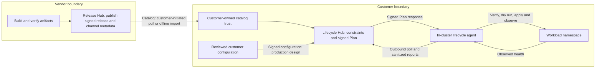
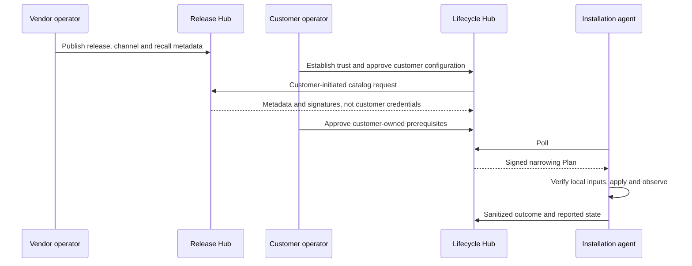

# Hub lifecycle operator guide

Use this guide to understand who prepares a release, who approves an installation, and who
applies a change. It separates the current development procedure from the intended production
workflow so you don't mistake a successful registration for a working deployment service.

> **Scope:** Hub-managed lifecycle is not a completed production installation path. Use the
> [source deployment](../roadmap/deployment/source-deployment.md) or signed offline installation
> path for the implemented FDAI installation contract. This guide does not authorize cloud
> changes, publication, key export, or workload application.

## What this guide covers

The FDAI Release Hub serves the vendor. The Lifecycle Hub serves the installation operator.
The lifecycle agent runs inside the installation's AKS cluster and changes only its permitted
workload namespace. A separate infrastructure agent is part of the design for Azure changes;
it is not an invisible service you should assume is running.

| Actor | Responsibility | Not its responsibility |
|--------|----------------|-----------------------|
| Vendor release operator | Review manifests, publish signatures, curate channels, recall releases | Approve customer enrollment or access customer workloads |
| Customer setup operator | Bind identities, namespace permissions, public trust keys and durable storage | Export private keys or manufacture ownership evidence |
| Customer approver | Verify installation identity and approve permitted changes | Act as the Agent's execution identity |
| Lifecycle Hub | Evaluate constraints, sign Plans, retain lifecycle metadata | Hold Kubernetes credentials or execute workload changes |
| Lifecycle agent | Verify inputs, enforce local limits, apply, observe and recover | Publish releases, approve itself, or administer Azure |

## 1. See the whole flow

There are two different journeys. Installation onboarding happens once. Release discovery,
planning and application repeat. Don't repeat enrollment or key generation for every release.



This is the target topology, not evidence that automatic catalog refresh, configuration
delivery, permanent Agent scheduling, or production trust management exists today.
The Agent also needs mirrored images and independently verified signed Release/configuration
files inside its own boundary. A Plan does not deliver those files or make missing images exist.

```mermaid
sequenceDiagram
  participant Setup as Customer setup operator
  participant Key as Installation key custody
  participant Human as Customer approver
  participant Hub as Lifecycle Hub
  Setup->>Key: Establish stable installation ID and persistent key
  Setup->>Hub: Bind exact installation and Agent application identity
  Key-->>Setup: Public key ID and fresh signed enrollment file
  Setup-->>Human: Installation ID, file, independently verified public key ID
  Human->>Hub: Submit signed request before freshness deadline
  Hub-->>Human: Pending request
  Human->>Hub: Verify key ID and separately accept
  Hub-->>Human: Enrolled; all Entities remain unmanaged
```

The identity binding, namespace bootstrap and signing/file delivery in that diagram currently
need an explicitly approved engineering setup. They are not a shipped one-click installer.

## 2. Know where each value comes from

No AI needs to invent, know or retain a secret to operate this system.
Record the following public metadata in the customer's protected operational records.

| Value | Created or discovered by | How a human checks it |
|-------|--------------------------|-----------------------|
| Installation ID | Setup operator selects a stable unique ID before binding and enrollment | Same ID in binding, signed payload, enrollment and Agent arguments; canonical lowercase letters, digits and hyphens, starting with a letter, at most 63 characters |
| Agent application/client/object IDs | Customer identity provisioning | Read back the exact dedicated identity and `Agent.Access` binding; display names are insufficient |
| Installation private key | Installation-controlled signing boundary | Remains there with durable recovery; never uploaded, emailed or copied into chat |
| Installation public key ID | `installation-` plus the first 16 hex characters of SHA-256 of the raw Ed25519 public key | Compare custody output through an independent trusted channel, not only the pending request |
| Enrollment `signed_payload` and `proof` | Installation signs exact request bytes with its installation key | Hub verifies signature, matching ID, size and request time; the file is not the private key |
| Release digest and signature | Vendor publication over exact manifest bytes | Agent verifies with its independently trusted vendor public key |
| Catalog revision and exact export SHA-256 | Approved vendor publication, conveyed through the agreed trust channel | Compare with approved metadata; downloading a digest beside the same file is not independent trust |
| Configuration digest and signature | Customer configuration signing boundary | Separate customer public key and reviewed content; not the vendor key or installation enrollment proof |
| Plan key ID, epoch, fencing generation | Customer Hub trust/bootstrap configuration | Match Agent trust and Plan metadata; don't infer them from an untrusted Plan |

A human should receive a setup handoff containing public IDs, key references, evidence locations,
recovery instructions and the next action. A supported generator for that complete handoff is
still missing. A file path from an engineering session is not a product interface.

## 3. Follow the currently available development procedure

### A. Finish setup before opening the registration form

The setup operator verifies both Hub endpoints, the selected subscription and exact source,
AKS connectivity, the dedicated Agent identity and federation, namespace permissions, registry
pull access, a persistent volume claim (PVC), and trusted public keys. Reuse existing healthy
resources. Never fix a denied action by granting cluster administrator or broad Graph access.

Keep Agent replay state, rollback journal, current state and installation key custody durable.
Verify recovery in a separate Pod. Return temporary setup permissions to their prior state and
check effective denial. These are separate checks from the Hub showing an installation row.

**Stop if setup isn't documented for your target.** There is no supported remote Agent
bootstrap/sign-and-download command that this guide can substitute for engineering setup.
The development `fdai-lifecycle-hub dev-enroll` command writes through its selected Hub store;
it is not an export-only signer for the authenticated remote operator route.

### B. Submit and approve enrollment

1. Obtain the bound installation ID, fresh signed JSON file and independent public key ID from
   the installation setup operator. Do not choose an arbitrary ID or upload a PEM key.
2. Sign in to the customer's Lifecycle Hub. Open **Enrollment requests**.
3. Enter the ID, select the signed JSON file (at most 64 KiB), and click **Submit request** once.
   The request timestamp must be within five minutes of the Hub clock. This is a submission
   freshness limit, not a five-minute lifetime for the installation.
4. After success, open the pending request. Compare its key ID with the custody output.
5. Enter **Approver**, paste the independently verified ID into **Verified key id**, leave
   **Rejection reason** empty, and click **Accept enrollment** only if identity matches.
6. Verify the installation appears in **Installations**. No managed Entity, no current release,
   and no Plan are expected before ownership, configuration and planning are ready.

If submission has an uncertain result, refresh the pending list before retrying. If the
request is stale and no request exists, obtain a newly signed file using the same installation
key. Don't regenerate the key, reject an otherwise valid identity, or repeat an accepted request.

### C. Inspect inputs without confusing metadata with readiness

For the existing development catalog screen, follow these separate actions:

1. Obtain the exact export **Revision** and **SHA-256** through the approved independent trust
   channel. The setup must already bind the expected Release Hub and public key.
2. Open **Catalog import**. Enter those values and an **Approval reason**.
   In the confirmation field, type `approve <revision> <sha256>` with the actual values.
   Click **Approve exact pin** only after checking the independent source.
3. Click **Import approved catalog** once. Verify the accepted digest matches, the persisted
   revision floor has not gone backward, and no trust error is displayed.
4. Stop if the downloaded bytes differ or trust/expiry validation fails. Don't approve whatever
   the download reports just to make the error disappear.

In builds containing the read-only inventory implementation:

- **Available releases** reads only the already accepted catalog and rechecks its digest,
  signatures and expiry. Inspect component image digests, channel and schema range.
  Unavailable/expired is different from a verified empty catalog.
- **Configuration packages** lists stored revision digests and installation references.
  Enrollment can create these rows without an independent package signature.
  **Not recorded** is not a verified signed package. Values and sealed identifiers aren't shown.

Older builds intentionally disable both menus. Don't add operator roles or reimport a catalog
to enable a missing screen. Confirm which exact build is deployed before following these steps.

#### Recover an expired development catalog

This procedure needs a Release Hub build with **Renew catalog freshness**. If that action is
missing, stop and arrange an approved Release Hub update. A browser refresh can't add it.

1. As the vendor operator, review **Releases**, **Channels** and **Activity**, including recalls.
   Open **Catalog trust** and check the current revision, key and export expiry.
2. Choose **Renew catalog freshness**, enter the review reason and type `renew <revision>` using
   that current revision. Confirm once. Manifests, signatures, channels, recalls and keys stay
   unchanged; publication adds one revision and expires 24 hours after the renewal.
3. Read back the new **Revision**, **Export expiry** and **Export SHA-256 pin**. If the write's
   result is uncertain, close the dialog and use **Refresh catalog** and **Activity** before
   another attempt. Refresh is read-only; don't automatically repeat the write.
4. Through the approved independent trust channel, give the customer operator the reviewed
   new revision and exact pin. In Lifecycle Hub, repeat the separate pin approval and explicit
   import steps above. Existing accepted bytes don't change automatically.
5. Reopen **Available releases**. It should show the newly accepted revision's valid data or a
   specific failure, not a success-shaped empty list. Import doesn't apply an installation.

Don't republish a release, add a duplicate channel membership, change signing keys, disable
expiry checks or edit stored timestamps just to hide an expired catalog.

The current development Agent can verify and stage independently signed files:

```bash
fdai-lifecycle-agent stage-input --kind release \
  --digest <approved-canonical-digest> --document <release.json> \
  --signature <release.sig> --public-key <trusted-release-public.pem> \
  --inputs-dir <installation-input-directory>
```

Use `--kind configuration` with the customer's configuration public key for configuration.
This command verifies an existing signature; it does not create a signed package, acquire trust
from a bundled key, mirror registry images or make a target eligible.

#### Prepare execution windows

This procedure requires a build with the execution-settings API and UI, an enrolled installation,
and a verified customer operator. A missing section or authentication failure isn't a reason to
add permissions or edit the database.

1. Open **Installations**, select the installation, and open **Execution schedule**.
   The default constraints view doesn't load or change the schedule.
2. If an open Plan blocks changes, resolve that Plan through the existing review procedure,
   then refresh the installation. This form doesn't cancel or replace it.
3. Choose **Add window**. Set **Local start time**, **Duration (minutes)** and **Time zone**,
   such as `Asia/Seoul`. You can keep up to 32 daily windows, each from 1 through 1440 minutes.
   Leave **Allow downtime in this window** unchecked unless downtime is approved.
4. Set **Plan duration (minutes)** to an integer from 1 through 1440 and choose **Reason**.
   Review all windows, including any removed ones.
5. Copy the displayed confirmation into **Exact confirmation**.
   The UI reads the expected settings digest and creates the request UUID; you don't calculate
   or invent them. This settings digest isn't a catalog trust pin or ownership proof.
6. Choose **Save execution settings** once. Verify the saved notice and reread the schedule.
   Only scheduling changes; ownership, placement, channel, signing keys, configuration and
   installed-state reports stay unchanged. No Plan is computed or applied.
7. If saving is rejected or its outcome is uncertain, choose **Refresh settings** before
   another request. Review the actual stored values and confirmation again. Don't automatically
   repeat a write or interpret a network failure as proof that nothing changed.

#### Bind the installation to its application

Use a build that includes the application-binding API and UI. An older Hub that doesn't report
this capability is unavailable, not an unbound installation.

1. Verify the application ID from the reviewed signed package and the independent local Agent
   policy. Don't select an ID from an untrusted Plan.
2. Open the enrolled installation's **Application** tab as a verified customer operator.
   An existing binding is read-only. A different application cannot replace it.
3. Resolve any open Plan through its existing procedure before proceeding. Enter **Application ID**
   and enter it again to confirm. Review that binding is permanent.
4. Choose **Bind application** once and reread the stored binding. The UI supplies the UUID,
   current Settings digest and full confirmation; you don't construct machine values.
5. If saving fails or its outcome is uncertain, choose **Refresh binding** and review the actual
   result before another request. There is no automatic write retry.

Binding changes only the allowed application ID and attributed audit. It does not prove namespace
ownership, add permissions, replace configuration, compute a Plan or deploy a workload.
Agent local policy and the package's `product` must independently match this binding.
Enrollment requests must leave `settings.product` unset; bind it here only after enrollment approval.

### D. Plan, then apply only when the missing prerequisites are resolved

The current setup should stop before apply unless all of these are independently established:
proven Entity ownership, compatible schema and overrides, real artifact availability, trusted
signed Release/configuration files, a narrowing local policy, an open maintenance window,
and approved scope. An absent workload stays unknown; don't fabricate an installed version,
healthy state, artifact mirror, receipt, Terraform digest or rollback journal.

**Catalog import** provides independent pin approval, one explicit import and explicit Plan
computation. Computing a Plan does not apply it. The Agent's `poll` command is finite and
requires explicit limits and trust/input paths; it is not a permanently installed scheduler.
Start without `--apply`. See the [Agent guide](../../lifecycle/agent/README.md) for exact
options and the separate apply/rollback requirements.

Success requires the Agent's observed effect and durable result, not a submitted request,
issued Plan, accepted HTTP response, running Pod, or a few successful no-Plan polls.

## 4. Understand "Development only"

The label describes the current **trust implementation**, not an optional security step.
Current catalog exports need an independently approved digest and revision. Manifest signatures
alone do not authenticate all channel/recall/freshness metadata.

In the production design, the import concept remains: the customer's Hub validates and admits
vendor metadata. Signed root, snapshot and timestamp metadata, persistent anti-rollback state,
key rotation and controlled refresh replace routine manual export-pin transcription.
That production protocol and its operational ceremony are not completed. Removing the label,
auto-approving a downloaded digest or scheduling the current import endpoint is not the fix.
Offline installations still need an explicitly verified offline transfer/import process.

## 5. Separate necessary boundaries from avoidable work

The current manual journey is not demonstrated to be optimal or production-ready.
Keep vendor publication, customer approval and installation execution distinct; simplify how
operators see and move between those boundaries.

| Today | Recommended product improvement, not an available feature |
|-------|----------------------------------------------------------|
| IDs, trust references and files passed through an engineer or chat | One supported installer produces a durable public handoff and a registration download |
| Independent key verification has no integrated workflow | A trusted setup channel presents the exact key comparison without exporting the key |
| Manual export revision/digest approval for every development change | Production catalog metadata with authenticated freshness and controlled refresh |
| Package delivery, artifact checks and Agent start require separate setup | Installation-side input staging, registry verification and bounded scheduling |
| Several disconnected status pages | One installation journey showing prerequisite, owner, blocker and next action |
| Missing end-to-end notifications | Durable tasks and notifications for each responsible human, with acknowledgement and audit |

Simplification should remove transcription and hidden steps, not signatures, independent trust,
identity separation, ownership checks, local limits, recovery or observed-effect verification.
Changing that production architecture needs a separate reviewed design.

## 6. Know what crosses the vendor/customer boundary



This is the intended connected loop. The current development profile replaces parts with
explicit manual imports, setup and finite checks. A vendor does not need the customer's
installation private key, Kubernetes token, database connection or operational payload.
Enrollment ID/key verification stays within the customer's setup/approval boundary.

Today, both parties **cannot rely only on their web screens and automatic notifications**.
The production goal is system-to-system metadata transfer and actionable tasks for each operator,
not a vendor and customer pasting installation credentials to each other for every release.
Independent initial trust and exceptional recovery still need accountable human decisions.

## 7. Preserve an operator record

For each step, retain the responsible person, exact source/target, public identifiers,
evidence reference, result, remaining blocker and next action in customer-controlled records.
Never include private keys, tokens, connection strings or raw operational receipts.
Do not treat this guide or a checklist as authorization or a claim of production acceptance.

| Symptom | Next action |
|---------|-------------|
| Menu disabled | Check deployed implementation, not permission expansion |
| Pending request disappears | Check Installations and enrollment outcome before resubmitting |
| No managed Entity | Review real ownership/settings prerequisites; registration alone is insufficient |
| Catalog unavailable or expired | Review approved trust and freshness; don't silently display an empty list |
| Package signature not recorded | Stop before signed-input readiness; a digest alone isn't a signature |
| Azure/Entra timeout | Separate DNS, HTTPS, authentication and service health; read back ambiguous writes |

## Next steps

| To learn about | Read |
|----------------|------|
| Authoritative lifecycle design and gaps | [Hub-managed lifecycle](../roadmap/deployment/hub-managed-lifecycle.md) |
| Vendor publication and trust limits | [Release Hub](../../lifecycle/release-hub/README.md) |
| Customer enrollment and planning | [Lifecycle Hub](../../lifecycle/hub/README.md) |
| Configuration custody prerequisites | [Configuration key onboarding](lifecycle-configuration-key-onboarding.md) |
| Agent verification and recovery | [Lifecycle agent](../../lifecycle/agent/README.md) |
