# 먼저 관찰하고, 검증 후 변경 적용

FDAI의 새 자율 작업은 한꺼번에 활성화되지 않습니다. 적용 모드로 전환할 수 있는 모든
규칙, 할당, 워크플로, `ActionType`은 **관찰 모드**로 시작합니다. 프로덕션에서 내렸을
결정을 똑같이 계산하지만 기록만 하고 적용하지 않습니다. 기준선과 비교한 측정 결과가
기준을 충족하고 별도의 거버넌스 검토를 마쳐야 자동 실행 대상이 될 수 있습니다.

## 관찰 모드가 기록하는 것

새 기능이 관찰 모드에 있을 때도 모든 이벤트는 자율 실행이 이미 활성화된 것처럼 전체
판단 경로를 통과합니다.

- 전체 신뢰 라우팅과 안전성 검토 결과를 계산합니다.
- 적용 모드였다면 실행했을 작업을 제안 작업으로 저장합니다.
- 감사 기록에서 사람이 실제로 선택한 조치를 수집합니다.
- 제안 작업과 실제 조치의 차이가 **관찰 정확도 신호**입니다.

프로덕션 동작은 바뀌지 않습니다. 승인은 여전히 사람이 처리하고 수정은 기존 방식으로
전달됩니다. 새 기능은 판단 결과를 관찰할 뿐 실행에 개입하지 않습니다.

## 적용 모드 전환에 필요한 조건

FDAI는 단계 0 기준선에 대해 미리 등록해 둔 기준을 관찰 근거가 넘었을 때만 기능을
적용 모드로 전환합니다. 근거 패킷에는 고정된 시나리오 세트와 측정 기간을 적으므로 검토자가 비교
결과를 재현할 수 있습니다.

- **최소 근거**: 설정된 관찰 기간과 표본 크기를 충족합니다.
- **결과 품질**: 같은 시나리오 세트에서 일치율, 오탐지, 미탐지 비율이 작업별 임계값을
  충족합니다.
- **잠재 정책 위반 0건**: 결정론적 정책 거부를 빠져나갔을 관찰 작업이 하나도 없어야
  합니다. 정식 `policy_escapes` 보호 지표의 허용값은 정확히 0입니다.
- **안전 준비 상태**: 사전 조건, 중단 조건, 영향 범위 상한, 멱등성, 롤백 리허설,
  감사 완전성이 모두 통과합니다.
- **운영 보호 지표**: 변경 실패율과 롤백 비율이 기준선보다 나빠지지 않습니다.

근거가 준비됐다는 사실만으로 수명 주기 모드가 바뀌지는 않습니다. 정확한 대상, 범위,
버전, 근거 다이제스트를 대상으로 별도 거버넌스 검토를 시작합니다. 규칙이나 할당에는
검토된 카탈로그 pull request를 사용하고, `ActionType`이나 워크플로에는 통제된 승격
레지스트리 갱신을 사용합니다. 어느 쪽도 기능의 첫 커밋과 묶지 않습니다.

## 수명 주기 상태가 변경되는 방식

권위 있는 승격 레지스트리만 작업을 관찰 상태에서 적용 가능한 상태로 변경할 수 있습니다.
배포 환경, 실행 위치, 로컬 플래그는 이 전환을 수행할 수 없습니다.

## 정확히 무엇을 적용 모드로 전환하나요?

관련된 제어도 각각 독립적으로 전환됩니다.

| 제어 | 관찰 상태 | 적용 상태 |
|------|-----------|-----------|
| 규칙 효과 | `audit` 또는 `do-not-enforce` | 제한된 범위에 `deny` 또는 `remediate` 적용 |
| 할당 | 선택한 리소스에서 규칙 세트를 관찰 | 검토된 효과와 매개 변수를 해당 범위에 적용 |
| `ActionType` | `default_mode: shadow`이며 아무것도 바꾸지 않음 | 승격 레지스트리가 적용 가능 상태로 표시하며 각 이벤트는 계속 위험 및 권한 게이트를 통과 |

규칙을 적용 모드로 전환해도 그것을 참조하는 모든 할당이나 작업이 자동으로 전환되지는 않습니다.
각 제어는 자체 근거, 검토, 범위, 롤백 참조를 따로 가집니다.

## 적용 모드 전환 승인 주체

적용 모드 전환은 대상을 소유하는 검토 절차를 통해 전달되는 거버넌스 변경입니다. 규칙과
할당에는 카탈로그 pull request를 사용하고 `ActionType`과 워크플로 상태에는 통제된 승격
레지스트리 갱신을 사용합니다. 요청에는 근거 패킷, 대상 범위, 작업 버전 및 롤백 계획이
들어갑니다. 요청자는 자신의 적용 모드 전환 요청을 승인할 수 없습니다. 필요한 역할과 정족수는
거버넌스 작업과 위험 판정에서 가져오며 승인은 실행 결과와 별도로 기록됩니다.

## 관찰 모드로 되돌리는 조건

적용 모드로 전환한 뒤에도 같은 보호 신호를 계속 사용합니다. 적용된 기능이 전환 기준을
충족하지 못하거나, 정책 우회가 발생하거나, 필수 의존성을 잃으면 해당 할당이나 작업을
관찰 모드로 되돌리고 당직 운영팀에 알립니다. 회귀를 고친 뒤에는 새로운 근거 수집과
적용 모드 전환 절차를 시작합니다.

범위가 제한된 규칙 재정의는 전체 기능을 자동으로 관찰 모드로 되돌리는 동작이 아닙니다.
정해진 범위에서만 실행을 억제하거나 범위를 좁히며, 탐지는 관찰 모드로 계속합니다.
반복되거나 오래가는 재정의는 규칙 수정이나 사용 중지 후보를 제안하는 근거가 됩니다.
이 변경도 일반 카탈로그 품질 게이트를 통과해야 합니다.

## 관찰 모드 복귀와 롤백은 다릅니다

관찰 모드 복귀는 기능을 판단과 기록 전용으로 되돌려 이후의 변경을 막습니다. 이미 실행된
변경을 되돌리지는 않습니다. 이전 상태 복원은 작업 인스턴스의 `rollback_contract`가
담당하며 자체 감사 참조와 복구 검증을 남깁니다.

예시: 리소스 규모 조정 작업의 롤백 비율이 보호 기준을 벗어남 -> 할당을 관찰 모드로
되돌림 -> 새로운 규모 조정 작업을 중지 -> 이미 적용된 변경은 해당 작업의 스크립트 또는
pull 요청 기반 롤백 경로로 복원.

## 왜 이게 운영자에게 중요한가

시스템을 사용하는 누구에게나 해당하는 세 가지 결과가 있습니다.

- **새 자율 기능은 근거 없이 적용되지 않습니다.** 작업이 스스로 실행되기 전에 설정된
  기간 동안 같은 판단을 관찰하고 측정 가능한 기준을 통과합니다.
- **이후 실행 중지는 표준 제어입니다.** 관찰 모드 복귀는 적용 모드 전환과 같은 카탈로그
  및 할당 경로를 사용하므로 회귀에 정해진 대응을 적용할 수 있습니다.
- **실행된 상태에는 별도 복구 경로가 있습니다.** 관찰 모드 복귀와 롤백은 서로 다른 관측 가능한
  작업이므로 자동화 중지 여부와 이전 상태 복원 여부를 각각 확인할 수 있습니다.

## 다음 단계

| 학습 대상 | 문서 |
|-----------|------|
| 관찰 후 변경 적용을 처리하는 티어 | [deterministic-first-ko.md](deterministic-first-ko.md) |
| 생성된 작업의 자동 실행과 사람 승인 의미 | [risk-tiers-ko.md](risk-tiers-ko.md) |
| 모든 작업에 필요한 안전 불변식 | [../../../.github/instructions/coding-conventions.instructions.md](../../../.github/instructions/coding-conventions.instructions.md) |
| 기능을 적용 모드로 전환하는 단계 종료 기준 | [../../roadmap/README-ko.md](../../roadmap/README-ko.md) |
| 규칙 효과, 할당, 범위 제한 재정의 | [../../roadmap/rules-and-detection/rule-governance-ko.md](../../roadmap/rules-and-detection/rule-governance-ko.md) |
| 기준선과 적용 모드 전환 보호 지표 | [../../roadmap/architecture/goals-and-metrics-ko.md](../../roadmap/architecture/goals-and-metrics-ko.md) |
