# 인시던트 관리

인시던트는 상관관계가 있는 신호, 담당 주체, 조사, 대응, 복구, 사후 분석 근거를 연결하는 영속적인 운영 기록입니다. FDAI는 인시던트를 알림에 부여하는 레이블로 취급하지 않고 명시적인 수명 주기에 따라 관리합니다.

## 인시던트 전 단계: 탐지된 문제

FDAI는 일상적인 관측 결과와 개별 이상 징후가 불필요한 운영 비상 상황으로 이어지지 않도록 탐지된 문제와 인시던트를 구분합니다. 표준 처리 순서는 다음과 같습니다.



`Finding`은 근거가 뒷받침되는 정규화된 탐지 문제 하나를 나타냅니다. `Findings`는 컬렉션 또는 Console 페이지의 레이블입니다. 15개 에이전트는 각자의 책임 영역에서 탐지된 문제를 생성할 수 있지만, `Finding` 자체에는 Incident 수명 주기가 없습니다. 상관관계 분석을 통해 Incident 후보를 제출할 수 있으며, 수동 워크플로를 통해 Incident 제안을 제출할 수 있습니다. 인시던트 수명 주기 모듈만 이러한 요청을 수락하고 영속적인 Incident 기록을 생성할 수 있습니다.

Agent Activity는 `Finding`을 생성하거나 업데이트한 주체와 시점을 기록할 수 있습니다. 이 정보는 출처를 확인하기 위한 보조 기록이며, 탐지된 문제의 목록을 관리하는 기능은 아닙니다. Agent Activity는 탐지된 문제의 심각도, 중복 제거, 상관관계 분석 또는 인시던트로의 승격을 관리하지 않습니다.

## 인시던트 수명 주기

```text
open -> triaging -> mitigated -> resolved -> closed
```

상태 전환은 상태 머신에서 검증하며, 멱등성이 보장되도록 기록합니다. 요청에 지정된 예상 상태가 최신 상태와 일치하지 않으면 충돌이 발생합니다. 따라서 오래된 요청이 운영자나 자동화 시스템의 최신 결정을 덮어쓰지 않습니다.

| 상태 | 운영자에게 주는 의미 |
|------|----------------------|
| `open` | 연결된 근거가 모여 인시던트 기록이 만들어졌습니다 |
| `triaging` | 소유자를 정하고 근거를 모으는 중입니다 |
| `mitigated` | 당장의 영향은 막았지만 복구는 아직 끝나지 않았습니다 |
| `resolved` | 서비스 복구를 확인했습니다 |
| `closed` | 후속 조치와 필수 사후 작업까지 끝났습니다 |

생애주기를 기록하는 주체는 인시던트 모듈 하나뿐입니다. 버티컬과 운영자는 상태 전환을
제안할 수 있을 뿐, 직접 기록을 덧붙이지는 못합니다. 상태 전환은 인시던트, 목표 상태, 요청
주체를 묶어 중복을 걸러 냅니다. 저장 계층은 인시던트를 잠그고 예상 상태가 맞는지 확인한
뒤, 상태 전환을 전체 감사 체인에 한 번의 작업으로 덧붙입니다. 경쟁에서 밀린 요청은 어느
상태가 이겼는지 추측하지 않고 정본 데이터를 다시 읽습니다.

다시 열 수 있는 경로는 `resolved -> triaging` 하나뿐입니다. 심각도 변경도 이 구간에서만
허용되므로, 재실행이 진행 중인 인시던트의 심각도를 몰래 바꾸는 일은 없습니다.

## 기록에 담기는 내용

인시던트는 고정된 ID, 상관관계 키, 심각도, 상태, 출처, 소유자, 시각, 구성원 참조, 완화
요약, 포스트모템 참조를 담습니다. 감사 항목에는 인시던트 생성, 구성원 변경, 담당자 지정,
상태 전환이 그대로 남습니다.

소유권, 영향 범위, 복구 근거가 없으면 값을 지어내지 않고 확인 불가로 표시합니다. 콘솔도
화면에 보이는 문구만 보고 그 값을 짐작하지 않습니다.

이 기록을 근무 교대의 인수인계 경계로 사용하세요. 새 대응자는 다른 도구를 열기 전에
기록만으로 세 가지 질문에 답할 수 있어야 합니다.

- **무엇이 영향을 받았나요?** 범위, 구성원, 심각도, 소유자입니다.
- **무엇이 바뀌었나요?** 타임라인, 상관관계 키, 최근 상태 전환입니다.
- **아직 증명되지 않은 것은 무엇인가요?** 사용할 수 없는 근거, 빠진 복구 확인,
  종료를 막는 후속 작업입니다.

## 안전하게 만들고 배정하기

인시던트를 직접 만들려면 기여자 이상 권한이 필요하고, 제안된 심각도와 상관관계 키를
확인해야 합니다. 자동 연결은 고정된 인시던트 기준점을 뽑아내므로, 같은 신호가 여러 번
도착해도 같은 인시던트를 만들거나 갱신합니다.

담당자 변경은 감사에 남고, 알림은 유실 없이 전달됩니다. 알림이 실패해도 생애주기 기록을
되돌리지 않으며, 재시도 점유 방식 덕분에 중복 전달이 중복 상태 전환으로 이어지지 않습니다.

## 생애주기 결과와 전달 결과는 다릅니다

인시던트 상태 전환과 그 알림은 서로 관련은 있지만 별개의 결과입니다. 상태 전환은 감사
기록이 성공적으로 덧붙는 순간 확정됩니다. 알림 전달은 고정된 감사 ID, 한 번에 한 곳만
잡을 수 있는 점유권, 발송 완료 표시를 사용합니다. 시작할 때 수행하는 재실행은 완료 표시가
없는 항목만 다시 시도합니다.

| 생애주기 결과 | 전달 결과 | 운영자가 읽는 방법 |
|---------------|-----------|---------------------|
| 적용됨 | 발송됨 | 상태와 알림이 모두 최신입니다 |
| 적용됨 | 대기 또는 실패 | 상태는 최신이고, 전달만 재시도하거나 에스컬레이션하면 됩니다 |
| 중복 | 이미 발송됨 | 재실행이 새 상태도, 새 메시지도 만들지 않았습니다 |
| 충돌 | 미발송 | 인시던트를 다시 읽고 요청한 상태 전환을 재검토하세요 |

## 인시던트 목록에서 일하기

콘솔의 인시던트 목록은 대부분의 근무가 시작되는 곳입니다. 각 행에는 인시던트 ID, 추론이 아니라
생애주기 상태 머신에서 바로 가져온 상태, 심각도, 그룹화에 사용된 상관관계 키, 열린 시각과 마지막으로
변경된 시각, 관여한 에이전트, 운영 영역, 관찰 모드였는지 적용 모드였는지, 기록된 결과가 담깁니다.
최근 활동 순으로 정렬되며 상태와 버티컬로 필터링할 수 있습니다.

한 행에서 근거로 들어갈 수 있습니다. 대응 경로와 기록된 판정이 담긴 인시던트 상세, 무슨 일이
있었는지에 대한 일상어 이력, 그리고 거기서 해당 상관 ID의 전체 감사 기록과 재구성된 추적까지
이어집니다.

목록은 읽기 전용입니다. 상태 전환 버튼은 없습니다. 인시던트 전환은 투영 화면에서의 클릭이
아니라 형식화된 확인 요청이기 때문입니다.

한 가지 습관을 권합니다. 목록은 스냅샷이고, 조용한 목록은 실제로 조용하다는 뜻일 수도 있고
투영이 아직 따라오지 못했다는 뜻일 수도 있습니다. 그래서 시각은 상대 표현이 아니라 정확한 값으로
표시되고, 감사 화면은 어느 구간을 표본으로 삼았는지 밝힙니다. 최근 활동이 오래돼 보이면 아무 일도
없다고 결론 내리기 전에 새로 고치세요.

## 분류하고, 완화하고, 해결하기

1. 구성원, 범위, 심각도, 현재 소유자를 확인합니다.
2. `triaging`으로 옮기고 범위를 정한 조사를 시작합니다.
3. 완화 제안은 타입이 정의된 파이프라인과 필요한 승인 절차를 거치게 합니다.
4. 영향을 막았다는 근거가 있을 때만 `mitigated`로 표시합니다.
5. 서비스 복구를 확인한 뒤에만 `resolved`로 표시합니다.
6. 후속 조치, 포스트모템, 소유권 정리를 기록한 뒤에 종료합니다.

## SLA와 알림 폭주 대응

심각도별 확인 목표와 해결 목표는 상태 전환 기록만으로 평가할 수 있습니다. 이벤트가
폭주해도 고정된 인시던트 ID, 중복 제거, 명시적인 수정 단계가 범위를 잡아 주므로 변경이
무한정 동시에 일어나지 않습니다.

SLA 목표는 배포 환경의 정책이지 코드에 내장한 가정이 아닙니다. 모든 심각도에 확인 시간과
해결 시간 예산이 설정되기 전까지 모니터는 꺼져 있습니다. 켜지면 순서가 매겨진 상태 전환
기록에서 마감 시각을 계산하고, 위반 한 건마다 같은 형식의 운영 알림을 한 번만 보냅니다.
이미 해결되었거나 종료된 인시던트는 계속 알리지 않습니다.

폭주 상황에서는 정해진 순서 규칙이 제안된 수정 작업을 심각도, 영향 범위, 고정 ID 순으로
정렬합니다. 설정된 동시 실행 한도가 이를 여러 차수로 나누고, 폭주가 이어지는 동안 승인
기준을 더 높일 수 있습니다. 폭주 조정자는 안전성 검토에 조언만 할 뿐, 직접 실행하거나
권한을 갖지는 않습니다.

## 다음 단계

| 알아볼 내용 | 문서 |
|-------------|------|
| 근거를 모으는 방법 | [분류와 조사](triage-and-investigation-ko.md) |
| 원인을 표현하는 방법 | [근본 원인 분석](root-cause-analysis-ko.md) |
| 완화 조치를 통제 아래 두는 방법 | [대응 계획과 완화](response-plans-and-mitigation-ko.md) |
| 최종 기록을 검토하는 방법 | [포스트모템과 학습](postmortems-and-learning-ko.md) |
