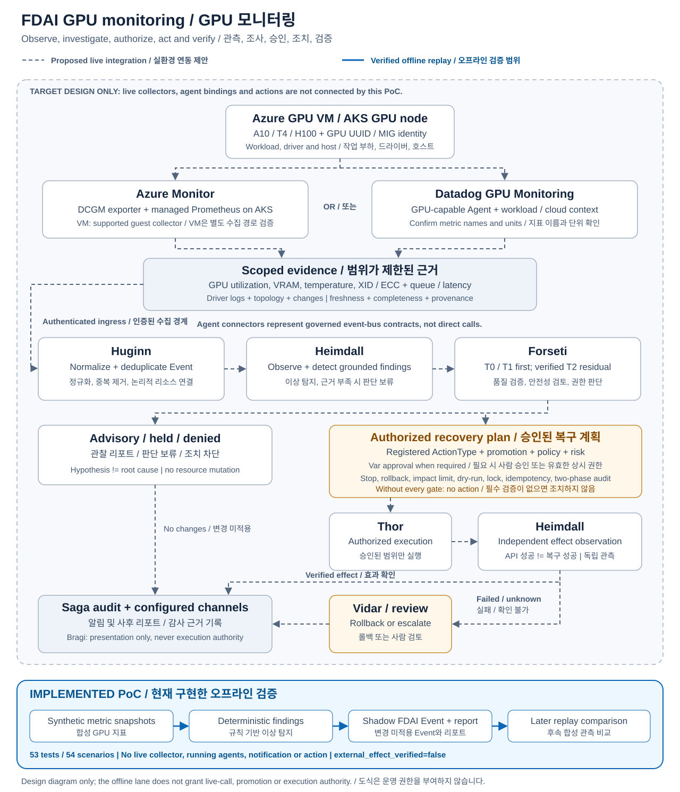

## 범위와 결과

FDAI의 기존 Event 계약과 제어 루프를 이용하면 GPU 관측을 수집하고, 이상 징후를
조사한 뒤 복구안을 제안하는 경로를 구성할 수 있습니다. 이번 평가가 검증한 범위는
GPU 지표에서 Event와 로컬 리포트를 만드는 경계입니다. 배포된 Agent 시스템을
검증한 것은 아닙니다.

> [!IMPORTANT]
> 기본 demonstration은 합성 관측만 사용합니다. Azure 리소스, Datadog API, 모델,
> 운영 이벤트 토픽, 알림 채널, 실행기를 호출하지 않습니다. 이 replay 데이터를
> 배포된 FDAI에 넣지 마세요. `external_effect_verified`는 `false`로 유지됩니다.

기준 소스는 upstream `f8a4208ef`이며 작업 브랜치는 `gpu-monitoring`입니다.
A10, T4, H100 라벨과 두 수집원 매핑, 아홉 시나리오를 조합한 54개 replay를
실행했습니다. 정상 6개와 finding 48개입니다. 이후 합성 관측에서는 48개의
모니터링 조건이 해제되었습니다. 실제 조치나 하드웨어 복구를 증명하지는 않습니다.
소유 테스트 54개가 통과했습니다. GPU 모델에 대한 물리적 인증이 아닌 소프트웨어
계약 검증입니다.

## 저장소 구조와 기존 연동 경계

| 위치 | 이번 테스트와 관련된 역할 |
|------|---------------------------|
| `services/core-control-plane/src/fdai/` | 제어 루프, 탐지, trust routing, risk gate, Agent, delivery adapter |
| `services/operator-service/` | 인증된 운영자 API. 실행 권한을 소유하지 않음 |
| `services/isolated-executor/` | 권한이 분리된 실행 서비스 |
| `services/document-ingestion-api/`, `services/document-processing-worker/` | 문서 증거 처리 |
| `services/system-knowledge-service/` | 독립 패키지인 지식 서비스 후보 |
| `packages/service-contracts/` | 서비스 간 공통 계약 |
| `rule-catalog/`, `policies/` | 규칙, Workflow, ActionType, 정책 |
| `console/`, `cli/` | 운영자 인터페이스 |
| `infra/` | 로컬 및 Azure 배포 인프라 |
| `eval/gpu_monitoring/` | 이번 오프라인 평가. 운영 composition에는 연결하지 않음 |

GPU 신호는 이미
[signals.py](../../services/core-control-plane/src/fdai/core/detection/signals.py)에
정의되어 있습니다.
[GPU chaos 시나리오](../../rule-catalog/chaos-scenarios/collected/gpu/)도 존재하지만,
파일이 있다는 사실만으로 실제 탐지기나 모니터링 연동이 구현되었다고 판단하지 않습니다.

Azure push 경계에는
[Common Alert Schema와 diagnostic 정규화](../../services/core-control-plane/src/fdai/delivery/azure/monitor_events.py),
[diagnostic stream bridge](../../services/core-control-plane/src/fdai/delivery/azure/diagnostic_event_ingest.py)가
있습니다. GPU guest 지표는 VM platform의 `AllMetrics`에 자동으로 들어오는 지표가
아닙니다. GPU exporter 또는 GPU 수집 기능이 있는 Agent가 필요합니다.

## 권장 아키텍처

이미 운영하는 관측 플랫폼을 우선 사용합니다. Azure 중심 환경은 Azure Monitor가
기본 선택이고, Datadog이 on-call을 담당하고 있다면 Datadog GPU Monitoring을
활용합니다. 둘을 같은 논리적 GPU 관측 계약으로 정규화하면 서로 다른 자동 조치
경로를 만드는 것을 피할 수 있습니다.



점선은 제안한 실환경 연동 경로이고 파란색 실선은 구현된 오프라인 평가 범위입니다.
두 언어 가이드는 같은 한국어·영어 병기 SVG를 사용합니다. 에이전트 연결선은
직접 호출이 아니라 통제된 event-bus 계약을 나타냅니다.

이 흐름은 연동 설계입니다. replay에서 위 Agent들을 실행한 것은 아닙니다.
새 pantheon Agent를 만들 필요는 없습니다. Agent 간 협력은 기존 event-bus 계약을
따릅니다. Bragi는 설명을 표현할 수 있지만 진단이나 조치 권한을 부여하지 않습니다.

### Azure Monitor 경로

* AKS에서는 NVIDIA DCGM Exporter와 Azure Monitor managed Prometheus를 사용합니다.
  GPU Operator exporter가 있으면 중복 설치하지 않습니다. Managed GPU node pool
  방식은 공식 문서상 preview이므로 운영 지원 조건을 검토해야 합니다.
* GPU VM에서는 지원되는 NVIDIA driver와 guest GPU collector를 설치하고, 해당
  환경에서 지원되는 Prometheus/remote-write 또는 Azure Monitor Logs 수집 경로를
  선택해 검증합니다. AKS `PodMonitor` 절차를 독립 VM에 그대로 적용하지 않습니다.
* 논리적 리소스, node, GPU UUID, 필요한 경우 MIG instance를 구분합니다. 서로 다른
  GPU를 먼저 평균 내면 문제 장치를 숨길 수 있습니다. MIG/driver/DCGM 버전에 따라
  지원하지 않는 지표가 있고, 지표 미지원은 0이 아닙니다.
* Prometheus alert의 연동 형식은 별도 확인이 필요합니다. 실제 payload를 확인하지
  않고 기존 Azure Monitor Common Alert Schema normalizer에 그대로 넣지 않습니다.
  Common Alert Schema를 사용하는 경로에서는 기존 normalizer를 재사용합니다.
* ingress 인증과 대상 제한을 적용하고 지표 window를 다시 조회합니다. 알람은
  조사 시작 신호이지 원인 증거나 실행 요청이 아닙니다.

### Datadog 경로

* 신규 설치는 현재 Datadog GPU Monitoring을 우선 검토합니다. DCGM이 필요 없는
  제품이며 기존 DCGM integration은 공식 문서에서 legacy로 분류합니다.
* 확인 시점의 요구 조건은 Linux, kernel 5.8+, NVIDIA driver 450.51+, Agent 7.80+
  입니다. 설정 문서는 Agent 7.82.0 사용을 경고합니다. 설치 전 최신 요구 조건과
  Datadog site의 지원 여부를 다시 확인하세요.
* Azure integration으로 cloud identity/cost 문맥을 연결하고 queue, latency,
  process 등의 workload 정보를 함께 수집합니다.
* 설치된 integration의 실제 지표 이름, dimension, 단위를 확인해야 합니다.
  replay의 `example.gpu.*`는 합성 별칭이며 실제 Datadog 지표 이름이 아닙니다.
* 인증된 webhook/API adapter, 알람 중복 제거, resolved 처리, 실제 FDAI composition
  연결은 이번 평가에서 구현하지 않았습니다.

## 지표와 판단 규칙

기본값은 예시입니다. 5분 window, 최대 60초 관측 간격, 120초 freshness,
사용률 95%, memory pressure 95%, 온도 85 C, 할당된 GPU의 idle 사용률 5% 이하를
사용합니다. GPU/driver 특성, workload SLO, 운영 일정에 맞게 조정해야 합니다.

| 관측 | 로컬 finding | 해석과 안전한 후속 단계 |
|------|--------------|-------------------------|
| 사용률 >=95% 지속 및 queue 증가 | `gpu_util_saturated` | capacity pressure 가설. latency SLO/quota 확인 후 증설안 제안 |
| 사용 memory / capacity >=95% | `alert_trigger`, memory pressure | OOM이나 memory leak으로 단정하지 않음 |
| workload CUDA OOM counter 증가 | `gpu_vram_oom` | 관측된 OOM. allocation, batch, KV cache 조사 |
| 온도 >=85 C, throttle 증거 없음 | `alert_trigger`, high temperature | thermal throttle을 증명하지 않음 |
| 명시적인 thermal throttle 관측 | `gpu_temp_throttle` | clock, power, host 상태 조사 |
| 이전 값에서 nonzero XID로 변경 | `gpu_xid_event` | 새로 관측한 코드 변경. driver log로 확인 |
| uncorrectable ECC counter 증가 | `gpu_ecc_uncorrectable` | 하드웨어 조사. 지표만으로 drain/reset하지 않음 |
| 할당된 GPU가 전체 window에서 <=5% | `gpu_util_zero_wasted` | idle 권고. 일정과 CPU/storage/network 병목 조사 |
| 관측 없음, 오래됨, 간격 초과, baseline 부족 | `insufficient_evidence` | 정상이라고 보고하지 않음 |

새 XID/ECC/OOM/throttle에 대한 직접적이고 신선한 증거는 사용률의 5분 window가
완성되기 전에도 finding으로 남깁니다. 리포트에 coverage 부족을 함께 기록합니다.
과거 XID가 계속 남아 있거나 누적 counter가 증가하지 않았으면 새 오류로 취급하지
않습니다. Timestamp가 있는 driver-log ingress나 영속적 edge state는 구현하지 않았습니다.

원인 조사에는 CPU 사용률, data-loader throughput, disk/network latency, inference
p99, queue, restart/OOM log, driver 버전, 최근 배포 변경 등이 필요합니다. GPU
지표만으로는 가설을 만들 수 있지만 원인을 확정할 수는 없습니다.

## 구현이 검증하는 범위

| 파일 | 역할 |
|------|------|
| [models.py](models.py) | 엄격한 입력 검증, 논리적 identity, 범위가 제한된 정책 |
| [providers.py](providers.py) | 시간과 GPU가 정렬된 지표 snapshot. percent/MiB/Celsius 사용 |
| [pipeline.py](pipeline.py) | window 탐지, evidence/policy digest, replay-stable FDAI Event |
| [reporting.py](reporting.py) | 알람형 권고 리포트와 후속 관측 비교 |
| [demo.py](demo.py) | 54개 합성 시나리오와 JSON 출력 |
| [tests/test_pipeline.py](tests/test_pipeline.py) | threshold, 입력, replay, publish, follow-up 검증 |

Normalizer는 raw Prometheus query response나 Datadog webhook parser가 아닙니다.
시간, GPU, 논리적 리소스가 정렬되고 단위가 확인된 point를 받습니다. 정수 값인
counter gauge는 허용하지만 boolean, 소수 진단 코드, NaN/Infinity, DCGM 미지원
sentinel은 거부합니다.

FDAI의 기존 `Event` 모델과 JSON Schema를 재사용합니다. 항상 `mode=shadow`이고
tier나 execution decision을 부여하지 않습니다. Publish 테스트는 EventBus의
publish-only 경계와 호환되는 로컬 기록 객체를 사용합니다. Kafka/Event Hubs나
실제 Agent를 실행하지 않았습니다. Replay key에는 identity, 증거, 정책을 포함합니다.
영속 중복 제거, 재시작, Incident lifecycle, 수집원 간 중복 억제는 구현하지 않았습니다.

`analyze`는 기본적으로 `synthetic_replay`를 사용합니다. 인증된 개발 어댑터는
`azure_vm_run_command` source와 함께 `authenticated_live_observation`을 명시적으로
선택할 수 있습니다. 이 출처는 Event, idempotency key, 리포트에 보존되지만 실행
권한을 부여하지 않으며 개발 진단을 운영 수집기로 바꾸지 않습니다.

후속 비교는 같은 GPU/source의 신선하고 완전한 후속 window가 기존 window와
겹치지 않고, 원래 finding에 필요한 지표가 계속 존재할 때만 검증됩니다.
`recovered_in_replay`는 합성 관측 조건이 해제되었다는 의미만 갖습니다. 실개발
관측은 `condition_cleared_in_followup`을 사용합니다. 실행하지 않은 복구 작업이
변화를 일으켰다고 주장하지 않기 위한 구분입니다.

## 실행과 검증

저장소 루트에서 Python 3.12+ 및 기존 locked 개발 환경을 사용합니다. 이번 평가를
위해 dependency manifest나 lockfile을 수정하지 않았습니다.

```powershell
uv sync --frozen --extra dev
$env:PYTHONPATH = '.;services\core-control-plane\src;packages\service-contracts\src'
$env:PYTEST_DISABLE_PLUGIN_AUTOLOAD = '1'
uv run --no-sync python -m pytest -c eval\gpu_monitoring\pytest.ini -q
uv run --no-sync python -m eval.gpu_monitoring.demo --output gpu-monitoring-results.json
```

결과 파일은 ignore된 로컬 또는 session 디렉터리에 보관하고 실제 운영 데이터를
커밋하지 않습니다. JSON에는 관측, 가설, 권고, digest, 실행 상태, 필요한 safety
gate, 사후 리포트가 포함됩니다.

이번 작업의 로컬 검증 증거:

* 소유 테스트 54개가 통과했고 54개 시나리오 demonstration을 실행했습니다.
* 구현 모듈 5개에 대한 strict mypy 검증이 통과했습니다.
* 기존 Python 3.12.4, pytest 9.1.1, Pydantic 2.12.5, jsonschema 4.26.0을 사용했고
  mypy는 1.10.0이었습니다.
* `files.pythonhosted.org` TLS handshake 실패로 전체 lockfile 환경을 복원하지
  못했습니다. 시스템 인증서로도 해결되지 않았고 Ruff도 cache에서 복원하지
  못했습니다. Pinned-lockfile CI와 동일한 검증 결과로 주장하지 않습니다.
* 전체 저장소 테스트, 실물 GPU 검증, Azure 배포, 실제 알람 전송은 수행하지 않았습니다.

## 실환경 수용 기준

1. 정확한 개발 subscription/resource 범위와 폐기 가능한 VM/AKS workload를
   선택합니다. GPU SKU/driver/collector 지원, identity, 접근 권한, data residency를 확인합니다.
2. Collector와 인증된 ingress를 연결합니다. 지표 단위와 label, missing series,
   counter reset, collection lag, 중복/복구 알람을 확인합니다.
3. Detector/rule과 소유 Agent binding을 shadow mode로 등록하고 실제 EventBus,
   Incident lifecycle, correlation, audit, 리포트 알림을 검증합니다.
4. 통제된 saturation, VRAM pressure, idle workload로 검증합니다. 파괴적 GPU fault는
   replay 또는 승인된 simulation으로 제한합니다. 탐지 지연과 오탐률은 실측 baseline으로
   평가하고 합성 테스트에서 추정하지 않습니다.
5. 모호한 RCA는 범위가 제한된 log/topology/change 증거와 T2 검증을 연결합니다.
   명시적 권한과 데이터 외부 전송 검토 없이 live model을 호출하지 않습니다.
6. 검토된 ActionType만 추가합니다. 증설, concurrency 변경, restart/drain, resize는
   현재 승인 또는 유효한 상시 권한, promotion/risk 검증, stop condition, tested rollback,
   blast radius, dry-run, target lock, idempotency, two-phase audit가 필요합니다.
   GPU reset, 임의 shell 실행, 삭제는 구현하지 않았습니다.
7. 변경 뒤 독립적인 관측으로 효과를 확인하고 실패/불명확 결과는 rollback 또는
   escalation합니다. Detector가 직접 메시지를 보내지 않고 FDAI의 별도 설정된
   channel 계약을 이용해 알림과 사후 리포트를 전달합니다.

## 참고 자료

* [Azure DCGM integration](https://learn.microsoft.com/azure/azure-monitor/containers/prometheus-dcgm-integration)
* [AKS GPU monitoring](https://learn.microsoft.com/azure/aks/monitor-gpu-metrics)
* [GPU 지표와 workload 연관 조사](https://learn.microsoft.com/azure/aks/best-practices-ml-ops#monitor-gpu-utilization-and-training-throughput)
* [Datadog GPU Monitoring](https://docs.datadoghq.com/gpu_monitoring/)
* [Datadog 설정과 요구 사항](https://docs.datadoghq.com/gpu_monitoring/setup/)
* [Legacy Datadog DCGM integration](https://docs.datadoghq.com/integrations/dcgm/)
* [FDAI observability 설계](../../docs/roadmap/rules-and-detection/observability-and-detection.md)
* [FDAI notification 계약](../../docs/roadmap/interfaces/channels-and-notifications.md)
* [영문 기술 테스트 가이드](README.md)
